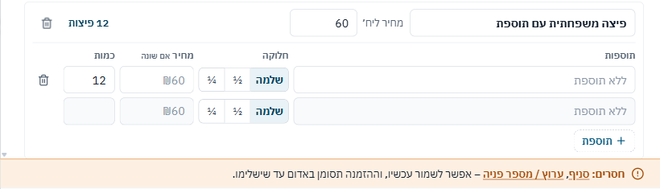
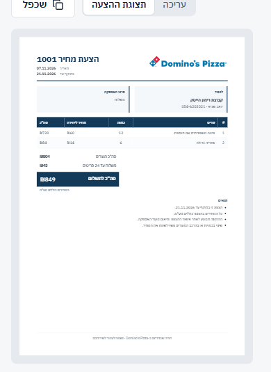
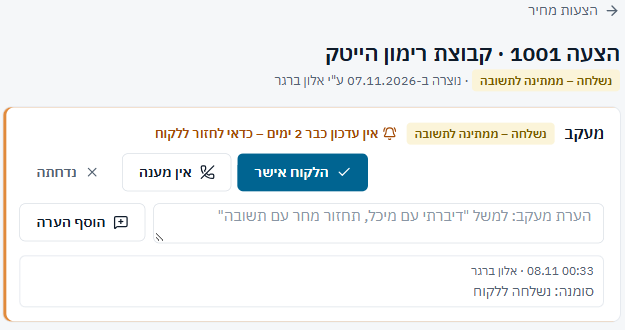
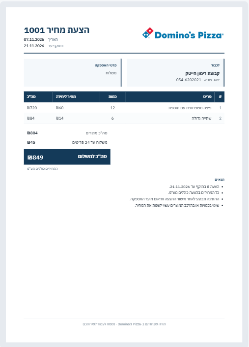
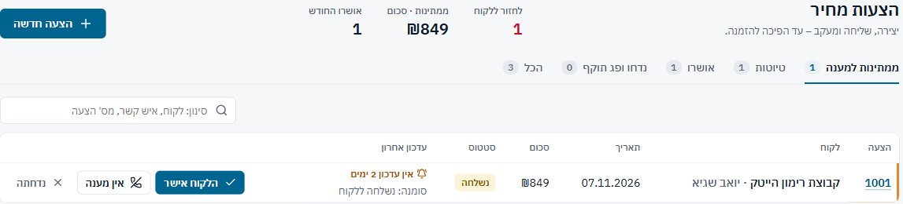
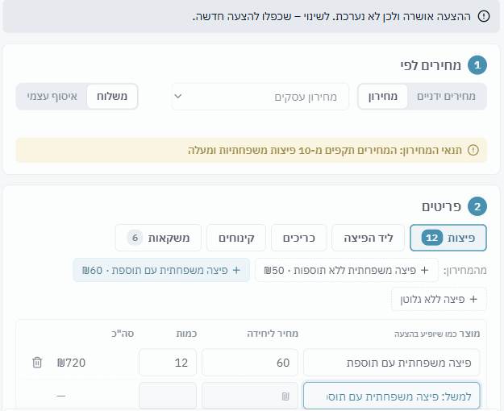
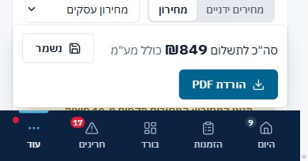
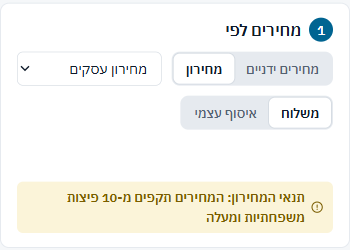

## מסך "הצעות מחיר" – `src/features/quotes/` – 26/40

| # | היוריסטיקה | ציון | הבעיה המרכזית |
|---|---|---|---|
| 1 | נראות מצב המערכת | 3 | תזכורת "אין עדכון" ויומן מעקב טובים; תצוגת הטלפון לא קריאה |
| 2 | התאמה לעולם האמיתי | 3 | "סמן שנשלחה", "אין מענה", סיבות דחייה – בשפת המוקד |
| 3 | שליטה וחופש | 3 | טיוטה משוחזרת, החזרת מחיר לשורה, "בטל אישור"; אין "בטל" על שינוי סטטוס |
| 4 | עקביות | 2 | הסטטוס מופיע פעמיים; אותה תזכורת באדום ובכתום; טופס נעול נראה פעיל |
| 5 | מניעת טעויות | 2 | הצעה שנשלחה נערכת בשקט; תוספות נעלמות בהפיכה להזמנה |
| 6 | זיהוי במקום זכירה | 3 | מוצרים מהמחירון כצ'יפים, "לקוח קיים ב-CRM?" |
| 7 | גמישות ויעילות | 2 | לחיצה על מוצר ממקדת כמות; אין קיצור לשמירה או ל-PDF |
| 8 | אסתטיקה ומינימליזם | 2 | בהצעה שמורה: מעקב + הודעת נעילה + 5 חלקים + פס + תצוגה |
| 9 | התאוששות משגיאות | 3 | שגיאות ספציפיות, קפיצה ללשונית של השורה הבעייתית |
| 10 | עזרה ותיעוד | 3 | טיפים רק בזמן עריכה |
| **סה"כ** | | **26/40** | |

**ספציפיות עיצובית:** ספציפי מאוד, וזה המסך הכי מגובש מבין השלושה.
- ההצעה ב-A4 מתעדכנת חי ליד העורך.
- הרשימה ממוינת לפי "מי מחכה הכי הרבה זמן".
- המחיר בכל שורה מסומן כשהוא שונה מהמחירון.
- ה-PDF עצמו ([quote-sample.pdf](shots/quote-sample.pdf)) נקי ומקצועי: לוגו, טבלה כחולה, סה"כ בולט ותנאים.

**עומס קוגניטיבי:**
- **עורך:** 4/8. הטופס והתצוגה מתחרים על הפוקוס. בהצעה שמורה כרטיס המעקב מעליהם. 5 עיגולי שלבים כחולים, פס תחתון וכפתור ראשי.
- **רשימה:** 6/8. כפתור כחול מלא בכל שורה ("הלקוח אישר" או "הפוך להזמנה"), וזה לא יחזיק ב-20 שורות.

**מה עובד:**
1. מיון לפי תזכורת ו"אין עדכון 2 ימים" בשורה (`QuotesPage.tsx:29`): הדבר הבא לעשות נמצא למעלה ([צילום](shots/quotes-1440-list.png)).
2. אחרי הורדת PDF המערכת שואלת "ההצעה ירדה ✓ – לסמן שנשלחה?" ברגע הנכון, ולא סומכת על זיכרון ([צילום](shots/quotenew-1440-after-pdf.png)).
3. מחיר ששונה מהמחירון מסומן בכתום, עם "שונה מהמחירון (₪X) – להצעה הזו בלבד" וכפתור חזרה (`QuoteEditor.tsx:403-412`).
4. לחיצה על מוצר מהמחירון מוסיפה שורה וממקדת את הכמות. מקלידים מספר וממשיכים.

### ממצאים לפי חומרה

#### Q4 · [P1] הפיכת הצעה להזמנה: התוספות לא עוברות, והבדיקה לא תופסת

**מה רואים:**
- הצעה 1003 כוללת "פיצה משפחתית עם תוספת × 12". בדיאלוג ההזמנה כל השורות מגיעות עם "ללא תוספת".
- ההודעה למעלה מבקשת "נשאר לפרט בפיצות סוגים ותוספות". אבל שורת החסרים למטה מציינת רק סניף וערוץ.
- שמרתי, וההזמנה 1023 נוצרה עם 12 פיצות בלי תוספת, וההצעה סומנה "הפכה להזמנה".

**שורש בקוד:**
- `NewOrder.tsx:93` ממפה כל שורת הצעה ל-`{group, name, qty, unitPrice}` בלי תוספת.
- רשימת החסרים (`missLive`) לא בודקת פיצות שלא פורטו.

**למה זה חשוב:** הנציג שומר תוך כדי שיחה וסומך על שורת החסרים. הזמנה שגויה מגיעה לקופה ולסניף.

**תיקון:**
- להוסיף לחסרים "פירוט תוספות בפיצות", כך שההזמנה תסומן באדום עד שמשלימים. זה בהתאם ל"שמירה עם פרטים חסרים מותרת, אבל מסומנת באדום".
- או להעביר את שם המוצר מההצעה לשדה התוספות כטקסט.

**פקודה:** `/impeccable harden`

#### Q1 · [P1] "תצוגת ההצעה" בטלפון לא קריאה, ואין בה כפתור PDF

**מה רואים:**
- ב-390 הדף מוקטן פי 0.41, וטקסט של 13px הופך לכ-5px. אין גלישה, אבל אי אפשר לקרוא.
- הכפתור "הורדת PDF" נמצא בתוך `.qe-main`, שמוסתר בלשונית התצוגה (`quotes.css:155`). לכן במקום היחיד שבו האחמ"ש רואה מה הוא שולח, אין דרך לשלוח.

**תיקון:**
- בטלפון להציג את הדף ב-1:1 עם גלילה אופקית, או לאפשר הגדלה.
- להוציא את פס הפעולות מ-`.qe-main` כדי שיופיע בשתי הלשוניות.

**פקודה:** `/impeccable adapt`

#### Q3 · [P1] הצעה שכבר נשלחה נערכת בשקט, והסטטוס מופיע פעמיים

**מה רואים:**
- הצעה 1001 בסטטוס "נשלחה", והטופס כולו פתוח לעריכה.
- שמירה לא אומרת שה-PDF שאצל הלקוח כבר לא מעודכן, ולא נרשמת ביומן המעקב.
- "נשלחה – ממתינה לתשובה" מופיע גם מתחת לכותרת וגם בכרטיס המעקב.

**שורש בקוד:**
- `locked` (`QuoteEditor.tsx:116`) כולל רק approved, rejected ו-ordered.
- הסטטוס מוצג בשני מקומות: `QuoteEditor.tsx:312` ו-`QuoteTrack.tsx:193`.

**תיקון:**
- כשעורכים הצעה שנשלחה: שורה כתומה "הלקוח קיבל גרסה קודמת – הורידו PDF מחדש".
- לרשום ביומן "עודכנה אחרי שליחה".
- להשאיר את הסטטוס רק בכרטיס המעקב.

**פקודה:** `/impeccable harden`

#### Q2 · [P2] גם בדסקטופ התצוגה קטנה

**מה רואים:** ב-1440 הדף מוקטן לכ-0.6, וטקסט הטבלה בערך 8px. אפשר לראות את המבנה, אבל לא לבדוק סכומים או שמות.

**תיקון:** הגדלה בלחיצה, או עמודת תצוגה רחבה יותר כשהמסך מאפשר.

**פקודה:** `/impeccable layout`

#### Q6 · [P2] תזכורת מעקב באדום

**מה רואים:**
- "לחזור ללקוח 1" והמונה בלשונית מסומנים באדום (`pages.css:117`, `pages.css:21`).
- אותו מצב בשורה ובכרטיס המעקב מסומן בכתום (`quotes.css:13`).
- אותו דפוס כמו L2 בלידים: אדום שמור לחריגה קריטית, ומעקב מכירות הוא לא חריגה קריטית.
- הסורק מצא גם פס צד (side-tab) בשורה ובכרטיס.

**תיקון:** כתום בכל המקומות. הפס יכול להישאר כסמן מצב, או להפוך לנקודה ליד המספר.

**פקודה:** `/impeccable quieter`

#### Q5 · [P2] הצעה נעולה נראית כמו טופס פעיל

**מה רואים:**
- הצעה מאושרת מוצגת כטופס עם `opacity:.7` (`quotes.css:29`).
- הצ'יפים "+ פיצה…", הלשוניות, סל המחיקה ושורת הטיוטה (עם מסגרת כחולה) נראים פעילים.

**תיקון:** כשההצעה נעולה, להציג סיכום לקריאה בלבד: בלי שורת טיוטה, בלי צ'יפים ובלי סלים.

**פקודה:** `/impeccable distill`

#### Q7 · [P3] בטלפון הפס התחתון והניווט מכסים רבע מסך

**מה רואים:** הפס "סה"כ + נשמר + הורדת PDF" (104px) יושב מעל הניווט התחתון (68px), בזמן שמקלידים כמויות.

**תיקון:** פס אחד צפוף בשורה אחת, או שהפס יופיע רק כשיש שינוי.

**פקודה:** `/impeccable adapt`

#### Q8 · [P3] רווח ריק בחלק "מחירים לפי"

**מה רואים:** הטיפ המוסתר (`visibility:hidden`, כמו שצריך) משאיר רצועה ריקה בין הבחירה לבין תנאי המחירון. בטלפון זה בולט.

**תיקון:** להשאיר את המקום רק כשהטיפ נמצא מתחת לשדה שעורכים כרגע. כאן אין שדה שזז מתחתיו.

**פקודה:** `/impeccable layout`

**הערות קטנות:**
- הקישור ללקוח לא מעדכן את המחירים. `linkCustomer` (`QuoteEditor.tsx:215`) לא קורא ל-`reprice`, ולכן שורות שתומחרו לפני הקישור נשארות במחיר הקודם. זה נבדק בקוד בלבד.
- ב-PDF אין שם או טלפון של מי שמטפל בהצעה, ולכן ללקוח אין למי לחזור.
- "נשלחה" ו"אין מענה" באותו צהוב, ולכן הרשימה לא מראה "כבר חזרנו פעם אחת".
- "ממתינות · סכום" היא כותרת מסורבלת.

### דגלים אדומים לפי פרסונה
- **נציג מקליד תוך כדי שיחה:**
  - "לקוח ואספקה" הוא חלק 4 מתוך 5, אבל הלקוח הוא הדבר הראשון שנאמר בשיחה, והוא גם קובע את המחירון.
  - בהפיכה להזמנה הוא סומך על שורת החסרים (Q4).
- **נציג מהיר (Alex):** אין קיצור לשמירה או ל-PDF. ברשימה אין ניווט בחיצים, בניגוד לסניפים.
- **מקלדת / קורא מסך (Sam):** תצוגה של 5px. נעילה מסומנת רק בשקיפות. צ'יפי המדרגות הם `role="radio"` בלי ניווט בחיצים.
