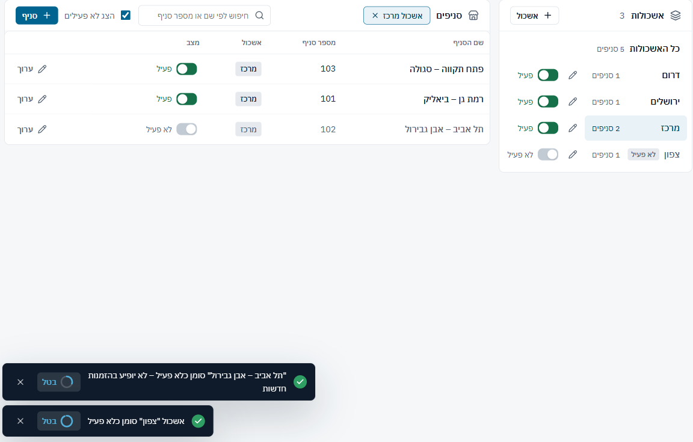
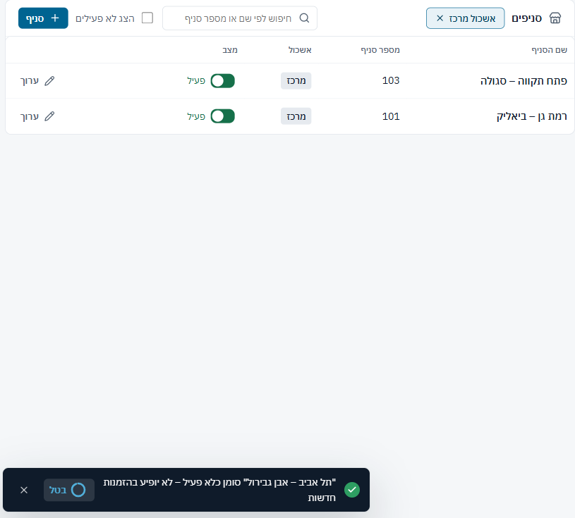
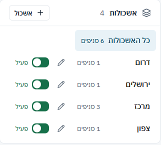
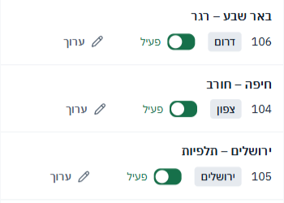

## מסך "סניפים ואשכולות" – `src/features/branches/BranchesPage.tsx` – 28/40

| # | היוריסטיקה | ציון | הבעיה המרכזית |
|---|---|---|---|
| 1 | נראות מצב המערכת | 2 | שורה נעלמת מיד כשמכבים; אשכול לא פעיל לא אומר מה קרה לסניפים |
| 2 | התאמה לעולם האמיתי | 3 | "1 סניפים" |
| 3 | שליטה וחופש | 3 | "בטל" על שני המתגים, Esc מבטל עריכה |
| 4 | עקביות | 3 | עמודות זזות כשמסננים; כל המתגים ירוקים |
| 5 | מניעת טעויות | 2 | "האם התכוונת" מצוין; אשכול לא פעיל לא משפיע על הסניפים |
| 6 | זיהוי במקום זכירה | 3 | תג אשכול בכל שורה, צ'יפ סינון עם × |
| 7 | גמישות ויעילות | 3 | חיצים בין שורות, Enter לעריכה, החיפוש ממלא את שורת ההוספה |
| 8 | אסתטיקה ומינימליזם | 3 | שתי רשימות זו לצד זו, נקי |
| 9 | התאוששות משגיאות | 3 | שגיאות ברורות בשורה |
| 10 | עזרה ותיעוד | 3 | כותרת משנה אחת שמסבירה מה זה "לא פעיל" |
| **סה"כ** | | **28/40** | |

**ספציפיות עיצובית:** ספציפי ושקט, ומתאים למסך הגדרה שמשתמשים בו לעיתים רחוקות.

**עומס קוגניטיבי:** 7/8. הכישלון היחיד: אחרי כיבוי צריך לזכור לסמן "הצג לא פעילים" כדי למצוא את השורה.

**מה עובד:**
1. "קיים כבר סניף בשם דומה: 'רמת גן – ביאליק'. האם התכוונת אליו?" עם בחירה בינארית ברורה ([צילום](shots/findings/BR5-dup-prompt.png)).
2. מקלדת מלאה: חיצים, Enter ו-Esc, ומסגרת מיקוד כחולה.
3. מה שהוקלד בחיפוש עובר לשורת ההוספה: "חיפשתי, לא מצאתי, הוספתי" בלי להקליד שוב.

### ממצאים לפי חומרה

#### BR1 · [P1] אשכול "לא פעיל" לא מוציא את הסניפים שלו משימוש

**מה רואים:**
- כיביתי את "צפון". האשכול מסומן "לא פעיל", אבל "חיפה – חורב" נשאר "פעיל" ו"1 סניפים".
- ההודעה אומרת רק "סומן כלא פעיל".
- בקוד, בחירת הסניף בהזמנה מסננת רק לפי `b.active` (`BranchPicker.tsx:33`), כך שהסניף ממשיך להופיע בהזמנות חדשות.
- בפועל, "לא פעיל" באשכול רק מונע להוסיף לו סניפים חדשים.

**תיקון:** אחת משתיים:
- כיבוי אשכול מכבה גם את הסניפים שלו, או מסנן אותם בבחירה.
- הודעה שאומרת את התוצאה, עם הצעה: "הסניף חיפה – חורב עדיין זמין בהזמנות – לכבות גם אותו?".

**פקודה:** `/impeccable harden`

#### BR2 · [P2] שורה נעלמת מתחת ליד כשמכבים סניף

**מה רואים:**
- כיביתי את "תל אביב – אבן גבירול", והשורה נעלמה מיד כי לא פעילים מוסתרים כברירת מחדל (`BranchesPage.tsx:27-28`).
- נשארה רק ההודעה עם "בטל". השורות מתחתיה עלו למעלה, מתחת לסמן העכבר.

**תיקון:** להשאיר את השורה מעומעמת עד שמשנים סינון או יוצאים מהמסך.

**פקודה:** `/impeccable harden`

#### BR3 · [P3] כל המתגים ירוקים, ו"1 סניפים"

**מה רואים:**
- כל "פעיל" מסומן במתג ירוק (`BranchesPage.css:65-66`), שמונה בעמוד אחד. ירוק על המצב הרגיל הוא רעש, והחריג הוא "לא פעיל".
- "1 סניפים" (`BranchesPage.tsx:113,133`) צריך להיות "סניף אחד".

**תיקון:** מתג ניטרלי (כחול כהה או אפור) למצב פעיל, ותיקון הניסוח.

**פקודה:** `/impeccable quieter`

#### BR4 · [P3] בטלפון המתגים לא מיושרים, ובדסקטופ העמודות זזות

**מה רואים:**
- ב-390 המתג והכפתור "ערוך" זזים לפי אורך תג האשכול ("ירושלים" לעומת "דרום").
- ב-1440 עמודת "מצב" זזה כשמסננים לפי אשכול ([לפני](shots/br-1440-list.png) · [אחרי](shots/br-1440-cluster-filter.png)).

**תיקון:** רוחב קבוע לתג ו-`table-layout: fixed`.

**פקודה:** `/impeccable layout`

**הערה קטנה:** "כן, זה רמת גן – ביאליק" רק סוגר את שורת ההוספה. הוא לא מדגיש את השורה הקיימת, ולכן צריך לחפש אותה.

### דגלים אדומים לפי פרסונה
- **מנהל שסוגר אשכול:** חושב שהסניפים שלו יצאו משימוש, והם לא (BR1).
- **מקלדת / קורא מסך:** אחרי כיבוי השורה נעלמת, והמיקוד נשאר על אלמנט שכבר לא קיים.

### שאלות
1. האם הצעה שנשלחה צריכה להינעל כמו הצעה מאושרת, כך ששינוי ייעשה ב"שכפל כגרסה ב׳"? היום ה-CRM יכול להחזיק גרסה שונה מה-PDF שאצל הלקוח.
2. האם העורך צריך להתחיל ב"מי הלקוח?" ולא ב"מחירים לפי"? הלקוח קובע את המחירון.
3. האם "לא פעיל" הוא מושג אחד או שניים? באשכול ובמחירון המתג משנה תווית ולא התנהגות. או שהוא צריך להשפיע על מה שתחתיו ולנעול, או שצריך לקרוא לו בשם של מה שהוא עושה בפועל.
