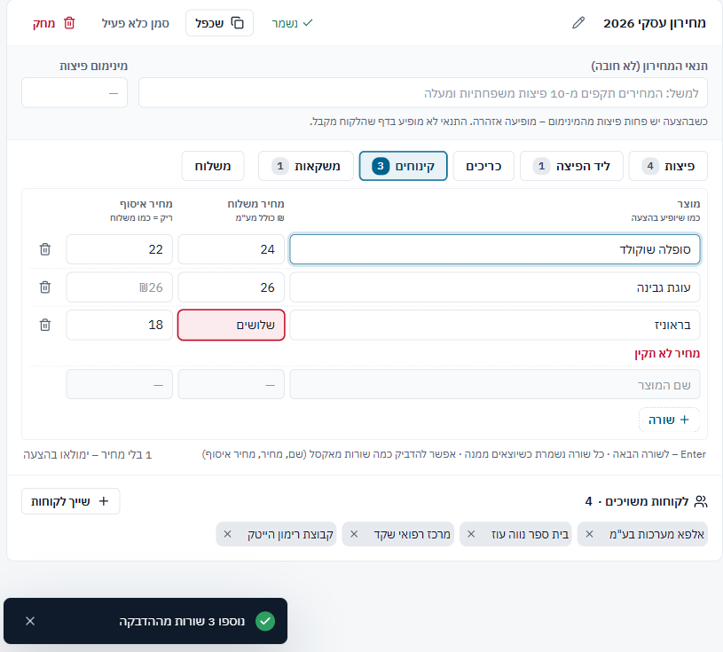
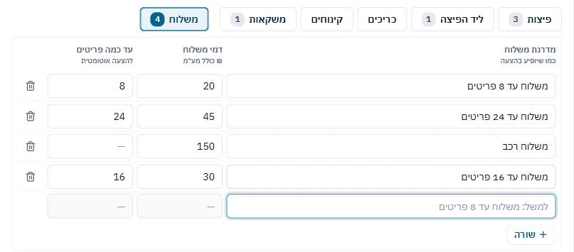
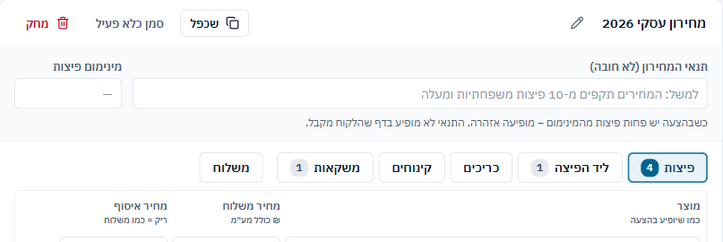
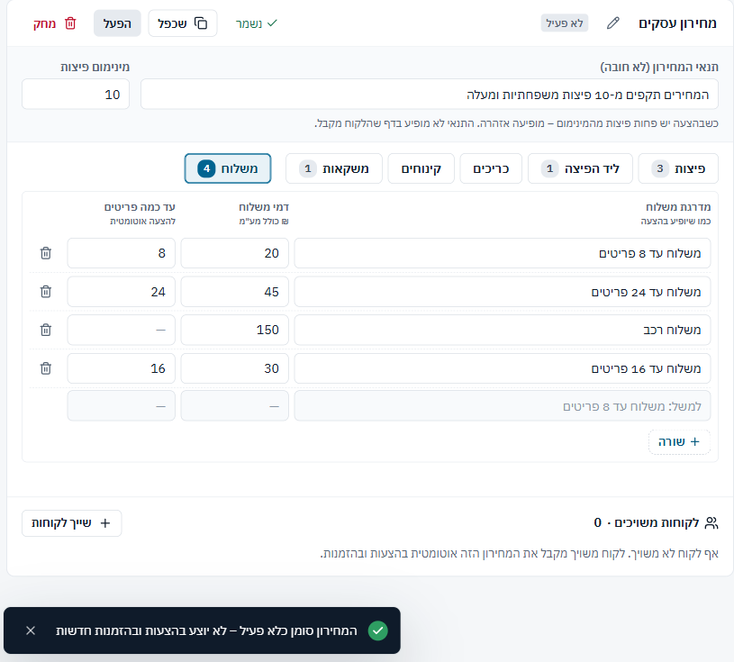
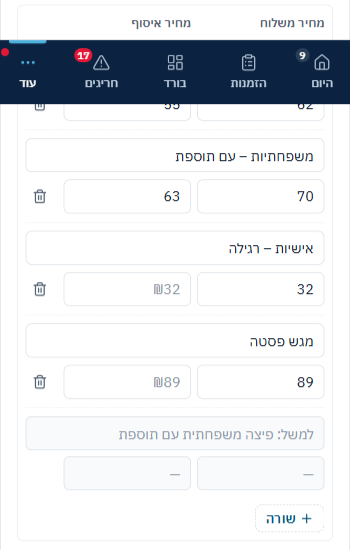

## מסך "מחירונים" – `src/features/pricelists/PriceListsPage.tsx` – 24/40

| # | היוריסטיקה | ציון | הבעיה המרכזית |
|---|---|---|---|
| 1 | נראות מצב המערכת | 2 | "נשמר ✓" אוטומטי, אבל הוא שגוי אחרי הדבקה |
| 2 | התאמה לעולם האמיתי | 3 | הדבקה מאקסל ו"עד כמה פריטים" מתאימים לעבודה; מדרגות לא ממוינות |
| 3 | שליטה וחופש | 2 | מחיקת שורה עם "בטל"; "לא פעיל" בלי "בטל" |
| 4 | עקביות | 2 | "בטל" בסניפים ולא כאן; "מחק" אדום; מחירון לא פעיל ממשיך להיות ניתן לעריכה |
| 5 | מניעת טעויות | 1 | הדבקה שומרת מחיר לא תקין כ"בלי מחיר" |
| 6 | זיהוי במקום זכירה | 3 | מחיר איסוף מציג את מחיר המשלוח כברירת מחדל |
| 7 | גמישות ויעילות | 3 | הדבקה, Enter לשורה הבאה, שכפול עם אחוז |
| 8 | אסתטיקה ומינימליזם | 3 | שקט ב-1440; הכותרת נשברת לשלוש שורות ב-390 |
| 9 | התאוששות משגיאות | 2 | השגיאה מוצגת, אבל הנתון כבר נשמר |
| 10 | עזרה ותיעוד | 3 | שורת עזרה על פורמט ההדבקה |
| **סה"כ** | | **24/40** | |

**ספציפיות עיצובית:** ספציפי.
- הדבקה מאקסל בפורמט "שם, מחיר משלוח, מחיר איסוף".
- מדרגות משלוח לפי "עד כמה פריטים".
- תנאי מינימום פיצות שמופיע כאזהרה בהצעה ולא בדף ללקוח.

**עומס קוגניטיבי:** 6/8. 6 לשוניות ("משלוח" מופרדת, וזה עובד) ו-4 פעולות בכותרת. מדרגות לא ממוינות מכריחות למיין בראש.

**מה עובד:**
1. עריכה ישירה בטבלה עם שמירה ביציאה מהשורה ו"נשמר ✓" בכותרת ([צילום](shots/pl-1440-after-edit.png)).
2. מחיקת שורה עם "בטל" בהודעה.
3. שכפול עם שינוי באחוז ועיגול, ומחיקה שדורשת סיבה ומציינת מה יקרה ללקוחות המשויכים.

### ממצאים לפי חומרה

#### PL1 · [P1] הדבקה מאקסל שומרת שורה לא תקינה, ומודיעה שנשמר

**מה רואים:** הדבקתי 3 שורות, ובאחת המחיר "שלושים".
- השורה מסומנת באדום "מחיר לא תקין".
- בכותרת: "נשמר ✓". בהודעה: "נוספו 3 שורות מההדבקה". בתחתית: "1 בלי מחיר – ימולאו בהצעה".
- בבדיקה במאגר: "בראוניז" נשמר **בלי מחיר משלוח** (רק `pickupPrice: 18`).

**שורש בקוד:**
- `onPaste` (`PriceListsPage.tsx:193-202`) שומר בלי לעבור דרך `problem()`, ו-`num()` הופך טקסט ל-`undefined`.
- במילוי רגיל של שורה, `leaveRow` כן חוסם שמירה כשיש בעיה, ולכן ההתנהגות לא עקבית.
- המונה בהודעה סופר גם שורות כפולות שסוננו (`:201`).

**תיקון:**
- לשמור רק שורות תקינות.
- הודעה מדויקת: "נוספו 2 · 1 לא נשמרה (מחיר לא תקין)".
- "נשמר ✓" רק כשאין בעיות פתוחות.

**פקודה:** `/impeccable harden`

#### PL2 · [P1] מדרגות משלוח לא ממוינות

**מה רואים:**
- הוספתי "משלוח עד 16 פריטים", והיא נכנסה בסוף: 8, 24, רכב, 16.
- באותו סדר המדרגות מוצגות כצ'יפים בהצעה ([צילום](shots/quotenew-1440-fee.png)).
- הבחירה האוטומטית כן ממיינת (`QuoteEditor.tsx:202`), כך שהחישוב נכון אבל התצוגה מבלבלת.

**תיקון:** למיין לפי `upTo` בכל מקום, ומדרגות בלי `upTo` (רכב) בסוף.

**פקודה:** `/impeccable layout`

#### PL3 · [P2] שינוי מחיר במחירון משותף נשמר מיד, בלי להראות על מי הוא משפיע

**מה רואים:**
- שיניתי 62 ל-64 ויצאתי מהשדה. השינוי נשמר מיד, והמחיר החדש חל על 4 לקוחות משויכים, בלי שום אזכור.
- אין "בטל" על שינוי מחיר, רק על מחיקת שורה.
- הלקוחות המשויכים מופיעים בתחתית הכרטיס, רחוק מהשדה.

**תיקון:** בהודעה אחרי שינוי מחיר: "המחיר עודכן · חל על 4 לקוחות" עם "בטל".

**פקודה:** `/impeccable clarify`

#### PL5 · [P2] "סמן כלא פעיל" בלי "בטל", ו"מחק" באדום

**מה רואים:**
- ההודעה "המחירון סומן כלא פעיל" היא בלי "בטל", בניגוד לסניפים ואשכולות (`BranchesPage.tsx:143,247`).
- מחירון לא פעיל נשאר פתוח לעריכה מלאה, עם תג אפור קטן בלבד.
- "מחק" באדום (`PriceListsPage.css:9`) הוא הדבר הכי צבעוני בכותרת, לפעולה נדירה של מנהל בלבד.

**תיקון:**
- "בטל" בהודעה.
- "מחק" בצבע ניטרלי או בתפריט ⋯. דיאלוג האישור כבר אדום.

**פקודה:** `/impeccable quieter`

#### PL4 · [P3] בטלפון המחירים בלי תוויות

**מה רואים:**
- ב-390 כל מוצר הופך לכרטיס עם שני שדות מספר.
- הכותרות "מחיר משלוח / מחיר איסוף" מופיעות פעם אחת למעלה, ואחרי גלילה כבר לא ברור איזה שדה הוא איזה.
- זה אותו דפוס כמו C6 בלקוחות.
- בנוסף, "מגש פסטה" מהמחירון הישן (בלי קטגוריה) נופל ללשונית "פיצות".

**תיקון:** תווית קטנה בתוך כל שדה ("משלוח", "איסוף").

**פקודה:** `/impeccable adapt`

### דגלים אדומים לפי פרסונה
- **מנהל שמדביק מחירון שלם:** לא יכול לסמוך על "נשמר", ולכן צריך לבדוק כל הדבקה ידנית.
- **מקלדת / קורא מסך:** עם 5 שורות שגויות בהדבקה יש 5 הכרזות `role="alert"` ברצף. אף אחת לא אומרת מה נשמר בפועל. ה-Tab עובר בכל שורה גם דרך סל המחיקה.
