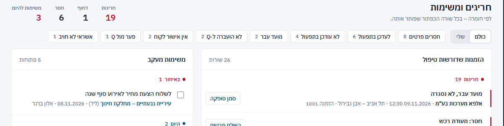
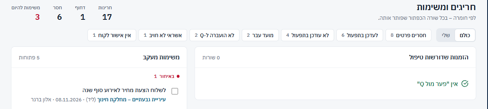
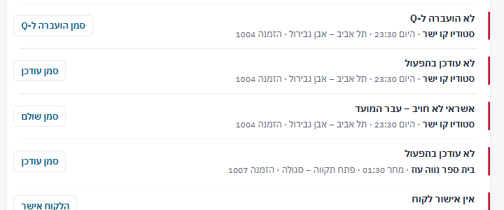
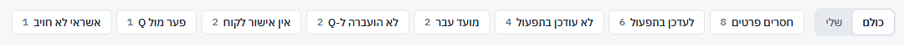
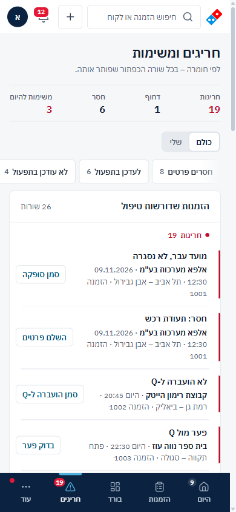

## חריגים ומשימות – 24/40

| # | היוריסטיקה | ציון | עיקר |
|---|---|---|---|
| 1 | נראות מצב | 3 | שורה שתוקנה יוצאת עם "בטל" |
| 2 | התאמה לעולם | 2 | הקבוצה "חסר" מכילה רק "לעדכן בתפעול"; פרטים חסרים נמצאים תחת "חריגות" |
| 3 | שליטה וחופש | 2 | סינון שהתרוקן לא משאיר דרך החוצה |
| 4 | עקביות | 2 | הצ'יפים מתמיינים מחדש אחרי כל תיקון. "לעדכן בתפעול" ו"לא עודכן בתפעול" זה לצד זה |
| 5 | מניעת טעויות | 3 | פופאובר לתיקונים רגישים. "הלקוח אישר" ישיר, עם "בטל" |
| 6 | זיהוי ולא זכירה | 3 | בכל שורה: לקוח, מועד, סניף ומספר הזמנה |
| 7 | גמישות ויעילות | 2 | אין ניווט מקלדת בין שורות. "שלי" לא נשמר בכתובת, בניגוד לסינון הסוג |
| 8 | אסתטיקה ומינימליזם | 2 | שורה לכל בעיה: הזמנה 1004 תופסת 3 שורות. 19 שורות אדומות |
| 9 | התאוששות משגיאות | 2 | סימון משימה שנכשל משאיר את התיבה מסומנת |
| 10 | עזרה | 3 | שורת המשנה והטקסט במשימות ריקות טובים |

### ממצאים

**[P1] EX1 · קבוצות החומרה לא תואמות את מה שבתוכן**
- 
- **מה ראיתי:**
  - בכותרת: "חריגות 19 · דחוף 1 · חסר 6".
  - בתוך "חריגות" יש 9 שורות "חסר: תעודת רכש" ו"חסר: כתובת", כולל הזמנות ל-13.11 ול-14.11.
  - "חסר 6" הן כולן "לעדכן בתפעול" להזמנות רחוקות, שאין בהן שום פרט חסר.
- **בקוד:** כלל 8 תמיד `red` (`health.ts:104`), עם `alert: soon || diff < 0`. המסך מתעלם מ-`alert`. הקבוצה הצהובה ניזונה רק מכלל 0 (`health.ts:107`, `ExceptionsPage.tsx:20`).
- **למה זה חשוב:**
  - מי שמחפש פרטים חסרים מסתכל בקבוצה הלא נכונה.
  - "תעודת רכש לשבת" נראית בדיוק כמו "מועד עבר, לא נסגרה" מאתמול. 19 שורות אדומות, ושום דבר לא בולט.
  - ההחלטה "פרטים חסרים מסומנים באדום" נשמרת. הבעיה היא בשם הקבוצה ובערבוב של עכשיו מול בהמשך.
- **תיקון:**
  - במסך הזה, כלל 8 עם `alert: false` יורד לקבוצה התחתונה. הסימון האדום בשורה נשאר.
  - לשנות את שמות הקבוצות לפי זמן: "עכשיו" / "היום" / "בהמשך". או לשנות את "חסר" ל"להשלים בהמשך".
- **פקודה:** `/impeccable clarify`

**[P2] EX2 · סינון שהתרוקן נעלם, והמסך נשאר בלי דרך החוצה**
- 
- **מה ראיתי:** סיננתי "פער מול Q" ותיקנתי את השורה היחידה. הצ'יפ נעלם (הצ'יפים נבנים רק מסוגים שיש להם שורות, `ExceptionsPage.tsx:38-42`). נשאר 'אין "פער מול Q"', הכתובת עדיין `?rule=2`, ואין כפתור לבטל את הסינון.
- **תיקון:**
  - הצ'יפ הפעיל נשאר תמיד, גם עם 0.
  - ברשימה הריקה: "הצג הכל".
  - עוד יותר טוב: כשהסינון מתרוקן אחרי תיקון, לבטל אותו אוטומטית עם "כל ה'פער מול Q' טופלו".
- **פקודה:** `/impeccable harden`

**[P2] EX3 · שורה לכל בעיה, לא לכל הזמנה**
- 
- **מה ראיתי:** 26 שורות על כ-14 הזמנות. סטודיו קו ישר (1004) מופיע 3 פעמים ברצף: "לא הועברה ל-Q", "לא עודכן בתפעול", "אשראי לא חויב". מרכז רפואי שקד (1010) מופיע 4 פעמים.
- **למה זה חשוב:** הנציג מרכיב בראש "מה חסר ב-1004", והרשימה נראית ארוכה פי 2 ממה שהיא.
- **תיקון:** שורה אחת להזמנה. הכפתור של הבעיה החמורה ביותר נשאר בשורה, ושאר הבעיות מופיעות כתגים קטנים עם תיקון משלהם. הקבוצה נקבעת לפי הבעיה החמורה.
- **פקודה:** `/impeccable distill`

**[P2] EX4 · צ'יפים שקופצים ממקומם, ושניים שנראים אותו דבר**
- 
- **מה ראיתי:**
  - 8 צ'יפים ועוד "כולם / שלי", כלומר 10 אפשרויות באותה שורה.
  - הם ממוינים לפי כמות, ולכן זזים אחרי כל תיקון (השוו [לפני](shots/exc-1440-list.png) ו[אחרי](shots/exc-1440-chip-empty.png)).
  - "לעדכן בתפעול 6" ו"לא עודכן בתפעול 4" עומדים זה לצד זה, וההבדל ביניהם הוא רק המרחק בזמן.
  - הצ'יפ "חסרים פרטים" לא תואם לשורה "חסר: תעודת רכש".
- **תיקון:**
  - סדר קבוע לפי שלבי ההזמנה: אישור לקוח, תפעול, Q, תשלום, סגירה, פרטים.
  - לאחד את כלל 0 ואת כלל 4 לצ'יפ אחד, "עדכון בתפעול".
- **פקודה:** `/impeccable layout`

**[P3] EX5 · בטלפון המשימות קבורות בתחתית**
- 
- **מה ראיתי:**
  - ב-390 כרטיס המשימות מתחיל בגובה 2,784px, מתחת ל-26 שורות. משימה באיחור לא תיראה.
  - כפתורי התיקון בגובה 30px.
  - הצ'יפים נחתכים באמצע, בלי שום רמז שיש עוד.
  - מספר ההזמנה נשבר לשורה שלישית.
- **תיקון:**
  - בטלפון: לשונית "חריגים / משימות" במקום שתי עמודות אחת מתחת לשנייה. לחלופין, להעלות את המשימות שבאיחור לראש הרשימה.
  - כפתורים בגובה 44px.
  - דהייה בקצה שורת הצ'יפים.
- **פקודה:** `/impeccable adapt`

### מה עובד
- **תיקון מתוך השורה:** פופאובר מותאם לכל סוג. ב"עודכן בתפעול" מופיע טלפון הסניף. ב"פער מול Q" מוצגים חיוב, Q ופער, עם שתי יציאות: לעדכן את הסכום, או לאשר עם סיבה. נפתר בלי לפתוח את ההזמנה.
- **מנוע אחד** מזין את "היום", הפעמון והמסך הזה, והתוויות והפעולות אחידות מהמקור.
- **תנועה פונקציונלית:** שורה שתוקנה יוצאת, עם כבוד ל-reduced motion. הרשימה הריקה ("אין חריגים. הכל מטופל") רגועה וברורה.

## אדומים לפי פרסונה
- **נציג תחת לחץ (דסקטופ):**
  - 19 שורות אדומות, בלי לדעת מה בוער בחצי השעה הקרובה.
  - שתי הודעות על "סמן שנשלח", בלי לדעת מה "בטל" מבטל.
  - יכול לסמן "נשלח" בלי לשלוח.
- **אחמ"ש בטלפון:**
  - הדף לתפעול הוא תמונה ממוזערת.
  - משימות באיחור נמצאות 3 מסכים למטה.
  - ביום שישי "מחר" אומר "עוד לא נשלח" על מה שנשלח בחמישי.
- **קורא בסניף (ה-PDF):**
  - "עודכן" בלי מה.
  - "ירדו" בלי למה.
  - אין מידע על גבייה.
  - "הערות לסניף" היא העמודה האחרונה בסדר הקריאה.

## שאלות
1. אם "שתף" באפליקציה היה שולח את ה-PDF, האם "סמן שנשלח" צריך להיות לחיצה נפרדת? השליחה יכולה להירשם ברגע השיתוף.
2. מה הסניף צריך לדעת על תשלום: "לגבות / לא לגבות" מספיק, או שצריך את אמצעי התשלום?
3. האם "חריגים" צריך לסדר לפי זמן עד ההשפעה ("נשארו 40 דקות") במקום לפי סוג הכלל?
