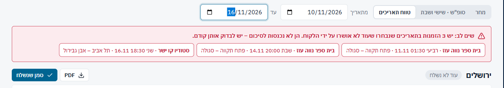
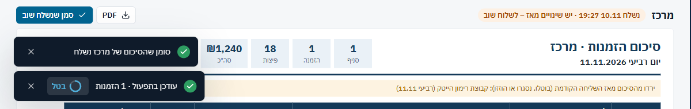
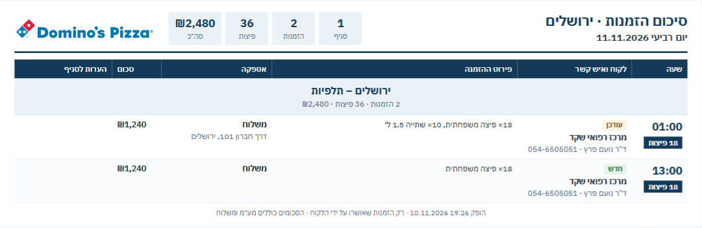
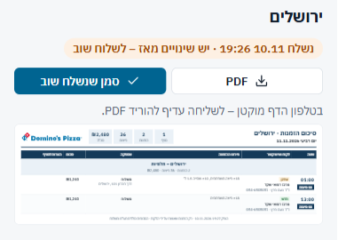
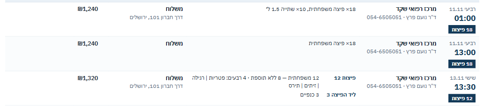

## סיכום לתפעול – 25/40

| # | היוריסטיקה | ציון | עיקר |
|---|---|---|---|
| 1 | נראות מצב | 3 | הפס עוד לא נשלח / נשלח / יש שינויים ברור. אבל "סמן שנשלח" מסמן גם "עודכן בתפעול" בהזמנות, ורק הודעה שנייה מספרת על זה |
| 2 | התאמה לעולם | 3 | שפת הדף נכונה לסניף. אין בה שום מידע על תשלום |
| 3 | שליטה וחופש | 2 | "בטל" מחזיר את "עודכן בתפעול" אבל לא את סימון השליחה |
| 4 | עקביות | 2 | שני תחבירים לפריטים באותו דף, שתי הודעות על לחיצה אחת, "נשלח" שונה לפי הטווח |
| 5 | מניעת טעויות | 2 | אפשר לסמן "נשלח" בלי להוריד PDF. סיכום לטווח לא יודע על שליחה קודמת |
| 6 | זיהוי ולא זכירה | 3 | ההזמנות שלא אושרו מוצגות ככפתורים שפותחים את ההזמנה |
| 7 | גמישות ויעילות | 2 | הורדה, וואטסאפ, צירוף, חזרה ו"סמן שנשלח": חמישה צעדים בלי קיצור |
| 8 | אסתטיקה ומינימליזם | 3 | הדף צפוף ונקי. "הערות לסניף" ריקה כמעט תמיד ותופסת 150px |
| 9 | התאוששות משגיאות | 2 | "הורדת ה-PDF נכשלה. נסו שוב." בלי סיבה |
| 10 | עזרה | 3 | שורת המשנה ושורת הטלפון מספיקות |

### ממצאים

**[P1] OPS1 · "נשלח" נשמר רק לאותו טווח בדיוק**
- 
- **מה ראיתי:** סימנתי שהסיכום של ירושלים ל-11.11 נשלח. בטווח 10–16.11 אותו אשכול מופיע כ"עוד לא נשלח", בלי תגי "חדש" או "עודכן".
- **בקוד:** השליחות נטענות לפי `from`, ומסוננות לפי `s.to === to` (`OpsSummaryPage.tsx:37`).
- **למה זה חשוב:** ביום חמישי שולחים סופ"ש (שישי–שבת). ביום שישי בבוקר מי שפותח "מחר" (שבת) רואה "עוד לא נשלח" על הזמנות שכבר נשלחו. השינויים שקרו מאז לא מסומנים. התוצאה: שליחה כפולה לקבוצה, או שינוי שלא מגיע לסניף.
- **תיקון:** לחשב את מצב השליחה לכל הזמנה ולא לכל טווח. כל הזמנה בדף מקבלת את השליחה האחרונה שכללה אותה, והפס מסכם: "נשלח · 3 מתוך 4", או "חדש מאז: 1".
- **פקודה:** `/impeccable harden`

**[P1] OPS2 · "סמן שנשלח" כותב לשני מקומות, ו"בטל" מחזיר רק אחד**
- 
- **מה ראיתי:** לחיצה אחת הקפיצה שתי הודעות: "סומן שהסיכום של מרכז נשלח" ו"עודכן בתפעול · 1 הזמנות [בטל]".
- **בקוד:** "בטל" מחזיר את `branchApproval`, אבל רשומת `opsSends` נשארת (`OpsSummaryPage.tsx:58-66`, `opsSummary.ts:69`). אחרי "בטל" הפס עדיין אומר "נשלח 19:27", וההזמנות חוזרות ל"לא עודכן בתפעול" במסך החריגים.
- **למה זה חשוב:** הכלל ב-CLAUDE.md הוא ש"סמן שנשלח" **הוא** העדכון בתפעול. אחרי "בטל" חלקי, שני המסכים סותרים זה את זה. בנוסף, "1 הזמנות" שגוי.
- **תיקון:**
  - הודעה אחת: "סומן שנשלח · מרכז · עודכן בתפעול ב-1 הזמנה [בטל]".
  - "בטל" מחזיר את שני הדברים. `opsSends` בלי מחיקה, אז לשמור את השליחה הקודמת ולשחזר אותה, או לכתוב `revoked: true`.
- **פקודה:** `/impeccable harden`

**[P2] OPS3 · "עודכן" לא אומר מה השתנה, ו"ירדו מהסיכום" לא אומר למה**
- 
- **מה ראיתי:**
  - בהזמנה של מרכז רפואי שקד השעה שונתה מ-00:30 ל-01:00. הדף שנשלח שוב מציג "עודכן" בלבד.
  - הזמנה שבוטלה מופיעה תחת "ירדו מהסיכום (בוטלו, נסגרו או הוזזו)", כלומר שלוש אפשרויות שונות מאוד לסניף.
- **למה זה חשוב:** הסניף צריך להשוות לבד מול ה-PDF של אתמול כדי להבין מה השתנה.
- **תיקון:**
  - ב"עודכן": השדה שהשתנה ("שעה 00:30←01:00", "כתובת", "פריטים"). `orderSig` כבר שומר חתימה לכל הזמנה, אז אפשר לשמור את השדות עצמם.
  - ב"ירדו": "בוטלה" או "הועברה ל-13.11".
- **פקודה:** `/impeccable clarify`

**[P2] OPS4 · בטלפון הדף שנשלח מוקטן פי 0.32**
- 
- **מה ראיתי:** הטקסט יוצא בגודל של 3.5–4px. השורה "בטלפון הדף מוקטן – לשליחה עדיף להוריד PDF" מודה בזה, אבל שורת המשנה עדיין מציעה "לצילום מסך".
- **למה זה חשוב:** אחמ"ש בטלפון לא יכול לבדוק את הדף לפני "סמן שנשלח". צילום מסך מהטלפון שולח לקבוצה תמונה לא קריאה. זה אותו דפוס כמו Q1 בהצעות מחיר.
- **תיקון:**
  - בטלפון: הפעולות קודם, והדף מוסתר מאחורי "תצוגה" שנפתחת ברוחב מלא עם גלילה אופקית.
  - "שתף" עם קובץ ה-PDF דרך `navigator.share` (עובד ב-Chrome באנדרואיד ובלי עלות), במקום הורדה ואז צירוף.
- **פקודה:** `/impeccable adapt`

**[P2] OPS5 · אין בדף שום מידע על תשלום**
- 
- **מה ראיתי:** עמודת "סכום" מציגה ₪1,240 בלי לומר אם לגבות. `o.method` ו-`o.payment` לא מוצגים (`OpsSummaryPage.tsx:189-205`).
- **למה זה חשוב:** הזמנה בהקפה, באשראי שכבר חויב או במזומן במקום דורשות התנהגות אחרת מהשליח. סניף עלול לגבות מלקוח הקפה.
- **תיקון:** שורה קטנה מתחת לסכום: "הקפה – לא לגבות", "שולם", "לגבייה במקום". צריך לאשר את הנוסח מול התפעול (שאלה 2).
- **פקודה:** `/impeccable clarify`

**[P3] OPS6 · פריטים בשני תחבירים באותו דף, ודקדוק**
- 
- **מה ראיתי:**
  - באותו דף מופיע "18× פיצה משפחתית, 10× שתייה 1.5 ל׳" (הזמנה בלי קטגוריות, `Items()` בשורות 208-210) ליד "פיצות 12 · 12 משפחתית — 8 ללא תוספת…". ה-"×" בהתחלה נקרא הפוך ב-RTL.
  - באזהרה האדומה: "יש הזמנה אחת … הן לא נכנסות".
  - בהודעה: "1 הזמנות".
- **תיקון:**
  - להעביר גם הזמנות ישנות דרך `groupItems`, או לאחד ל"פיצה משפחתית ×18".
  - יחיד ורבים באזהרה ובהודעה.
- **פקודה:** `/impeccable clarify`

### מה עובד
- **מעקב השינויים מאז השליחה:** חתימה לכל הזמנה, תגי "חדש" ו"עודכן", ופס "ירדו מהסיכום". שליחה חוזרת מספרת לסניף מה השתנה בלי הודעה נפרדת.
- **הדף נבנה לקורא שלו:** סניף ככותרת פרק במרכז, שעה ב-17px/800, תג כמות פיצות, "רק הזמנות שאושרו" בשורה התחתונה, ואין מספר הזמנה. ה-PDF חותך בין הזמנות ולא באמצע שורה.
- **ברירות מחדל חכמות:** ביום חמישי המסך נפתח על "סופ"ש". ההזמנות שלא אושרו מופיעות באדום עם קישור ישיר לכל אחת.

## אדומים לפי פרסונה
- **נציג תחת לחץ (דסקטופ):**
  - 19 שורות אדומות, בלי לדעת מה בוער בחצי השעה הקרובה.
  - שתי הודעות על "סמן שנשלח", בלי לדעת מה "בטל" מבטל.
  - יכול לסמן "נשלח" בלי לשלוח.
- **אחמ"ש בטלפון:**
  - הדף לתפעול הוא תמונה ממוזערת.
  - משימות באיחור נמצאות 3 מסכים למטה.
  - ביום שישי "מחר" אומר "עוד לא נשלח" על מה שנשלח בחמישי.
- **קורא בסניף (ה-PDF):**
  - "עודכן" בלי מה.
  - "ירדו" בלי למה.
  - אין מידע על גבייה.
  - "הערות לסניף" היא העמודה האחרונה בסדר הקריאה.

## שאלות
1. אם "שתף" באפליקציה היה שולח את ה-PDF, האם "סמן שנשלח" צריך להיות לחיצה נפרדת? השליחה יכולה להירשם ברגע השיתוף.
2. מה הסניף צריך לדעת על תשלום: "לגבות / לא לגבות" מספיק, או שצריך את אמצעי התשלום?
3. האם "חריגים" צריך לסדר לפי זמן עד ההשפעה ("נשארו 40 דקות") במקום לפי סוג הכלל?
