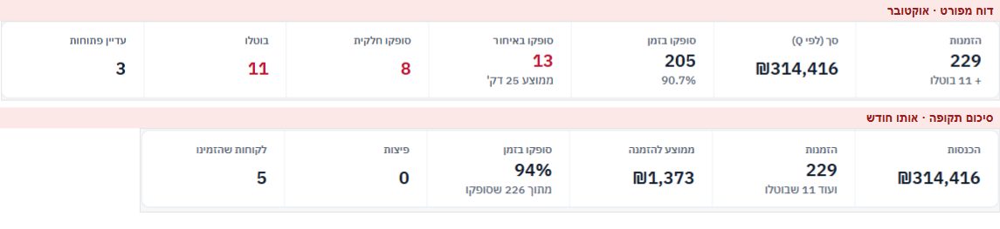
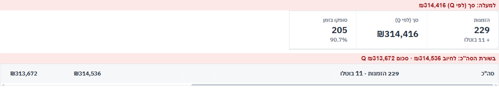
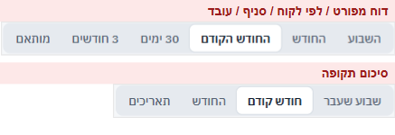
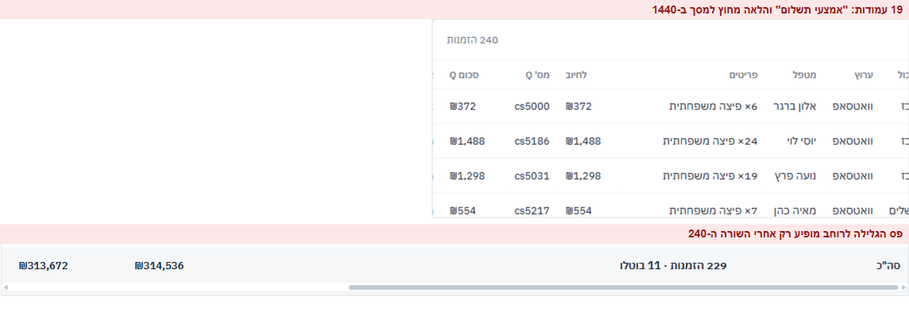
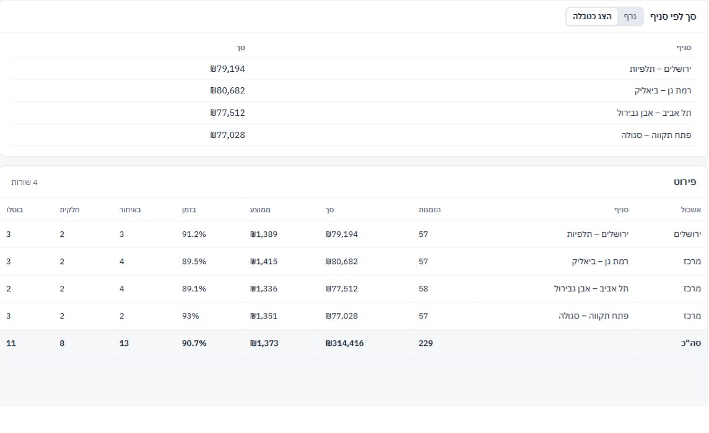
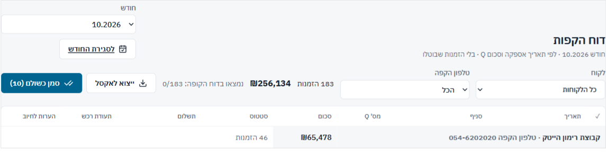
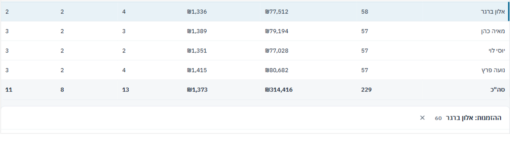
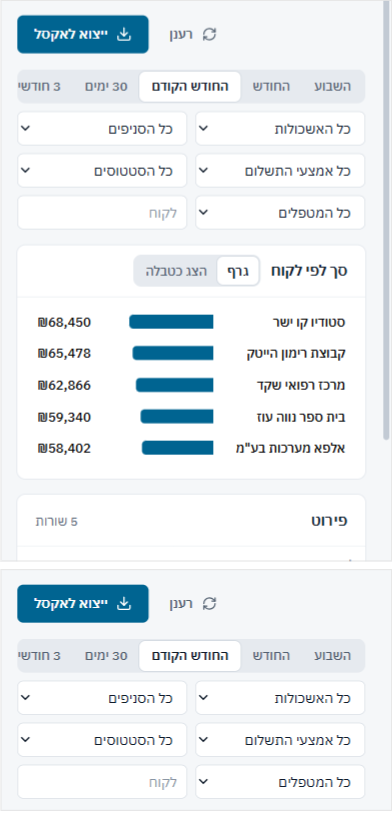

## דוחות – 23/40

| # | היוריסטיקה | ציון | עיקר |
|---|---|---|---|
| 1 | נראות מצב | 3 | הטווח מופיע בשורת המשנה, יש שלד טעינה. אבל שום דבר לא אומר שחלק מ"סך (לפי Q)" הוא בעצם הסכום לחיוב |
| 2 | התאמה לעולם | 2 | "מותאם" ו"תאריכים" הם אותו פקד בשני שמות. "בלי הזמנות שבוטלו" במרכז הדוחות, והדוח המפורט מציג אותן |
| 3 | שליטה וחופש | 3 | המסננים בכתובת, יש "נקה סינון". סינון הלקוח לא נשמר בכתובת ונעלם ברענון |
| 4 | עקביות | 1 | שתי הגדרות ל"בזמן", שני סטים של טווחים, ארבע ברירות מחדל שונות לתקופה |
| 5 | מניעת טעויות | 2 | רשימות המסננים נבנות מהנתונים שנטענו, ולכן מציעות צירופים שמחזירים ריק |
| 6 | זיהוי ולא זכירה | 3 | שמות עמודות ברורים. כל הדוחות במרכז מקבלים אותו אייקון |
| 7 | גמישות ויעילות | 2 | אין מיון עמודות ואין הסתרת עמודות בטבלה של 19 עמודות |
| 8 | אסתטיקה ומינימליזם | 3 | רגוע ומיושר. הגרף חוזר על הטבלה שמתחתיו, ושבעה מדדים ממלאים מסך טלפון שלם |
| 9 | התאוששות משגיאות | 2 | הודעות ריקות שונות בין הדוחות, ו"נסה טווח אחר" גם כשהסינון הוא הסיבה |
| 10 | עזרה | 2 | הגדרות המדדים לא מוסברות בשום מקום, חוץ מהערה אחת בסיכום תקופה |

### ממצאים

**[P1] REP1 · "סופקו בזמן" הוא שני מספרים שונים לאותו חודש**
- 
- **מה ראיתי:** אוקטובר בדוח המפורט: "סופקו בזמן 205 · 90.7%". אוקטובר בסיכום תקופה: "סופקו בזמן 94% · מתוך 226 שסופקו", ובטבלת "עמידה בזמנים" שם: 213. דוח הסניפים מראה את ה-90.7%, וסגירת החודש מראה "סופקה 205" בלי אחוז.
- **בקוד:**
  - `defs.ts` (מפורט, סניפים): `on / (on + late + part)`. חלקית היא קטגוריה נפרדת, ולא נחשבת "בזמן".
  - `periodData.ts:110, 133, 136` (סיכום תקופה): `(closed − late) / closed`, כש-`closed` כולל חלקיות. חלקית שלא איחרה נחשבת "בזמן".
  - `months.ts` (`summarize`): ספירה לפי `OUTCOME_LABEL`, בלי אחוז.
- **למה זה חשוב:** סיכום תקופה הוא "הדוח להנהלה" ומתויג "מוכן להנהלה". מנהל שמשווה אותו לדוח הסניפים יראה 94% מול 90.7%, ולא יידע באיזה מספר להאמין, ואולי גם לא באחרים.
- **תיקון:** פונקציה אחת, `onTimeRate()`, ב-`data/types.ts`, שכל הדוחות וסגירת החודש משתמשים בה. צריך להחליט פעם אחת אם חלקית בזמן נחשבת "בזמן" (שאלה 1), ולהציג את ההגדרה בשורה אחת ליד המדד.
- **פקודה:** `/impeccable harden`

**[P1] REP2 · שלושה סכומים שונים בדוח המפורט**
- 
- **מה ראיתי:** למעלה "סך (לפי Q)" ₪314,416. בשורת הסה"כ: "לחיוב" ₪314,536 ו"סכום Q" ₪313,672. אין הערה שמסבירה את ההבדל.
- **בקוד:** הקפ"י הוא `qVal` (Q, ואם אין – הסכום לחיוב). עמודת "סכום Q" מסכמת רק את ה-Q שקיים (`defs.ts:73`), ועמודת "לחיוב" מסכמת את החיוב. בסיכום תקופה כבר יש הערה: "N הזמנות בלי סכום Q – בסה"כ נלקח במקומן הסכום לחיוב" (`PeriodReport.tsx:94`), אבל בדוח המפורט היא חסרה.
- **למה זה חשוב:** מי שמעתיק "סך לפי Q" לדוח להנהלה ובודק מול עמודת Q מקבל הפרש בלי הסבר.
- **תיקון:** אותה הערה כמו בסיכום תקופה, מעל הטבלה. בשורת הסה"כ של "סכום Q" לסכם באותה שיטה כמו הקפ"י, או לסמן "(N חסרים)".
- **פקודה:** `/impeccable clarify`

**[P1] REP3 · "החודש" הוא טווח אחר בכל דוח, וכל דוח נפתח על תקופה אחרת**
- 
- **מה ראיתי:**
  - **בדוח המפורט, לפי לקוח, לפי סניף ולפי עובד:** "השבוע · החודש · החודש הקודם · 30 ימים · 3 חודשים · מותאם", וברירת המחדל היא "החודש".
  - **בסיכום תקופה:** "שבוע שעבר · חודש קודם · החודש · תאריכים", וברירת המחדל היא "שבוע שעבר".
  - **בדוח ההקפות:** ברירת המחדל היא החודש הנוכחי, מתוך 12 חודשים.
  - **בסגירת חודש:** ברירת המחדל היא החודש הקודם, מתוך 13.
- **בקוד:**
  - `ReportsPage.tsx:49-58`: "החודש" = כל החודש, כולל ימים שעוד לא הגיעו. "3 חודשים" כולל את סוף החודש הנוכחי.
  - `periodData.ts:15-21`: "החודש" = מה-1 בחודש ועד היום.
- **למה זה חשוב:** "החודש" בדוח המפורט כולל הזמנות עתידיות, ו"החודש" בסיכום תקופה לא כולל אותן. אז המספרים לא יתאימו גם כשהמשתמש בחר "אותו" טווח. חוץ מזה, מי שעובר בין דוחות צריך לבחור טווח מחדש בכל אחד.
- **תיקון:** מודול טווחים אחד לכל הדוחות, עם אותם שמות ואותה משמעות. שם אחד לטווח מותאם ("תאריכים"). ברירת מחדל אחת, או לזכור את הטווח האחרון שנבחר במעבר בין דוחות.
- **פקודה:** `/impeccable harden`

**[P2] REP4 · טבלה של 19 עמודות, ופס הגלילה לרוחב רק בסוף**
- 
- **מה ראיתי:**
  - ב-1440 העמודות מ"אמצעי תשלום" והלאה (תשלום, סטטוס אספקה, דקות איחור, סיבה, תעודת רכש, הערות) מחוץ למסך. הטבלה ברוחב 1,844px בתוך 1,142.
  - פס הגלילה לרוחב מופיע רק אחרי השורה ה-240, ולכן כדי לראות את "סטטוס אספקה" של השורה הראשונה צריך לגלול עד הסוף, לגלול הצידה ולחזור למעלה.
  - ב-390 זה 1,795px בתוך 348. הבעיה כבר ידועה, אבל כאן היא נוגעת גם לדסקטופ.
- **בקוד:** `.report__scroll { overflow-x: auto }` עוטף את כל הטבלה (`ReportsPage.css:42`), ולכן גם הכותרת הדביקה נדבקת לעוטף ולא לעמוד.
- **תיקון:**
  - גובה מקסימלי לעוטף עם גלילה פנימית. כך פס הגלילה וכותרת העמודות נשארים במסך.
  - בחירת עמודות (ברירת מחדל: 9 העיקריות). האקסל ממשיך לכלול את כולן.
  - בטלפון: שורה לכל הזמנה בפורמט כרטיס, כמו בדוח ההקפות.
- **פקודה:** `/impeccable adapt`

**[P2] REP5 · הגרף חוזר על הטבלה, ו"הצג כטבלה" מציג עוד עותק שלה**
- 
- **מה ראיתי:**
  - בלפי סניף ולפי עובד (4 שורות) כל הפסים כמעט באותו אורך (57–58 הזמנות). הגרף לא מראה שום דבר שהטבלה לא מראה טוב יותר.
  - "הצג כטבלה" מחליף את הגרף בטבלה של שתי עמודות, ממש מעל טבלת "פירוט" שמציגה את אותם ערכים ועוד.
  - הגרף לפי זמן (`BarChart.tsx`, `kind: 'time'`) קיים בקוד, אבל אף דוח לא משתמש בו. "לפי יום" בסיכום תקופה, שבו הוא היה מועיל באמת, הוא טבלה של 31 שורות.
- **תיקון:**
  - להסתיר את הגרף כשיש פחות מ-6 קטגוריות, או להציג בו מדד שאינו בטבלה (למשל אחוז בזמן לכל סניף).
  - לוותר על "הצג כטבלה" (הטבלה כבר שם), או לגרום לו לגלול לטבלה.
  - להשתמש בגרף הזמן ל"לפי יום" בסיכום תקופה.
- **פקודה:** `/impeccable distill`

**[P2] REP6 · בדוח ההקפות הכותרת נשברת, ו-10 שלא שולמו קבורות בין 183**
- 
- **מה ראיתי:**
  - בורר החודש וכפתור "לסגירת החודש" נערמים זה מעל זה בצד שמאל, והכותרת "דוח הקפות" יורדת מתחתם. בשאר הדוחות הפעולות בשורה אחת ליד הכותרת.
  - מבחינת עיצוב זה הדוח היחיד שלא נראה כמו הדוחות האחרים: אין קישור חזרה ל"דוחות", המסננים בפורמט אחר, ואין טווחים.
  - 183 שורות, ומתוכן 10 שלא שולמו. אין סינון "לא שולמו", ואין סדר שמעלה אותן.
- **תיקון:**
  - אותו ראש עמוד כמו בשאר הדוחות: קישור חזרה, כותרת, ופעולות בשורה אחת.
  - סינון "מצב תשלום" (ברירת מחדל: "לא שולמו" כשיש כאלה), או מיון שמעלה אותן.
- **פקודה:** `/impeccable layout`

**[P2] REP7 · פירוט שורה: מספר אחר מהשורה, ונפתח מתחת למסך**
- 
- **מה ראיתי:** בלפי עובד, השורה של אלון ברגר אומרת 58 הזמנות. הפירוט שנפתח: "ההזמנות: אלון ברגר 60" (כולל 2 שבוטלו). הפירוט נוסף אחרי כרטיס הטבלה (`ReportsPage.tsx:247`), בלי גלילה ובלי העברת פוקוס. בדוח עם 50 לקוחות הוא ייפתח הרחק מתחת למסך, ונראה כאילו הלחיצה לא עשתה כלום.
- **תיקון:** "58 · ועוד 2 שבוטלו" בכותרת הפירוט. לגלול אליו ולהעביר אליו פוקוס כשהוא נפתח, או לפתוח אותו בתוך השורה עצמה.
- **פקודה:** `/impeccable harden`

**[P3] REP8 · בטלפון חמש שורות מסננים לפני הנתון הראשון, והודעת הריק מאשימה את הטווח**
- 
- 
- **מה ראיתי:**
  - ב-390 הטווחים נחתכים באמצע ("3 חודשי") בלי רמז שיש עוד. אחריהם 6 מסננים בשלוש שורות, והגרף מתחיל בגובה 440px. בדוח המפורט שבעה מדדים ממלאים את כל המסך הראשון.
  - בחירת ירושלים + מטפל שלא עבד שם: "אין נתונים בטווח הזה. נסה טווח תאריכים אחר או נקה את הסינון". הטווח בסדר, הסינון הוא הסיבה. הדוח המפורט מציג גם שבעה אפסים מעל הודעת הריק.
  - במרכז הדוחות כל הדוחות מקבלים אותו אייקון, ו"סיכום תקופה" ו"דוח מפורט" נשמעים כמו אותו דבר.
- **תיקון:**
  - בטלפון: המסננים מאחורי כפתור "סינון (N)", ודהייה בקצה הטווחים.
  - הודעת ריק לפי הסיבה: "אין הזמנות לפי הסינון · נקה סינון" (כפתור), או "אין הזמנות בתקופה".
  - במרכז: משפט אחד שמבחין בין "סיכום תקופה" (להנהלה, אקסל מעוצב) ל"דוח מפורט" (לבדיקה, כל העמודות).
- **פקודה:** `/impeccable adapt`

### מה עובד
- **דפוס אחד לכל הדוחות:** מסננים בשורה אחת שנשמרים בכתובת, מדדים, טבלה עם שורת סה"כ, ייצוא שכולל את פרטי הסינון ונרשם ביומן.
- **"הצג עוד" כן:** 200 שורות, והשאר נטענות כשמגיעים לתחתית. הכפתור אומר "הסה"כ כולל את כל השורות", והאקסל תמיד מלא.
- **מספרים קריאים:** ספרות טבלאיות, `Ltr` לכל מספר, שורות שבוטלו מעומעמות בסיכום תקופה, והערה מסבירה למה הן לא נספרות.

## אדומים לפי פרסונה
- **מנהל שמכין דוח להנהלה:**
  - 94% בסיכום תקופה מול 90.7% בדוח הסניפים.
  - שלושה סכומים בדוח המפורט.
  - "החודש" בשני דוחות הוא שני טווחים שונים.
- **אחמ"ש שסוגר חודש:**
  - ייצוא לפני התיקונים, ו-✓ ירוק שנשאר.
  - "סמן כשולם" בלי ✓ אחד.
  - 14 לחיצות זהות על "אשר שבוטלה ב-Q".
  - בשלב 4 רואה רק "נעילת חודש – מנהל מערכת", בלי דרך להודיע למנהל שהחודש מוכן.
- **משתמש מקלדת וקורא מסך:**
  - שורות הדוח ממוקדות ונפתחות ב-Enter, אבל אין להן role, ורווח לא עובד.
  - מספרי ביטולים וחלקיות מסומנים רק בצבע אדום.
  - שלב שהושלם מסומן ב-✓ בלבד, בלי הטקסט "הושלם".
  - ה-placeholder של "לקוח" בניגודיות 3.0:1.

## שאלות
1. האם הזמנה שסופקה חלקית אבל בזמן נחשבת "סופקה בזמן"? צריך החלטה אחת, ואז כל הדוחות וסגירת החודש מציגים אותו מספר.
2. האם הייצוא להנה"ח צריך להיות שלב נפרד, או חלק מהנעילה עצמה? כלומר: נועלים, והקובץ נבנה מהסיכום הקפוא.
3. האם ה-✓ "נמצא בדוח הקופה" הוא בדיקה שמחייבת משהו, או רק סימון לעצמי? אם הוא לא קובע כלום, אולי עדיף לוותר עליו.

---
