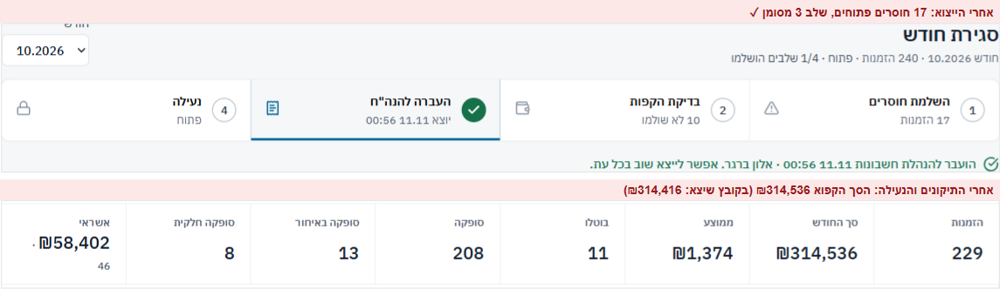
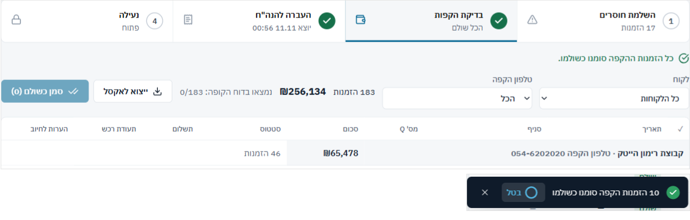
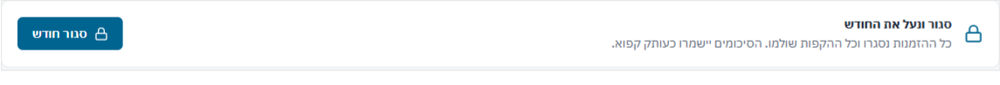
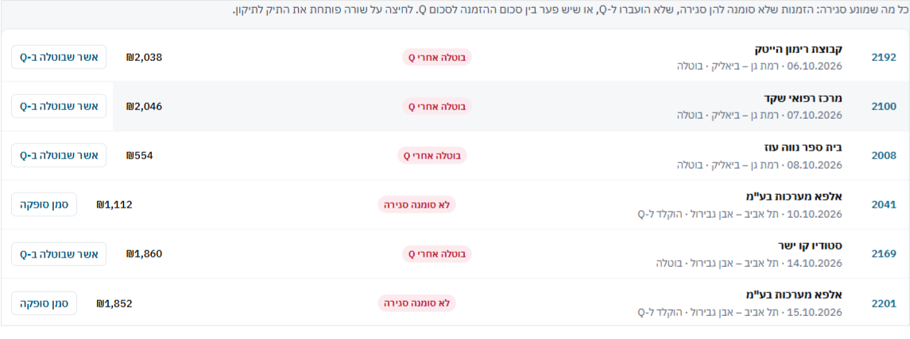
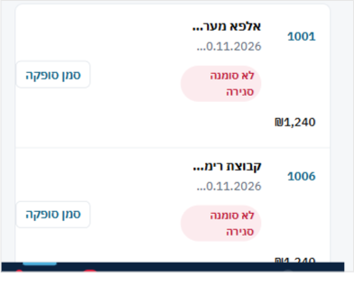
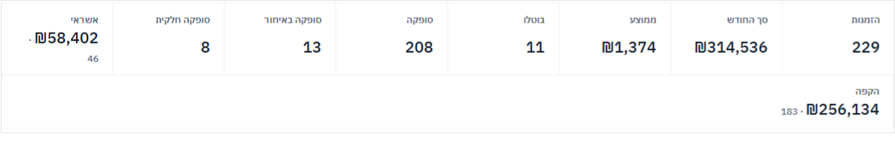

## סגירת חודש – 23/40

| # | היוריסטיקה | ציון | עיקר |
|---|---|---|---|
| 1 | נראות מצב | 2 | שלב 3 מסומן ✓ גם כשהקובץ יצא עם 17 חוסרים ובסכום אחר |
| 2 | התאמה לעולם | 3 | שפה של הנהלת חשבונות. "העברה להנה"ח" מקוצר, ו"סופקה" בסיכומים לא ברור |
| 3 | שליטה וחופש | 3 | "בטל", פתיחה מחדש עם סיבה, ממשיכים מאותה נקודה |
| 4 | עקביות | 2 | בעיות כתומות ("בוטלה אחרי Q") מוצגות באדום כמו חוסר אמיתי. השלבים ממוספרים אבל לא מחייבים סדר |
| 5 | מניעת טעויות | 1 | ייצוא עם חוסרים, "סמן כשולם" שמתעלם מה-✓, נעילה בלחיצה אחת |
| 6 | זיהוי ולא זכירה | 3 | בכל שורה הסיבות וכפתור תיקון |
| 7 | גמישות ויעילות | 2 | 14 מתוך 17 החוסרים הם אותו "אשר שבוטלה ב-Q", ואין פעולה לכולם |
| 8 | אסתטיקה ומינימליזם | 3 | פס השלבים נקי. אריחי הסיכום נשברים |
| 9 | התאוששות משגיאות | 2 | הודעת הכישלון בייצוא טובה. אבל שום דבר לא מתריע שהייצוא ישן |
| 10 | עזרה | 2 | ההסבר בשלב 1 לא מזכיר את "בוטלה אחרי Q", שהוא רוב השורות |

### ממצאים

**[P1] CL1 · ייצוא להנה"ח נחשב "הושלם" גם כשהוא נעשה לפני התיקונים**
- 
- **מה ראיתי:** ייצאתי כשבשלב 1 היו 17 חוסרים. שלב 3 קיבל ✓ ירוק ("יוצא 11.11 00:56"), והמונה אמר "1/4 שלבים הושלמו", לפני שלב 1. אחרי התיקונים החודש ננעל עם סך קפוא של ₪314,536 ו"סופקה 208". בקובץ שכבר יצא להנה"ח: ₪314,416 ו-205. שלב 3 נשאר ✓, ושלב 4 לא הזהיר.
- **בקוד:** `done[3] = !!month?.exportedAt` (`MonthClosePage.tsx:71`). הייצוא לא תלוי בשלבים 1–2, ו-`markExported` לא שומר את הסכום שיצא, ולכן אי אפשר לדעת שהקובץ ישן.
- **למה זה חשוב:** זו בדיוק התקלה שסגירת חודש אמורה למנוע. הנה"ח מקבלת קובץ שלא תואם לסיכום הקפוא, והמערכת מראה שהכל בסדר.
- **תיקון:**
  - `markExported` שומר מספר הזמנות וסך.
  - כשהסיכום החי שונה מהסיכום שיצא, שלב 3 חוזר להיות פתוח עם "יוצא לפני תיקונים – לייצא מחדש", ושלב 4 מזהיר לפני הנעילה.
  - כל עוד שלב 1 פתוח: הכפתור "ייצוא טיוטה" לא מסמן "הועבר", ושם הקובץ כולל "טיוטה".
  - חלופה: הייצוא נעשה רק מהסיכום הקפוא, אחרי הנעילה (שאלה 2).
- **פקודה:** `/impeccable harden`

**[P1] CL2 · "סמן כשולם" מתעלם מהבדיקה מול דוח הקופה**
- 
- **מה ראיתי:** ההסבר בשלב 2: "מסמנים ✓ ליד כל שורה שנמצאה… ובסוף 'סמן כשולם'". לחצתי "סמן כשולם (10)" כש"נמצאו בדוח הקופה: 0/183". כל ה-10 סומנו כשולמו, בלי אישור, ושלב 2 עבר ל"הכל שולם" עם ✓.
- **בקוד:** הכפתור מסמן את כל השורות המסוננות שלא שולמו (`CreditCheck.tsx:38`), בלי קשר ל-`checked`. השלב "הושלם" כשאין הקפות שלא שולמו (`MonthClosePage.tsx:71`), גם בלי שום ✓.
- **למה זה חשוב:** ה-✓ הוא כל הבדיקה. אם הוא לא קובע כלום, אחמ"ש ידלג עליו, והזמנות שלא הופיעו בדוח הקופה יסומנו כשולמו.
- **תיקון:**
  - הכפתור פועל רק על השורות שסומנו ✓ ועדיין לא שולמו: "סמן כשולם (N שנמצאו)".
  - מי שרוצה לסמן גם שורות שלא נמצאו מקבל אישור מפורש: "3 מתוך 10 לא נמצאו בדוח הקופה. לסמן בכל זאת?"
  - השלב הושלם רק כשכל השורות סומנו ✓ ושולמו.
- **פקודה:** `/impeccable harden`

**[P2] CL3 · נעילה בלחיצה אחת, ו"בטל" ישן נשאר אחרי הנעילה**
- 
- **מה ראיתי:** "סגור חודש" נועל מיד, בלי אישור ובלי סיכום של מה ננעל. אחרי הנעילה ההודעה "10 הזמנות הקפה סומנו כשולמו · בטל" עדיין על המסך ([צילום](shots/close-1440-step4-locked-full.png)). לחיצה עליה תנסה לשנות מצב תשלום בחודש נעול.
- **למה זה חשוב:** נעילה היא פעולה שרק מנהל יכול לבטל, עם סיבה. היא צריכה רגע של "בטוח?" עם המספרים. "בטל" שעובד על חודש נעול יפתח תיבת "סיבה לתיקון לאחר סגירה" שאף אחד לא ציפה לה.
- **תיקון:** תיבת אישור קצרה: "נעילת 10.2026 · 229 הזמנות · ₪314,536 · יוצא להנה"ח 11.11", וכפתור "נעל". בזמן הנעילה לסגור הודעות "בטל" של אותו חודש.
- **פקודה:** `/impeccable harden`

**[P2] CL4 · כל החוסרים אדומים, ורובם הם אותה פעולה**
- 
- **מה ראיתי:** 17 שורות. 14 מהן "בוטלה אחרי Q" עם "אשר שבוטלה ב-Q", ו-3 "לא סומנה סגירה". כולן בתג אדום. ההסבר למעלה מזכיר "סגירה, Q ופער" אבל לא ביטולים.
- **בקוד:** התג תמיד אדום (`MonthClosePage.css:33`), גם כשחומרת הבעיה כתומה (`health.ts:74`, כלל 10). הכפתור מטפל רק ב-`blockers[0]` (`MonthClosePage.tsx:157`).
- **למה זה חשוב:** בחודש אמיתי עם 40 ביטולים זה 40 לחיצות זהות, וההזמנה שבאמת לא נסגרה טובעת ביניהן.
- **תיקון:**
  - קיבוץ לפי סוג החוסר, עם ספירה: "לא נסגרו 3 · בוטלו אחרי Q 14".
  - פעולה לקבוצה: "אשר שבוטלו ב-Q (14)", עם אישור.
  - צבע התג לפי חומרת הבעיה. להוסיף לטקסט ההסבר את "ביטולים שלא אושרו ב-Q".
- **פקודה:** `/impeccable distill`

**[P2] CL5 · בטלפון שורות החוסרים נחתכות**
- 
- **מה ראיתי:** ב-390 שם הלקוח נחתך ("אלפא מער…"), והתאריך נחתך מההתחלה ("…0.11.2026"), כך שאי אפשר לדעת איזה יום. הכפתור צף באמצע השורה, והסכום יורד לשורה נפרדת.
- **תיקון:** בטלפון סדר קבוע: מספר ולקוח (השם נשבר לשורה שנייה ולא נחתך), תאריך וסניף, תגים, ואז סכום וכפתור בשורה אחת. גובה כפתור 44px.
- **פקודה:** `/impeccable adapt`

**[P3] CL6 · אריחי הסיכום נשברים בשורה השנייה**
- 
- **מה ראיתי:**
  - בשלב 4 יש שמונה אריחים. "הקפה" יורד לבד לשורה שנייה ברוחב מלא.
  - ב"אשראי" נקודה מיותמת: "· ₪58,402" ו-"46" בשורה מתחת.
  - "סופקה 208" כאן, "סופקו בזמן 90.7%" בדוח המפורט ו-"94%" בסיכום תקופה (ראו REP1).
  - הקישור "דוח ההקפות של החודש" בתחתית צבוע בסגול של קישור שנפתח.
  - בורר החודש לא מראה אילו חודשים נעולים.
- **תיקון:** רשת של 4 אריחים בשורה. אמצעי תשלום בשורה נפרדת בפורמט "₪58,402 · 46 הזמנות". אותו שם מדד ואותה הגדרה כמו בדוחות. סימן נעילה ליד חודש נעול בבורר.
- **פקודה:** `/impeccable polish`

### מה עובד
- **התהליך נגזר מהנתונים:** כל שלב מחושב מההזמנות החיות, כך שאפשר לעצור באמצע ומשתמש אחר ממשיך מאותה נקודה. מונה "N/4 שלבים הושלמו" בשורת המשנה.
- **מודל ביקורת חזק:** סיכום קפוא ברגע הנעילה, רשימת "תיקונים לאחר סגירה", הודעה כשהסך הנוכחי שונה מהסך שננעל, ופתיחה מחדש רק עם סיבה.
- **"כדי לנעול צריך:"** עם קישורים ישירים לשלב שחסר. בשלב 1 יש כפתור תיקון בכל שורה, אותו `FixButton` כמו במסך החריגים.

## אדומים לפי פרסונה
- **מנהל שמכין דוח להנהלה:**
  - 94% בסיכום תקופה מול 90.7% בדוח הסניפים.
  - שלושה סכומים בדוח המפורט.
  - "החודש" בשני דוחות הוא שני טווחים שונים.
- **אחמ"ש שסוגר חודש:**
  - ייצוא לפני התיקונים, ו-✓ ירוק שנשאר.
  - "סמן כשולם" בלי ✓ אחד.
  - 14 לחיצות זהות על "אשר שבוטלה ב-Q".
  - בשלב 4 רואה רק "נעילת חודש – מנהל מערכת", בלי דרך להודיע למנהל שהחודש מוכן.
- **משתמש מקלדת וקורא מסך:**
  - שורות הדוח ממוקדות ונפתחות ב-Enter, אבל אין להן role, ורווח לא עובד.
  - מספרי ביטולים וחלקיות מסומנים רק בצבע אדום.
  - שלב שהושלם מסומן ב-✓ בלבד, בלי הטקסט "הושלם".
  - ה-placeholder של "לקוח" בניגודיות 3.0:1.

## שאלות
1. האם הזמנה שסופקה חלקית אבל בזמן נחשבת "סופקה בזמן"? צריך החלטה אחת, ואז כל הדוחות וסגירת החודש מציגים אותו מספר.
2. האם הייצוא להנה"ח צריך להיות שלב נפרד, או חלק מהנעילה עצמה? כלומר: נועלים, והקובץ נבנה מהסיכום הקפוא.
3. האם ה-✓ "נמצא בדוח הקופה" הוא בדיקה שמחייבת משהו, או רק סימון לעצמי? אם הוא לא קובע כלום, אולי עדיף לוותר עליו.

---
