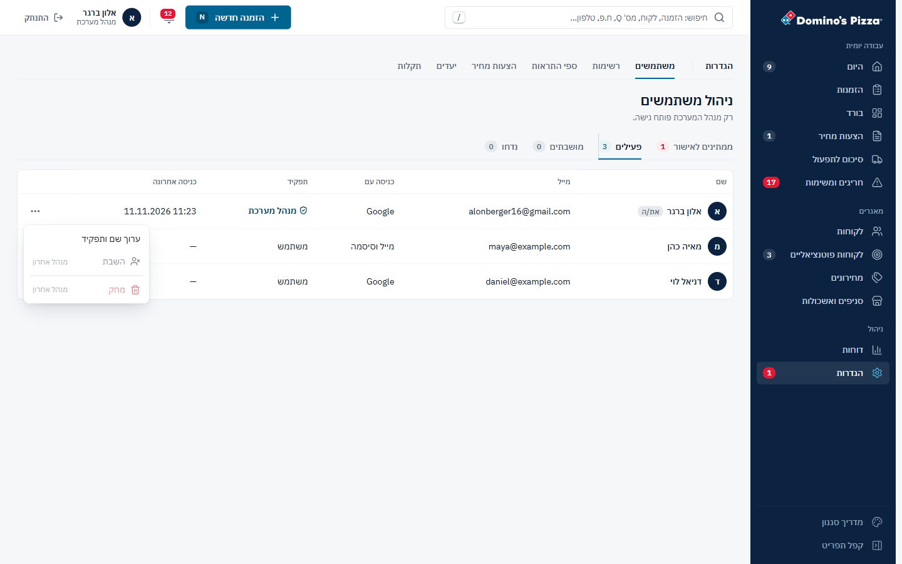
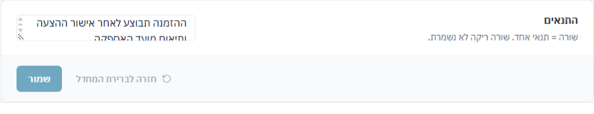
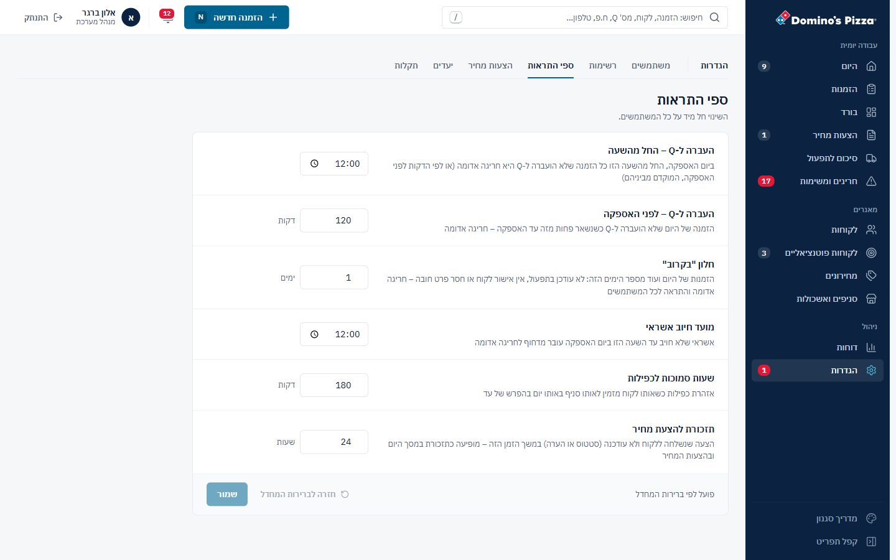
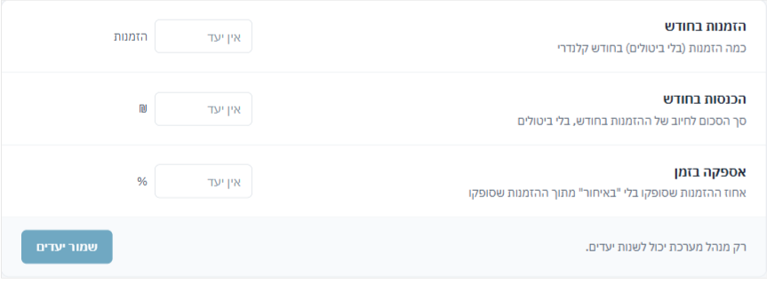
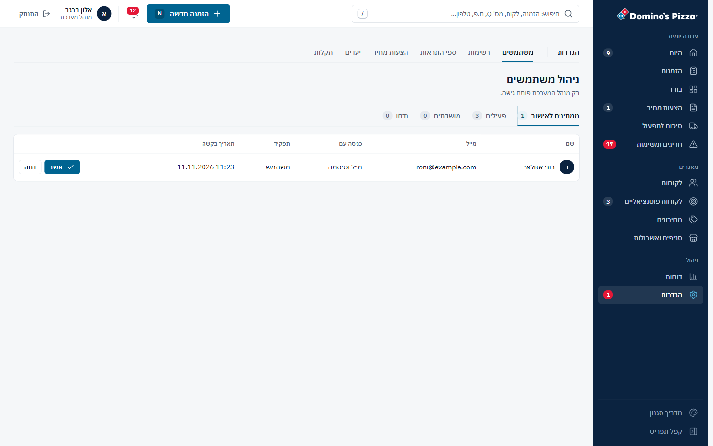
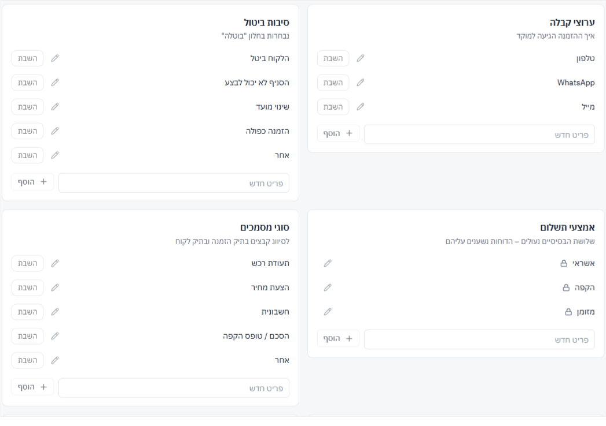

## הגדרות – 27/40

| # | היוריסטיקה | ציון | עיקר |
|---|---|---|---|
| 1 | נראות מצב | 3 | הודעות, "שמור" כבוי עד שיש שינוי, סימון "ברירת מחדל". לשונית "ממתינים" נפתחת לבד כשיש בקשות |
| 2 | התאמה לעולם | 3 | מונחים נכונים. ההסברים בספים הם פסקאות של 2–3 שורות |
| 3 | שליטה וחופש | 2 | ברשימות יש "בטל". ב"השבת" אין אישור ואין "בטל". טיוטה נמחקת במעבר בין לשוניות |
| 4 | עקביות | 3 | אותו כרטיס בספים, ביעדים ובתנאים. רוחב התוכן קופץ בין המסכים |
| 5 | מניעת טעויות | 2 | הגנה על המנהל האחרון. אבל "מחק משתמש" נפתח עם פוקוס על המחיקה, ומנהל יכול להשבית את עצמו |
| 6 | זיהוי ולא זכירה | 3 | הסבר לכל רשימה ולכל סף |
| 7 | גמישות ויעילות | 2 | אין אישור של כמה בקשות יחד |
| 8 | אסתטיקה ומינימליזם | 3 | ההסברים בספים חורגים מהכלל "שורת משנה אחת" |
| 9 | התאוששות משגיאות | 3 | הודעות ברורות, אבל אחת בכל פעם, בתחתית |
| 10 | עזרה | 3 | ההסבר על Firebase Console אחרי מחיקת משתמש עם סיסמה |

### ממצאים

**[P1] SET1 · "מחק משתמש" נפתח עם הפוקוס על כפתור המחיקה**
- 
- **בקוד:** `autoFocus={state.kind === 'approve' || state.kind === 'delete'}` (`UsersPage.tsx:259`). בחלון המחיקה Enter אחד, או נגיעה כפולה בטלפון, מוחק את המשתמש.
- **למה זה חשוב:** מחיקה היא הפעולה היחידה בהגדרות שאין לה "בטל". למשתמש שנרשם עם סיסמה היא גם דורשת צעד ב-Firebase Console כדי שיוכל להירשם מחדש.
- **תיקון:** בחלון המחיקה הפוקוס עובר ל"ביטול". `autoFocus` על הכפתור הראשי נשאר רק באישור בקשה.
- **פקודה:** `/impeccable harden`

**[P1] SET2 · "השבת" פועל מיד, בלי "בטל", ומנהל יכול להשבית את עצמו**
- 
- **בקוד:** "השבת" מנתק את המשתמש מיד ומקפיץ הודעה בלי "בטל" (`UsersPage.tsx:134`). `isProtected` חוסם רק את המנהל האחרון (`:51`), כך שכשיש שני מנהלים אפשר להשבית את עצמך מהתפריט.
- **למה זה חשוב:** נציג שהושבת בטעות באמצע משמרת נזרק מהמערכת עם הזמנה פתוחה.
- **תיקון:**
  - "בטל" בהודעה. המצב הקודם כבר שמור ב-`before`.
  - פעולות על עצמך חסומות (`u.uid === profile.uid`).
- **פקודה:** `/impeccable harden`

**[P2] SET3 · תיבת תנאי ההצעה ברוחב 260px ובגובה שורה אחת**
- 
- **מה ראיתי:** רשימת התנאים (שורה = תנאי) נערכת בתיבה ברוחב 260px ובגובה 36px. רואים שורה וחצי מתוך כל התנאים.
- **בקוד:** הסגנון `.qterms` (רוחב מלא, גובה לפי `rows={6}`) נמצא ב-`quotes.css:150`, שנטען רק כשנכנסים למסך הצעות המחיר. מי שנכנס ישר להגדרות מקבל את עמודת השדה של הספים, שרוחבה 260px (`ThresholdsPage.css:2`).
- **תיקון:** להעביר את `.qterms` לקובץ של ההגדרות, או לייבא אותו ב-`QuoteTermsPage`. השורה צריכה להיות ברוחב מלא, עם תצוגה מקדימה של איך התנאים נראים בסוף ההצעה.
- **פקודה:** `/impeccable layout`

**[P2] SET4 · טיוטה נמחקת בלי אזהרה**
- 
- **בקוד:** בספים, ביעדים ובתנאים, מעבר ללשונית אחרת מוחק את מה שהוקלד. גם `useEffect(() => setDraft(th), [th])` (`ThresholdsPage.tsx:18`, `GoalsPage.tsx:18`, `QuoteTermsPage.tsx:16`) דורס את הטיוטה אם מגיע עדכון מהשרת באמצע העריכה.
- **תיקון:** נקודה ליד הלשונית כשיש שינוי שלא נשמר, ואישור לפני יציאה. לא לדרוס טיוטה שעדיין בעריכה.
- **פקודה:** `/impeccable harden`

**[P2] SET5 · ביעדים, "אספקה בזמן" ו"הכנסות" מוגדרים אחרת מהדוחות**
- 
- **מה ראיתי:**
  - "אספקה בזמן – אחוז ההזמנות שסופקו בלי 'באיחור' מתוך ההזמנות שסופקו". זו ההגדרה של סיכום תקופה (חלקית נחשבת בזמן), ולא של הדוח המפורט ודוח הסניפים (ראו REP1).
  - "הכנסות בחודש – סך הסכום לחיוב". כל הדוחות מסכמים לפי Q.
- **למה זה חשוב:** בבורד, היעד יושווה למספר שמחושב בשיטה אחרת מזו של הדוח שהמנהל יפתח אחר כך.
- **תיקון:** אותה פונקציה אחת כמו בתיקון REP1, ואותו בסיס סכום (Q) בכל מקום.
- **פקודה:** `/impeccable clarify`

**[P2] SET6 · שורת "ממתינים" מציגה תפקיד שעוד לא נבחר, ו"נדחו" לא מציגה סיבה**
- 
- **מה ראיתי:** בבקשה הממתינה כתוב "משתמש" בעמודת התפקיד (`UsersPage.tsx:118`), אבל התפקיד נבחר רק באישור. בלשונית "נדחו" לא רואים את הסיבה שהוקלדה בדחייה.
- **תיקון:** "—" בתפקיד של בקשה ממתינה. בלשונית "נדחו", עמודת "סיבה" במקום עמודת "תפקיד".
- **פקודה:** `/impeccable clarify`

**[P3] SET7 · פריסת הרשימות וסימון "ברירת מחדל"**
- 
- **מה ראיתי:**
  - שבע רשימות ברשת של שתי עמודות. כרטיס בודד בסוף, ורווחים לא אחידים.
  - "ברירת מחדל: 15" בספים בצבע כתום (`ThresholdsPage.css:9`), בלי יחידה.
  - ביעדים "₪" ו-"%" בכחול ו"הזמנות" באפור.
  - רוחב התוכן משתנה בין המסכים: טבלה ברוחב מלא, רשימות 1,040px, ספים 860px.
- **תיקון:** רשת של עמודה אחת ברוחב הספים, או מיון הרשימות לפי גובה. "ברירת מחדל" באפור ועם יחידה.
- **פקודה:** `/impeccable polish`

### מה עובד
- **חלון אישור בקשה:** בחירת תפקיד עם תיאור פשוט של כל אחד, "משתמש" כברירת מחדל בטוחה, וכפתור שאומר בדיוק מה יקרה ("אשר והפעל").
- **רשימות:** פריט שהושבת נשאר עם קו חוצה, פריטי מערכת נעולים, זיהוי כפילויות דומות, ו"בטל" בהודעה.
- **המנהל האחרון מוגן,** וההסבר מופיע בתוך התפריט ("מנהל אחרון").

## אדומים לפי פרסונה
- **נציג ותיק (מקלדת):**
  - כ-260ms בכל מעבר מסך.
  - החיפוש לא מוביל למסכים.
  - שלושה מספרים שלא מתיישבים.
- **משתמש מקלדת וקורא מסך:**
  - שגיאות ההרשמה לא מחוברות לשדות.
  - כותרות הקבוצות בתפריט מוסתרות.
  - תגים של 10px אדום על כחול מעל אייקונים.
  - placeholder בניגודיות 3.0:1 בשדות בלי תווית.
- **נציג חדש שנרשם מהטלפון:**
  - הלוגו דוחף את הטופס.
  - "חובה" על כל שדה.
  - השגיאות מופיעות אחת אחת בתחתית.
  - "חזרה לכניסה" מנתק בשקט.
- **מנהל שמאשר בקשה:**
  - מהפעמון למשתמשים, והחלון נשאר פתוח.
  - תפקיד "משתמש" שעוד לא נבחר.
  - בטלפון "אשר" ו"דחה" צמודים לתאריך בלי תוויות.
  - מחיקה ב-Enter אחד.
  - השבתה בלי "בטל".

## שאלות
1. האם צריך את הפעמון, כשמסך "היום" כבר אומר מה צריך לעשות עכשיו? אם הוא נשאר: רק חריגות דחופות, ובלי מספר?
2. האם עורכים הגדרות מהטלפון? אם לא, הגדרות לקריאה בלבד בטלפון פותרות בבת אחת את רוב הפקדים הקטנים ואת הטיוטות שאובדות.
3. האם אישור בקשת הצטרפות צריך להיות בתוך "הגדרות", או ישר מהמשימה ב"היום" ומהפעמון, עם בחירת התפקיד באותו מקום?
