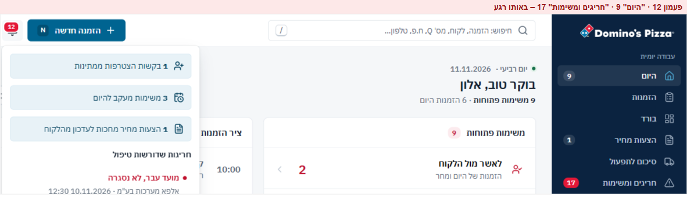
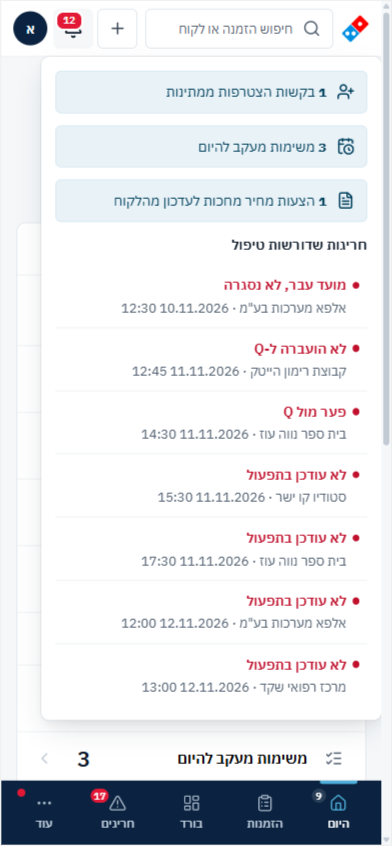
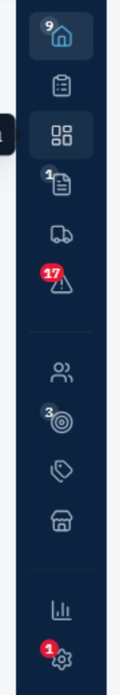
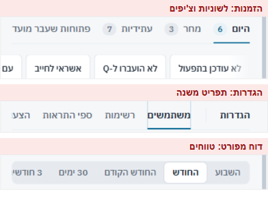
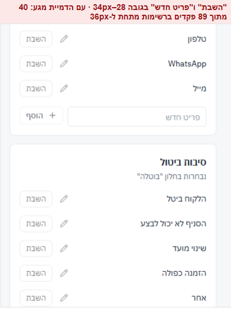
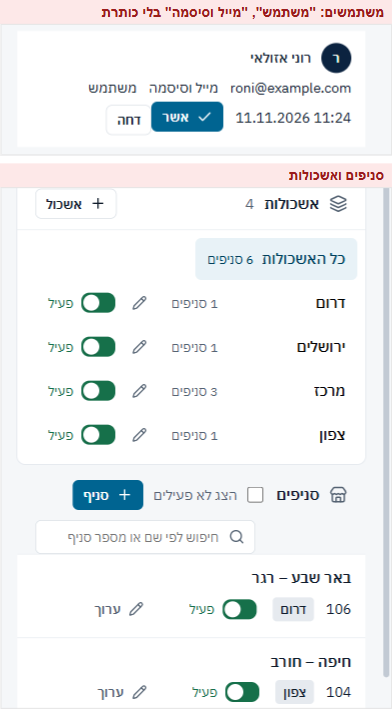
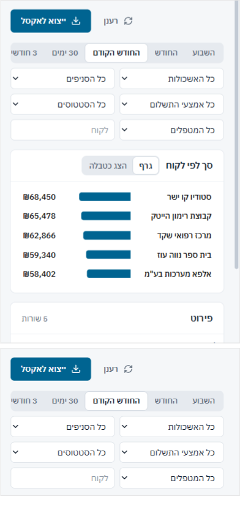

## מעטפת – 28/40

| # | היוריסטיקה | ציון | עיקר |
|---|---|---|---|
| 1 | נראות מצב | 3 | מספרים בתפריט, סימון המסך הפעיל |
| 2 | התאמה לעולם | 3 | שמות קבוצות ברורים |
| 3 | שליטה וחופש | 3 | Esc בכל מקום. מעבר מסך סוגר את תיק ההזמנה ואת "עוד", אבל לא את הפעמון |
| 4 | עקביות | 2 | שלושה מספרים שונים לעבודה חופפת. אדום גם למה שאינו קריטי |
| 5 | מניעת טעויות | 3 | — |
| 6 | זיהוי ולא זכירה | 3 | tooltip בתפריט המקופל, קיצורי מקלדת מוצגים בחיפוש וב-N |
| 7 | גמישות ויעילות | 3 | `/` ו-`N`. החיפוש לא מוביל למסכים |
| 8 | אסתטיקה ומינימליזם | 2 | רעש של תגים: 12, 9, 17 ונקודה אדומה |
| 9 | התאוששות משגיאות | 3 | גבול שגיאה לכל מסך. "אין תוצאות" מציע הזמנה ללקוח חדש |
| 10 | עזרה | 3 | שורת קיצורים בחיפוש |

### ממצאים

**[P1] SH1 · פעמון 12, "היום" 9, "חריגים" 17, באותו רגע**
- 
- **בקוד:**
  - **הפעמון:** הזמנות עם חריגה דחופה (7) + בקשות הצטרפות (1) + משימות להיום (3) + הצעות מחכות (1) (`AppShell.tsx:126-128`).
  - **"היום":** משימות פתוחות. כולל גם בקשות הצטרפות והצעות.
  - **"חריגים":** כל הבעיות האדומות, לא ההזמנות. הזמנה עם שתי בעיות נספרת פעמיים.
  - תג הפעמון אדום גם כשיש בו רק פריטי מידע.
- **למה זה חשוב:** נציג שרואה שלושה מספרים שלא מתיישבים לומד להתעלם משלושתם. זה ההפך ממה שהתגים אמורים לעשות. בנוסף, הצבע האדום שמור במערכת לקריטי בלבד (DESIGN.md).
- **תיקון:**
  - הפעמון סופר ומציג רק חריגות דחופות. בקשות, משימות והצעות נשארות ב"היום".
  - "חריגים" סופר הזמנות ולא בעיות, או שהמספר שם מופיע במסך עם אותה הגדרה.
  - חלופה: לוותר על המספר בפעמון ולהשאיר נקודה (שאלה 1).
- **פקודה:** `/impeccable clarify`

**[P2] SH2 · חלון הפעמון לא מוגבל בגובה ולא נסגר במעבר מסך**
- 
- **מה ראיתי:**
  - בטלפון החלון בגובה 663px מתוך 844. עם 20 חריגות הוא ייצא מהמסך.
  - 4 מתוך 7 השורות הן "לא עודכן בתפעול", בלי קיבוץ ובלי קישור "הכל בחריגים".
- **בקוד:** ל-`.pop` אין גובה מקסימלי (`components.css:108`). החלון לא מנוהל, ולכן לחיצה על "בקשות הצטרפות" מנווטת בלי לסגור אותו. מעבר מסך סוגר רק את "עוד" (`AppShell.tsx:96-102`).
- **תיקון:**
  - `max-height: var(--radix-popover-content-available-height)` עם גלילה, לכל `.pop` ו-`.menu`.
  - `open` מנוהל, וסגירה במעבר מסך.
  - בטלפון: גיליון תחתון.
  - קיבוץ לפי סוג ("לא עודכן בתפעול · 4"), וקישור "הכל בחריגים".
- **פקודה:** `/impeccable adapt`

**[P2] SH3 · בתפריט המקופל המספרים מכסים את האייקונים**
- 
- **מה ראיתי:** התגים 9, 1, 17, 3 ו-1 יושבים על החלק העליון של האייקונים: הבית, המסמך, המשולש, המטרה וגלגל השיניים. הטקסט בגודל 10px, אדום על כחול כהה.
- **בקוד:** `AppShell.css:136`.
- **תיקון:** בתפריט מקופל נקודה בפינה החיצונית, עם טבעת כהה, והמספר עובר ל-tooltip. או תג מתחת לאייקון.
- **פקודה:** `/impeccable polish`

**[P2] SH4 · כל מעבר מסך מחכה לאנימציה**
- **בקוד:** `AnimatePresence mode="wait"` (`AppShell.tsx:253`). המסך הישן נעלם תוך 80ms, ורק אז החדש נכנס תוך 180ms. כ-260ms בכל מעבר.
- **למה זה חשוב:** נציג שעובר בין "היום", "הזמנות" ו"חריגים" עשרות פעמים במשמרת מרגיש את העיכוב. CLAUDE.md קובע אנימציות מינימליות ופונקציונליות במערכת.
- **תיקון:** בלי `mode="wait"` ובלי יציאה. רק כניסה בדהייה של 120ms לכל היותר.
- **פקודה:** `/impeccable quieter`

**[P3] SH5 · פרטים בחיפוש ובתפריט**
- **מה ראיתי:**
  - בחיפוש, הסימון של השורה הפעילה בצד שמאל (`AppShell.css:172`), ובתפריט הצד בצד ימין.
  - החיפוש לא מוביל למסכים: "דוחות" או "סיכום לתפעול" לא מחזירים כלום.
  - כותרות הקבוצות בתפריט מוסתרות מקורא מסך (`aria-hidden`).
  - "1 בקשות הצטרפות ממתינות", "1 הצעות מחיר מחכות".
- **תיקון:** סימון בצד ההתחלה. מסכים כקבוצה שלישית בחיפוש. כותרות קבוצות כ-`aria-labelledby` של כל קבוצה. יחיד ורבים.
- **פקודה:** `/impeccable polish`

### מה עובד
- **החיפוש בנוי למוקד:** שאילתה אחת מוצאת מספר הזמנה, Q, טלפון, ח.פ ואיש קשר. חיפוש ריק מציג "דורש טיפול עכשיו". כשאין תוצאה מוצעת הזמנה חדשה עם השם שהוקלד. ניווט מקלדת מלא.
- **ניווט בטלפון:** 4 יעדים עם שמות קצרים ו"עוד". השמות המלאים נשמרים לקורא מסך. תפריט המשתמש (ההתנתקות) לא יושב ליד הפעמון.
- **התפריט המקופל** שומר מספרים ו-tooltip, וההעדפה נשמרת.

## מעבר טלפון (390) – דפוסים שחוזרים בכל המערכת

הממצאים מסודרים לפי כמה מסכים נפגעים. לכל אחד יש תיקון אחד ברמת המערכת, ולא מסך-מסך.

**[P2] MOB1 · פסי גלילה אופקיים שנחתכים באמצע מילה, בלי רמז שיש עוד**
- 
- **איפה:**
  - **תפריט המשנה בהגדרות**, בכל מסכי ההגדרות (500px בתוך 348): "הצע" נחתך, ו"יעדים" ו"תקלות" לא נראים בכלל.
  - **לשוניות המשתמשים:** "נדח" נחתך.
  - **הזמנות:** לשוניות וצ'יפים. הצ'יף הראשון נחתך בצד ימין.
  - **לשוניות ההצעות.**
  - **צ'יפים בחריגים** (963px בתוך 364).
  - **טווחים בדוחות.**
- **בקוד:** רק ל-`.chips` יש דהייה בקצה. ל-`.tabs`, ל-`.subnav` ול-`.seg` אין (`pages.css:92-94`).
- **תיקון:**
  - כלי אחד, `.hscroll`, לכל הפסים: דהייה בשני הקצוות, `scroll-snap`, ו-`scroll-padding-inline: 16px`.
  - גלילה אוטומטית לפריט הפעיל.
  - בהגדרות, מתחת ל-700px: תפריט נפתח במקום הפס.

**[P2] MOB2 · פקדים קטנים מ-36px במסכי ההגדרה**
- 
- **איפה** (מדידה עם הדמיית מגע):
  - **רשימות:** 40 מתוך 89 ("השבת" 28px, "פריט חדש" 34px).
  - **מחירונים:** 32 מתוך 44 (לשוניות קטגוריה 34px, "הוסף שורה" 28px).
  - **סניפים:** 12 מתוך 29 (מתג 32px, "ערוך" 22px).
  - **דוח מפורט:** 7 מתוך 15.
  - **חריגים:** 10 מתוך 70.
- **בקוד:** הכלל `(pointer: coarse)` מגדיל ל-44px רק את `.btn--sm`, `.icon-btn`, `.chip` ו-`.seg button` (`components.css:227`). כל השאר נשאר קטן: `.litem__toggle`, `.input--sm`, מתגים, וקישורי טקסט כמו "ערוך" ו"מחק".
- **תיקון:** להרחיב את הכלל ל-`button`, `[role=tab]`, `[role=switch]` ו-`.input--sm`. לקישורי טקסט: אזור לחיצה מוגדל ב-`::after`.

**[P2] MOB3 · טבלאות שהופכות לכרטיסים בלי תוויות**
- 
- **איפה:**
  - **משתמשים:** "משתמש" ו"מייל וסיסמה" צפים בלי הקשר, ו"אשר"/"דחה" צמודים לתאריך.
  - **סניפים:** "106" בלי לומר שזה מספר הסניף.
  - **מחירונים, לקוחות ולידים.**
- **בקוד:** הכלל הכללי `.otable:not(.otable--orders)` הופך שורה לשורת flex (`pages.css:100-108`).
- **תיקון:** `data-label` לכל תא, ו-`td[data-label]::before { content: attr(data-label) }`. תא הפעולות בשורה נפרדת ברוחב מלא.

**[P2] MOB4 · כותרת, מדדים ומסננים דוחפים את התוכן מתחת לקפל**
- 
- **איפה:**
  - **הזמנות:** הרשומה הראשונה בגובה כ-375px.
  - **חריגים:** כ-410px.
  - **דוח מפורט:** כ-440px. בדוח המפורט שבעה מדדים ממלאים מסך שלם.
  - **בורד** ו**דוח ההקפות**.
  - הניווט התחתון לוקח עוד 70px.
- **תיקון:** מתחת ל-700px, המדדים והמסננים עוברים מאחורי כפתור אחד, "סינון (2)", שפותח גיליון תחתון. בשורה נשארות רק הלשוניות. המדדים בשורה אחת שגוללת לרוחב.

**[P2] MOB5 · חלונות צפים לא מוגבלים לגובה המסך**
- **איפה:** הפעמון (663px מתוך 844, ראו SH2). "עוד" עם 8 פריטים (כ-400px). כל תפריט שנפתח ליד הניווט התחתון.
- **תיקון:** אותו תיקון כמו ב-SH2, ברמת `.pop` ו-`.menu` לכל המערכת. בטלפון, הפעמון ו"עוד" כגיליון תחתון.

**[P3] MOB6 · מסכי הגדרה בטלפון הם עורכים מלאים של דסקטופ**
- **איפה:** עורך המחירונים, רשימות, מתגי הסניפים, ספים ותנאי הצעה.
- **למה זה חשוב:** לפי PRODUCT.md, בטלפון עיקר העבודה הוא צפייה ומעקב של אחמ"שים. המסכים האלה מייצרים את רוב הפקדים הקטנים ואת רוב הטיוטות שאובדות.
- **תיקון:** מתחת ל-700px: תצוגה לקריאה בלבד עם "עריכה במחשב" (שאלה 2), או לפחות להסתיר את פקדי העריכה בשורה.

**שכבר דווחו בסבבים קודמים:**
- טבלאות הדוחות ברוחב 1,989px בתוך 348.
- הדף לתפעול מוקטן פי 0.32.
- שורות סגירת החודש נחתכות.
- המשימות בחריגים קבורות בתחתית.

## אדומים לפי פרסונה
- **נציג ותיק (מקלדת):**
  - כ-260ms בכל מעבר מסך.
  - החיפוש לא מוביל למסכים.
  - שלושה מספרים שלא מתיישבים.
- **משתמש מקלדת וקורא מסך:**
  - שגיאות ההרשמה לא מחוברות לשדות.
  - כותרות הקבוצות בתפריט מוסתרות.
  - תגים של 10px אדום על כחול מעל אייקונים.
  - placeholder בניגודיות 3.0:1 בשדות בלי תווית.
- **נציג חדש שנרשם מהטלפון:**
  - הלוגו דוחף את הטופס.
  - "חובה" על כל שדה.
  - השגיאות מופיעות אחת אחת בתחתית.
  - "חזרה לכניסה" מנתק בשקט.
- **מנהל שמאשר בקשה:**
  - מהפעמון למשתמשים, והחלון נשאר פתוח.
  - תפקיד "משתמש" שעוד לא נבחר.
  - בטלפון "אשר" ו"דחה" צמודים לתאריך בלי תוויות.
  - מחיקה ב-Enter אחד.
  - השבתה בלי "בטל".

## שאלות
1. האם צריך את הפעמון, כשמסך "היום" כבר אומר מה צריך לעשות עכשיו? אם הוא נשאר: רק חריגות דחופות, ובלי מספר?
2. האם עורכים הגדרות מהטלפון? אם לא, הגדרות לקריאה בלבד בטלפון פותרות בבת אחת את רוב הפקדים הקטנים ואת הטיוטות שאובדות.
3. האם אישור בקשת הצטרפות צריך להיות בתוך "הגדרות", או ישר מהמשימה ב"היום" ומהפעמון, עם בחירת התפקיד באותו מקום?
