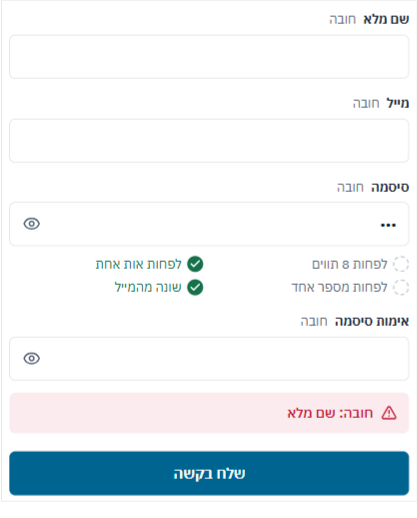
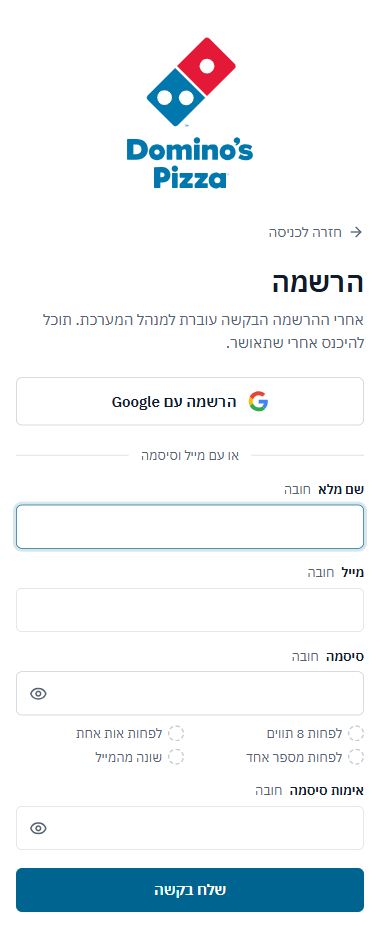
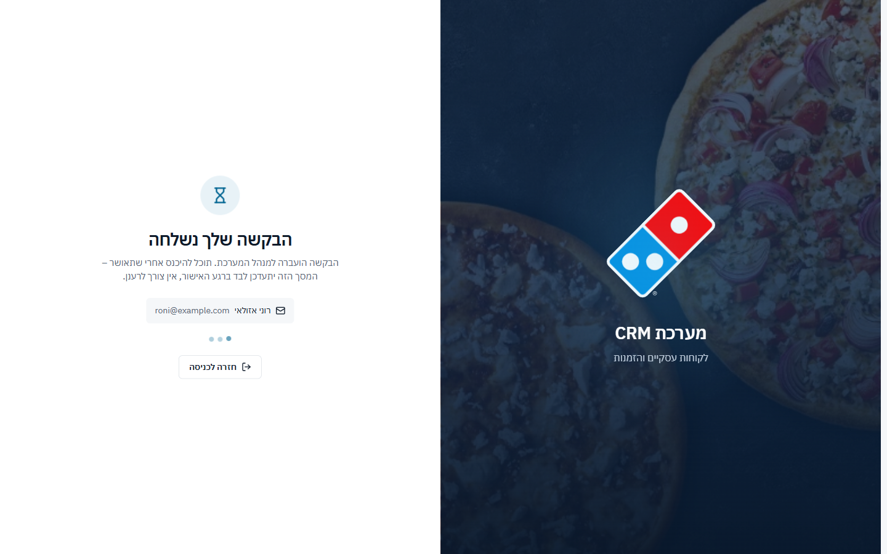

## כניסה והרשמה – 30/40

| # | היוריסטיקה | ציון | עיקר |
|---|---|---|---|
| 1 | נראות מצב | 3 | מסך "ממתין" מתעדכן לבד, ספינר על הכפתור שנלחץ |
| 2 | התאמה לעולם | 4 | עברית פשוטה. "שכחת סיסמה? פנה למנהל המוקד" תואם את המדיניות |
| 3 | שליטה וחופש | 3 | "חזרה לכניסה" במסך ההמתנה הוא בעצם התנתקות |
| 4 | עקביות | 3 | "חובה" על כל שדה, כשכל השדות חובה |
| 5 | מניעת טעויות | 3 | כללי סיסמה חיים, ו"הסיסמאות זהות ✓" |
| 6 | זיהוי ולא זכירה | 3 | `autocomplete` נכון בכל שדה |
| 7 | גמישות ויעילות | 3 | Google או מייל, ועובד עם מנהלי סיסמאות |
| 8 | אסתטיקה ומינימליזם | 3 | בטלפון הלוגו תופס כ-200px מעל הטופס |
| 9 | התאוששות משגיאות | 2 | בהרשמה: שגיאה אחת בכל פעם, למטה, לא ליד השדה |
| 10 | עזרה | 3 | מסך ההמתנה אומר שאין צורך לרענן |

### ממצאים

**[P2] AUTH1 · בהרשמה השגיאה מופיעה רחוק מהשדה, אחת בכל פעם**
- 
- **מה ראיתי:**
  - שלחתי טופס עם סיסמה בלבד. השגיאה "חובה: שם מלא" הופיעה מעל הכפתור, כ-400px מתחת לשדה השם. השדה עצמו לא סומן באדום. בטלפון המרחק כ-450px.
  - כללי הסיסמה סימנו ✓ ליד "שונה מהמייל" כששדה המייל היה ריק.
- **בקוד:** הבדיקות רצות אחת אחרי השנייה (`AuthScreens.tsx:115-118`). לשם ולמייל אין `aria-invalid`, ו-`reg-err` לא מחובר לשום שדה. בכניסה זה כן נעשה נכון.
- **תיקון:** לבדוק את כל השדות יחד, להציג שגיאה מתחת לכל שדה, ולהעביר את הפוקוס לשדה הראשון עם שגיאה. "שונה מהמייל" יסומן רק כשיש מייל.
- **פקודה:** `/impeccable harden`

**[P2] AUTH2 · בטלפון הלוגו דוחף את הטופס למטה**
- 
- **מה ראיתי:** בטלפון הלוגו האנכי ברוחב 132px עם שוליים (`AuthScreens.css:115`). בהרשמה, "שלח בקשה" נמצא שני מסכים למטה כשהמקלדת פתוחה.
- **תיקון:** לוגו של כ-64px בהרשמה, או לוגו אופקי קטן בראש המסך.
- **פקודה:** `/impeccable adapt`

**[P3] AUTH3 · "חזרה לכניסה" במסך ההמתנה הוא התנתקות**
- 
- **מה ראיתי:** נציג חדש עלול לחשוב שהכפתור מבטל את הבקשה. במסך גם אין שום מושג כמה זמן ההמתנה ולמי לפנות.
- **תיקון:** "התנתק – הבקשה נשארת ממתינה", ושורה: "בדרך כלל מאושר באותו יום. לשאלות: מנהל המוקד".
- **פקודה:** `/impeccable clarify`

**[P3] AUTH4 · "חובה" על כל שדה, ושתי אנימציות קבועות**
- **מה ראיתי:** בהרשמה כל ארבעת השדות מסומנים "חובה". כשהכל חובה, הסימון לא מוסר מידע. במסך ההמתנה רצות כל הזמן גם שעון החול וגם שלוש הנקודות.
- **תיקון:** להוריד את "חובה". להשאיר אנימציה אחת.
- **פקודה:** `/impeccable quieter`

### מה עובד
- **מסך "ממתין לאישור":** מאשר את השם והמייל, ואומר שהמסך יתעדכן לבד. אין רענונים מתוך לחץ.
- **כניסה קצרה:** Google קודם, טופס של שני שדות, הפוקוס כבר בשדה המייל, ושגיאה ברורה ("המייל או הסיסמה שגויים") עם שני השדות מסומנים.
- **פרטים נכונים:** כפתור הצגת הסיסמה ממוקם נכון בשדה LTR בתוך עמוד RTL, והרעידה של השגיאה מכבדת reduced motion.

## אדומים לפי פרסונה
- **נציג ותיק (מקלדת):**
  - כ-260ms בכל מעבר מסך.
  - החיפוש לא מוביל למסכים.
  - שלושה מספרים שלא מתיישבים.
- **משתמש מקלדת וקורא מסך:**
  - שגיאות ההרשמה לא מחוברות לשדות.
  - כותרות הקבוצות בתפריט מוסתרות.
  - תגים של 10px אדום על כחול מעל אייקונים.
  - placeholder בניגודיות 3.0:1 בשדות בלי תווית.
- **נציג חדש שנרשם מהטלפון:**
  - הלוגו דוחף את הטופס.
  - "חובה" על כל שדה.
  - השגיאות מופיעות אחת אחת בתחתית.
  - "חזרה לכניסה" מנתק בשקט.
- **מנהל שמאשר בקשה:**
  - מהפעמון למשתמשים, והחלון נשאר פתוח.
  - תפקיד "משתמש" שעוד לא נבחר.
  - בטלפון "אשר" ו"דחה" צמודים לתאריך בלי תוויות.
  - מחיקה ב-Enter אחד.
  - השבתה בלי "בטל".

## שאלות
1. האם צריך את הפעמון, כשמסך "היום" כבר אומר מה צריך לעשות עכשיו? אם הוא נשאר: רק חריגות דחופות, ובלי מספר?
2. האם עורכים הגדרות מהטלפון? אם לא, הגדרות לקריאה בלבד בטלפון פותרות בבת אחת את רוב הפקדים הקטנים ואת הטיוטות שאובדות.
3. האם אישור בקשת הצטרפות צריך להיות בתוך "הגדרות", או ישר מהמשימה ב"היום" ומהפעמון, עם בחירת התפקיד באותו מקום?
