# ביקורת עיצוב מצטברת – Domino's CRM

קובץ מצטבר: כל ריצת `/impeccable critique` מוסיפה סעיף מתוארך בראש היומן, והסעיפים הקודמים נשארים כמו שהם. הצילומים נמצאים ב-`shots/`, והחיתוכים לכל ממצא ב-`shots/findings/`.

---

# 2026-11-11 · "דוחות", "סגירת חודש" · ענף design-polish

- **שיטה:** dual-agent (A: סקירת עיצוב של הקוד והצילומים · B: סורק `impeccable detect` ושכבת סימון בדפדפן). שילבתי את התוצאות ואימתתי בדפדפן ובקוד.
- **מצב:** מוצר (Operate). **בסיס:** PRODUCT.md, DESIGN.md. **סקילים:** impeccable critique + frontend-design.
- **סביבה:** harness מקומי (פורט 5174, Firebase מזויף, Playwright MCP, 1440 ו-390).
  - בנתוני הדמה אין חודש קודם, ולכן הוספתי לחנות המזויפת 240 הזמנות לאוקטובר 2026: 5 לקוחות, 4 סניפים, 4 מטפלים, 11 ביטולים, 8 חלקיות, 13 איחורים, 3 הזמנות שלא נסגרו, 2 בלי Q, פער אחד, ו-10 הקפות שלא שולמו.
  - בסגירת החודש עברתי במכוון בסדר "לא נכון": קודם ייצוא להנה"ח (שלב 3) כשבשלב 1 היו 17 חוסרים, אחר כך "סמן כשולם" בשלב 2 בלי לסמן ✓ אף שורה. רק אז תיקנתי את החוסרים (ישירות בחנות המזויפת) ונעלתי.
  - לא שיניתי קוד.

| מסך | ציון | דירוג | P0 | P1 | P2 | P3 |
|---|---|---|---|---|---|---|
| **דוחות** | **23/40** | סביר (57%) | 0 | 3 | 4 | 1 |
| **סגירת חודש** | **23/40** | סביר (57%) | 0 | 2 | 3 | 1 |

**החוט המשותף לשני המסכים:**
- **המראה עצמו ממושמע ונאמן למערכת:** כרטיסים שטוחים, ספרות טבלאיות, כחול אחד, מסננים שנשמרים בכתובת, ושורת סה"כ בכל טבלה. סגירת החודש נגזרת כולה מהנתונים החיים, כך שמשתמש אחר ממשיך מאותה נקודה.
- **החולשה: אמון במספרים.**
  - אותו מדד ("סופקו בזמן") מקבל שתי הגדרות: 94% בסיכום תקופה ו-90.7% בדוח המפורט ובדוח הסניפים, על אותו חודש.
  - בדוח המפורט יש שלושה סכומים שונים לאותן הזמנות.
  - בסגירת החודש שני שלבים מקבלים ✓ ירוק בלי שהבדיקה שהם מתארים קרתה: ייצוא שנעשה לפני התיקונים, ו"שולם" בלי השוואה לדוח הקופה.
- סוכן A דירג שלושה מהממצאים כ-P0. הורדתי ל-P1: הם לא חוסמים את העבודה, אבל הם מייצרים מספרים שגויים בלי שום אזהרה. כדאי לתקן אותם לפני שהנה"ח מקבלת קובץ אמיתי.

## מה נבדק

| מסך | מצב | צילום |
|---|---|---|
| מרכז הדוחות | 6 דוחות + כרטיס סגירת חודש | [1440](shots/rep-1440-hub.png) · [390](shots/rep-390-hub.png) |
| סיכום תקופה – הזמנות | ברירת מחדל (שבוע שעבר) וחודש קודם, 240 שורות | [שבוע](shots/rep-1440-period-orders.png) · [אוקטובר](shots/rep-1440-period-oct-orders.png) · [מלא](shots/rep-1440-period-oct-orders-full.png) · [390](shots/rep-390-period-orders.png) |
| סיכום תקופה – סיכום | מדדים + 6 טבלאות | [למעלה](shots/rep-1440-period-oct-summary.png) · [מלא](shots/rep-1440-period-oct-summary-full.png) · [390](shots/rep-390-period-summary.png) · [390 מלא](shots/rep-390-period-summary-full.png) |
| דוח מפורט | 240 שורות, 19 עמודות, "הצג עוד", סה"כ | [למעלה](shots/rep-1440-detail-oct.png) · ["הצג עוד"](shots/rep-1440-detail-more.png) · [תחתית](shots/rep-1440-detail-bottom.png) · [390](shots/rep-390-detail.png) |
| לפי לקוח / סניף / עובד | גרף, "הצג כטבלה", פירוט לשורה | [לקוח](shots/rep-1440-customers.png) · [סניף](shots/rep-1440-branches.png) · [כטבלה](shots/rep-1440-branches-astable.png) · [עובד](shots/rep-1440-team.png) · [פירוט](shots/rep-1440-team-drill.png) · [לקוח 390](shots/rep-390-customers.png) · [סניף 390](shots/rep-390-branches.png) |
| מסננים | אשכול + מטפל, "נקה סינון" | [מסננים](shots/rep-1440-filters.png) |
| דוח בלי נתונים | טווח מותאם ביוני | [לפי לקוח](shots/rep-1440-empty.png) · [מפורט](shots/rep-1440-detail-empty.png) · [סיכום תקופה](shots/rep-1440-period-empty.png) |
| הקפות | אוקטובר, 183 שורות | [למעלה](shots/rep-1440-credit.png) · [מלא](shots/rep-1440-credit-full.png) · [390](shots/rep-390-credit.png) |
| סגירת חודש – שלב 1 | 17 חוסרים | [למעלה](shots/close-1440-step1.png) · [מלא](shots/close-1440-step1-full.png) |
| שלב 2 | בדיקת הקפות, ואחרי "סמן כשולם" | [לפני](shots/close-1440-step2.png) · [אחרי](shots/close-1440-step2-markpaid.png) |
| שלב 3 | לפני ואחרי ייצוא; הקובץ שירד | [לפני](shots/close-1440-step3.png) · [אחרי](shots/close-1440-step3-done.png) · [xlsx](shots/close-sample-accounting.xlsx) |
| שלב 4 | לא מוכן, מוכן, נעול | [לא מוכן](shots/close-1440-step4-notready.png) · [מוכן](shots/close-1440-step4-ready.png) · [נעול](shots/close-1440-step4-locked.png) · [נעול מלא](shots/close-1440-step4-locked-full.png) |
| סגירת חודש בטלפון | אוקטובר נעול, נובמבר פתוח | [נעול](shots/close-390-locked.png) · [נובמבר](shots/close-390-nov.png) · [נובמבר מלא](shots/close-390-nov-full.png) |

**מה לא נבדק:**
- קובצי האקסל של הדוחות עצמם (עיצוב הגיליון). בדקתי רק שהקובץ יורד ומה רשום בהודעה.
- פתיחה מחדש של חודש נעול, ותיקון לאחר סגירה עם סיבה. ראיתי רק את הטופס ואת "אין תיקונים מאז הנעילה".
- סגירת חודש כאחמ"ש שאינו מנהל מערכת. נבדק רק כמנהל.
- דוח עם אלפי שורות. נבדקו 240, כלומר מנה אחת של "הצג עוד".
- הקפ"י "פיצות 0" בסיכום תקופה: בהזמנות שהוספתי אין קטגוריה לפריטים, ולכן כנראה זה תוצר של נתוני הדמה ולא באג. כדאי לבדוק על נתונים אמיתיים.

**סורק:**
- **CLI** (`src/features/reports`): 2 ממצאים.
  - `side-tab` (אזהרה): `ReportsPage.css:50`. שורה שנבחרה מסומנת בפס של 3px בקצה הימני (`box-shadow` פנימי). זה בדיוק הדפוס שהכלל מחפש. עדיף רקע של השורה בלבד, כמו `is-on` בשאר המערכת.
  - `design-system-radius` (מייעץ): `MonthClosePage.css:33`, פינה 999px לתג. מכוון, וכדאי לתעד ב-DESIGN.md.
- **בדפדפן** (4 עמודים):
  - placeholder "לקוח" בסינון הדוח: ניגודיות 3.0:1, כשהדרישה היא 4.5:1 (`#8a96a5` על לבן). הצבע מגיע מסגנון ה-placeholder המשותף, ולכן כנראה קיים גם במסכים אחרים.
  - תג הפעמון ב-10px הוא במעטפת האפליקציה, לא במסכים האלה.
- **מדידה ב-390:** אין גלישה של העמוד. הטבלאות גוללות בתוך עצמן: הדוח המפורט 1,795px בתוך 348, סיכום תקופה – הזמנות 1,100px, לפי סניף 623px. דוח ההקפות הופך לכרטיסים, וגובה העמוד 19,069px.

## דוחות – 23/40

| # | היוריסטיקה | ציון | עיקר |
|---|---|---|---|
| 1 | נראות מצב | 3 | הטווח מופיע בשורת המשנה, יש שלד טעינה. אבל שום דבר לא אומר שחלק מ"סך (לפי Q)" הוא בעצם הסכום לחיוב |
| 2 | התאמה לעולם | 2 | "מותאם" ו"תאריכים" הם אותו פקד בשני שמות. "בלי הזמנות שבוטלו" במרכז הדוחות, והדוח המפורט מציג אותן |
| 3 | שליטה וחופש | 3 | המסננים בכתובת, יש "נקה סינון". סינון הלקוח לא נשמר בכתובת ונעלם ברענון |
| 4 | עקביות | 1 | שתי הגדרות ל"בזמן", שני סטים של טווחים, ארבע ברירות מחדל שונות לתקופה |
| 5 | מניעת טעויות | 2 | רשימות המסננים נבנות מהנתונים שנטענו, ולכן מציעות צירופים שמחזירים ריק |
| 6 | זיהוי ולא זכירה | 3 | שמות עמודות ברורים. כל הדוחות במרכז מקבלים אותו אייקון |
| 7 | גמישות ויעילות | 2 | אין מיון עמודות ואין הסתרת עמודות בטבלה של 19 עמודות |
| 8 | אסתטיקה ומינימליזם | 3 | רגוע ומיושר. הגרף חוזר על הטבלה שמתחתיו, ושבעה מדדים ממלאים מסך טלפון שלם |
| 9 | התאוששות משגיאות | 2 | הודעות ריקות שונות בין הדוחות, ו"נסה טווח אחר" גם כשהסינון הוא הסיבה |
| 10 | עזרה | 2 | הגדרות המדדים לא מוסברות בשום מקום, חוץ מהערה אחת בסיכום תקופה |

### ממצאים

**[P1] REP1 · "סופקו בזמן" הוא שני מספרים שונים לאותו חודש**
- 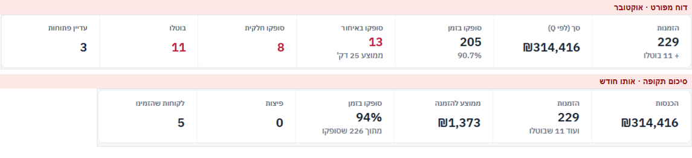
- **מה ראיתי:** אוקטובר בדוח המפורט: "סופקו בזמן 205 · 90.7%". אוקטובר בסיכום תקופה: "סופקו בזמן 94% · מתוך 226 שסופקו", ובטבלת "עמידה בזמנים" שם: 213. דוח הסניפים מראה את ה-90.7%, וסגירת החודש מראה "סופקה 205" בלי אחוז.
- **בקוד:**
  - `defs.ts` (מפורט, סניפים): `on / (on + late + part)`. חלקית היא קטגוריה נפרדת, ולא נחשבת "בזמן".
  - `periodData.ts:110, 133, 136` (סיכום תקופה): `(closed − late) / closed`, כש-`closed` כולל חלקיות. חלקית שלא איחרה נחשבת "בזמן".
  - `months.ts` (`summarize`): ספירה לפי `OUTCOME_LABEL`, בלי אחוז.
- **למה זה חשוב:** סיכום תקופה הוא "הדוח להנהלה" ומתויג "מוכן להנהלה". מנהל שמשווה אותו לדוח הסניפים יראה 94% מול 90.7%, ולא יידע באיזה מספר להאמין, ואולי גם לא באחרים.
- **תיקון:** פונקציה אחת, `onTimeRate()`, ב-`data/types.ts`, שכל הדוחות וסגירת החודש משתמשים בה. צריך להחליט פעם אחת אם חלקית בזמן נחשבת "בזמן" (שאלה 1), ולהציג את ההגדרה בשורה אחת ליד המדד.
- **פקודה:** `/impeccable harden`

**[P1] REP2 · שלושה סכומים שונים בדוח המפורט**
- 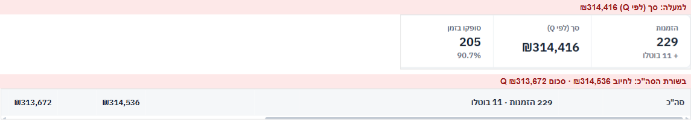
- **מה ראיתי:** למעלה "סך (לפי Q)" ₪314,416. בשורת הסה"כ: "לחיוב" ₪314,536 ו"סכום Q" ₪313,672. אין הערה שמסבירה את ההבדל.
- **בקוד:** הקפ"י הוא `qVal` (Q, ואם אין – הסכום לחיוב). עמודת "סכום Q" מסכמת רק את ה-Q שקיים (`defs.ts:73`), ועמודת "לחיוב" מסכמת את החיוב. בסיכום תקופה כבר יש הערה: "N הזמנות בלי סכום Q – בסה"כ נלקח במקומן הסכום לחיוב" (`PeriodReport.tsx:94`), אבל בדוח המפורט היא חסרה.
- **למה זה חשוב:** מי שמעתיק "סך לפי Q" לדוח להנהלה ובודק מול עמודת Q מקבל הפרש בלי הסבר.
- **תיקון:** אותה הערה כמו בסיכום תקופה, מעל הטבלה. בשורת הסה"כ של "סכום Q" לסכם באותה שיטה כמו הקפ"י, או לסמן "(N חסרים)".
- **פקודה:** `/impeccable clarify`

**[P1] REP3 · "החודש" הוא טווח אחר בכל דוח, וכל דוח נפתח על תקופה אחרת**
- 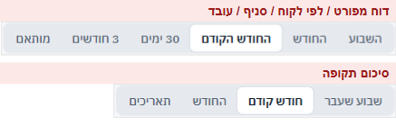
- **מה ראיתי:**
  - **בדוח המפורט, לפי לקוח, לפי סניף ולפי עובד:** "השבוע · החודש · החודש הקודם · 30 ימים · 3 חודשים · מותאם", וברירת המחדל היא "החודש".
  - **בסיכום תקופה:** "שבוע שעבר · חודש קודם · החודש · תאריכים", וברירת המחדל היא "שבוע שעבר".
  - **בדוח ההקפות:** ברירת המחדל היא החודש הנוכחי, מתוך 12 חודשים.
  - **בסגירת חודש:** ברירת המחדל היא החודש הקודם, מתוך 13.
- **בקוד:**
  - `ReportsPage.tsx:49-58`: "החודש" = כל החודש, כולל ימים שעוד לא הגיעו. "3 חודשים" כולל את סוף החודש הנוכחי.
  - `periodData.ts:15-21`: "החודש" = מה-1 בחודש ועד היום.
- **למה זה חשוב:** "החודש" בדוח המפורט כולל הזמנות עתידיות, ו"החודש" בסיכום תקופה לא כולל אותן. אז המספרים לא יתאימו גם כשהמשתמש בחר "אותו" טווח. חוץ מזה, מי שעובר בין דוחות צריך לבחור טווח מחדש בכל אחד.
- **תיקון:** מודול טווחים אחד לכל הדוחות, עם אותם שמות ואותה משמעות. שם אחד לטווח מותאם ("תאריכים"). ברירת מחדל אחת, או לזכור את הטווח האחרון שנבחר במעבר בין דוחות.
- **פקודה:** `/impeccable harden`

**[P2] REP4 · טבלה של 19 עמודות, ופס הגלילה לרוחב רק בסוף**
- 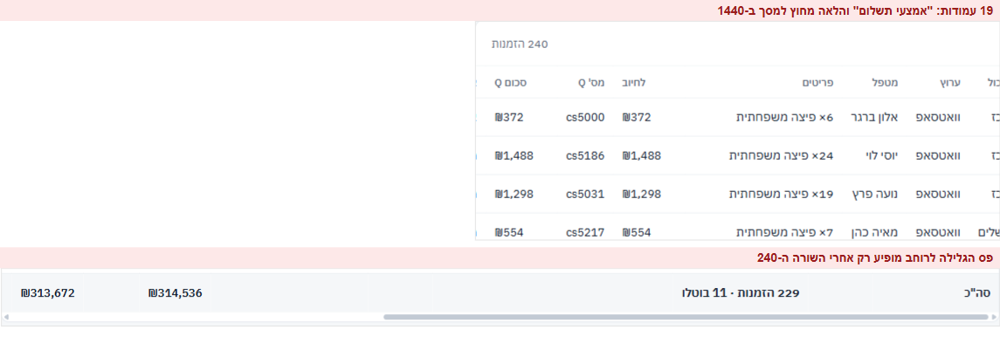
- **מה ראיתי:**
  - ב-1440 העמודות מ"אמצעי תשלום" והלאה (תשלום, סטטוס אספקה, דקות איחור, סיבה, תעודת רכש, הערות) מחוץ למסך. הטבלה ברוחב 1,844px בתוך 1,142.
  - פס הגלילה לרוחב מופיע רק אחרי השורה ה-240, ולכן כדי לראות את "סטטוס אספקה" של השורה הראשונה צריך לגלול עד הסוף, לגלול הצידה ולחזור למעלה.
  - ב-390 זה 1,795px בתוך 348. הבעיה כבר ידועה, אבל כאן היא נוגעת גם לדסקטופ.
- **בקוד:** `.report__scroll { overflow-x: auto }` עוטף את כל הטבלה (`ReportsPage.css:42`), ולכן גם הכותרת הדביקה נדבקת לעוטף ולא לעמוד.
- **תיקון:**
  - גובה מקסימלי לעוטף עם גלילה פנימית. כך פס הגלילה וכותרת העמודות נשארים במסך.
  - בחירת עמודות (ברירת מחדל: 9 העיקריות). האקסל ממשיך לכלול את כולן.
  - בטלפון: שורה לכל הזמנה בפורמט כרטיס, כמו בדוח ההקפות.
- **פקודה:** `/impeccable adapt`

**[P2] REP5 · הגרף חוזר על הטבלה, ו"הצג כטבלה" מציג עוד עותק שלה**
- 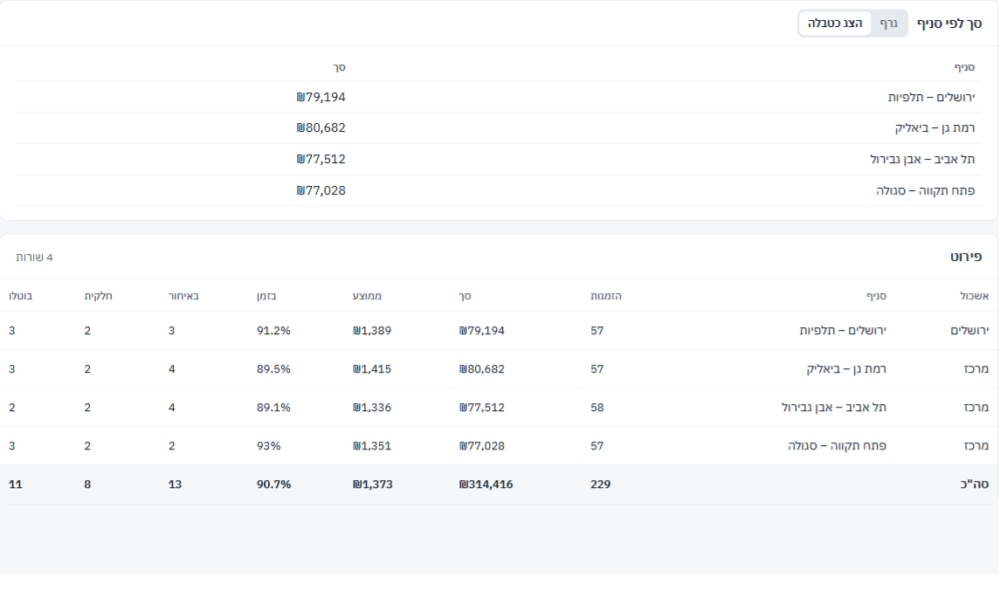
- **מה ראיתי:**
  - בלפי סניף ולפי עובד (4 שורות) כל הפסים כמעט באותו אורך (57–58 הזמנות). הגרף לא מראה שום דבר שהטבלה לא מראה טוב יותר.
  - "הצג כטבלה" מחליף את הגרף בטבלה של שתי עמודות, ממש מעל טבלת "פירוט" שמציגה את אותם ערכים ועוד.
  - הגרף לפי זמן (`BarChart.tsx`, `kind: 'time'`) קיים בקוד, אבל אף דוח לא משתמש בו. "לפי יום" בסיכום תקופה, שבו הוא היה מועיל באמת, הוא טבלה של 31 שורות.
- **תיקון:**
  - להסתיר את הגרף כשיש פחות מ-6 קטגוריות, או להציג בו מדד שאינו בטבלה (למשל אחוז בזמן לכל סניף).
  - לוותר על "הצג כטבלה" (הטבלה כבר שם), או לגרום לו לגלול לטבלה.
  - להשתמש בגרף הזמן ל"לפי יום" בסיכום תקופה.
- **פקודה:** `/impeccable distill`

**[P2] REP6 · בדוח ההקפות הכותרת נשברת, ו-10 שלא שולמו קבורות בין 183**
- 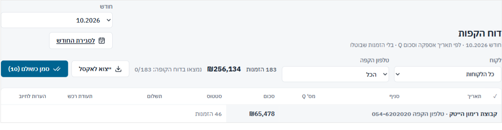
- **מה ראיתי:**
  - בורר החודש וכפתור "לסגירת החודש" נערמים זה מעל זה בצד שמאל, והכותרת "דוח הקפות" יורדת מתחתם. בשאר הדוחות הפעולות בשורה אחת ליד הכותרת.
  - מבחינת עיצוב זה הדוח היחיד שלא נראה כמו הדוחות האחרים: אין קישור חזרה ל"דוחות", המסננים בפורמט אחר, ואין טווחים.
  - 183 שורות, ומתוכן 10 שלא שולמו. אין סינון "לא שולמו", ואין סדר שמעלה אותן.
- **תיקון:**
  - אותו ראש עמוד כמו בשאר הדוחות: קישור חזרה, כותרת, ופעולות בשורה אחת.
  - סינון "מצב תשלום" (ברירת מחדל: "לא שולמו" כשיש כאלה), או מיון שמעלה אותן.
- **פקודה:** `/impeccable layout`

**[P2] REP7 · פירוט שורה: מספר אחר מהשורה, ונפתח מתחת למסך**
- 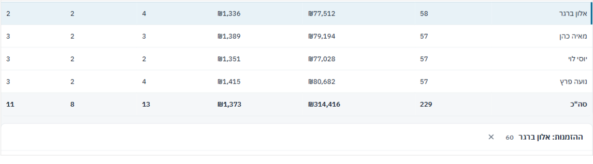
- **מה ראיתי:** בלפי עובד, השורה של אלון ברגר אומרת 58 הזמנות. הפירוט שנפתח: "ההזמנות: אלון ברגר 60" (כולל 2 שבוטלו). הפירוט נוסף אחרי כרטיס הטבלה (`ReportsPage.tsx:247`), בלי גלילה ובלי העברת פוקוס. בדוח עם 50 לקוחות הוא ייפתח הרחק מתחת למסך, ונראה כאילו הלחיצה לא עשתה כלום.
- **תיקון:** "58 · ועוד 2 שבוטלו" בכותרת הפירוט. לגלול אליו ולהעביר אליו פוקוס כשהוא נפתח, או לפתוח אותו בתוך השורה עצמה.
- **פקודה:** `/impeccable harden`

**[P3] REP8 · בטלפון חמש שורות מסננים לפני הנתון הראשון, והודעת הריק מאשימה את הטווח**
- 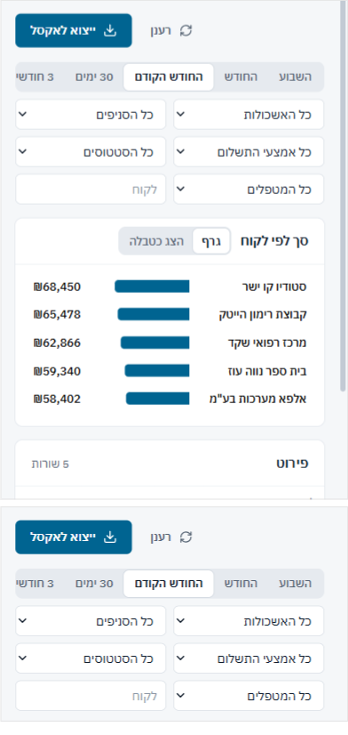
- 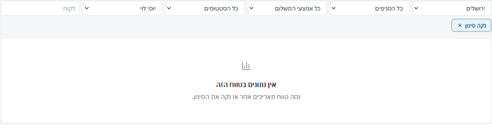
- **מה ראיתי:**
  - ב-390 הטווחים נחתכים באמצע ("3 חודשי") בלי רמז שיש עוד. אחריהם 6 מסננים בשלוש שורות, והגרף מתחיל בגובה 440px. בדוח המפורט שבעה מדדים ממלאים את כל המסך הראשון.
  - בחירת ירושלים + מטפל שלא עבד שם: "אין נתונים בטווח הזה. נסה טווח תאריכים אחר או נקה את הסינון". הטווח בסדר, הסינון הוא הסיבה. הדוח המפורט מציג גם שבעה אפסים מעל הודעת הריק.
  - במרכז הדוחות כל הדוחות מקבלים אותו אייקון, ו"סיכום תקופה" ו"דוח מפורט" נשמעים כמו אותו דבר.
- **תיקון:**
  - בטלפון: המסננים מאחורי כפתור "סינון (N)", ודהייה בקצה הטווחים.
  - הודעת ריק לפי הסיבה: "אין הזמנות לפי הסינון · נקה סינון" (כפתור), או "אין הזמנות בתקופה".
  - במרכז: משפט אחד שמבחין בין "סיכום תקופה" (להנהלה, אקסל מעוצב) ל"דוח מפורט" (לבדיקה, כל העמודות).
- **פקודה:** `/impeccable adapt`

### מה עובד
- **דפוס אחד לכל הדוחות:** מסננים בשורה אחת שנשמרים בכתובת, מדדים, טבלה עם שורת סה"כ, ייצוא שכולל את פרטי הסינון ונרשם ביומן.
- **"הצג עוד" כן:** 200 שורות, והשאר נטענות כשמגיעים לתחתית. הכפתור אומר "הסה"כ כולל את כל השורות", והאקסל תמיד מלא.
- **מספרים קריאים:** ספרות טבלאיות, `Ltr` לכל מספר, שורות שבוטלו מעומעמות בסיכום תקופה, והערה מסבירה למה הן לא נספרות.

## סגירת חודש – 23/40

| # | היוריסטיקה | ציון | עיקר |
|---|---|---|---|
| 1 | נראות מצב | 2 | שלב 3 מסומן ✓ גם כשהקובץ יצא עם 17 חוסרים ובסכום אחר |
| 2 | התאמה לעולם | 3 | שפה של הנהלת חשבונות. "העברה להנה"ח" מקוצר, ו"סופקה" בסיכומים לא ברור |
| 3 | שליטה וחופש | 3 | "בטל", פתיחה מחדש עם סיבה, ממשיכים מאותה נקודה |
| 4 | עקביות | 2 | בעיות כתומות ("בוטלה אחרי Q") מוצגות באדום כמו חוסר אמיתי. השלבים ממוספרים אבל לא מחייבים סדר |
| 5 | מניעת טעויות | 1 | ייצוא עם חוסרים, "סמן כשולם" שמתעלם מה-✓, נעילה בלחיצה אחת |
| 6 | זיהוי ולא זכירה | 3 | בכל שורה הסיבות וכפתור תיקון |
| 7 | גמישות ויעילות | 2 | 14 מתוך 17 החוסרים הם אותו "אשר שבוטלה ב-Q", ואין פעולה לכולם |
| 8 | אסתטיקה ומינימליזם | 3 | פס השלבים נקי. אריחי הסיכום נשברים |
| 9 | התאוששות משגיאות | 2 | הודעת הכישלון בייצוא טובה. אבל שום דבר לא מתריע שהייצוא ישן |
| 10 | עזרה | 2 | ההסבר בשלב 1 לא מזכיר את "בוטלה אחרי Q", שהוא רוב השורות |

### ממצאים

**[P1] CL1 · ייצוא להנה"ח נחשב "הושלם" גם כשהוא נעשה לפני התיקונים**
- 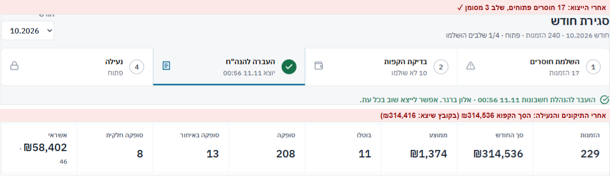
- **מה ראיתי:** ייצאתי כשבשלב 1 היו 17 חוסרים. שלב 3 קיבל ✓ ירוק ("יוצא 11.11 00:56"), והמונה אמר "1/4 שלבים הושלמו", לפני שלב 1. אחרי התיקונים החודש ננעל עם סך קפוא של ₪314,536 ו"סופקה 208". בקובץ שכבר יצא להנה"ח: ₪314,416 ו-205. שלב 3 נשאר ✓, ושלב 4 לא הזהיר.
- **בקוד:** `done[3] = !!month?.exportedAt` (`MonthClosePage.tsx:71`). הייצוא לא תלוי בשלבים 1–2, ו-`markExported` לא שומר את הסכום שיצא, ולכן אי אפשר לדעת שהקובץ ישן.
- **למה זה חשוב:** זו בדיוק התקלה שסגירת חודש אמורה למנוע. הנה"ח מקבלת קובץ שלא תואם לסיכום הקפוא, והמערכת מראה שהכל בסדר.
- **תיקון:**
  - `markExported` שומר מספר הזמנות וסך.
  - כשהסיכום החי שונה מהסיכום שיצא, שלב 3 חוזר להיות פתוח עם "יוצא לפני תיקונים – לייצא מחדש", ושלב 4 מזהיר לפני הנעילה.
  - כל עוד שלב 1 פתוח: הכפתור "ייצוא טיוטה" לא מסמן "הועבר", ושם הקובץ כולל "טיוטה".
  - חלופה: הייצוא נעשה רק מהסיכום הקפוא, אחרי הנעילה (שאלה 2).
- **פקודה:** `/impeccable harden`

**[P1] CL2 · "סמן כשולם" מתעלם מהבדיקה מול דוח הקופה**
- 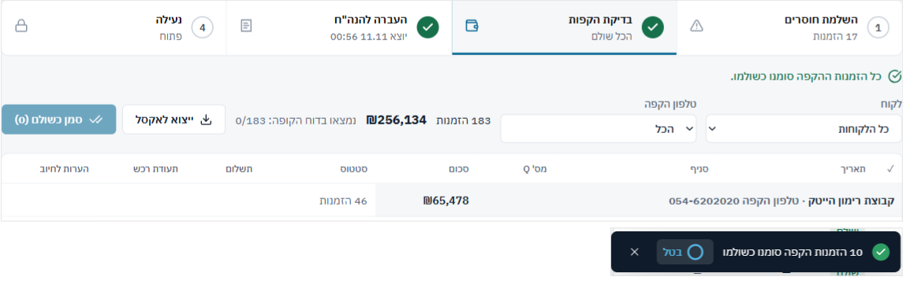
- **מה ראיתי:** ההסבר בשלב 2: "מסמנים ✓ ליד כל שורה שנמצאה… ובסוף 'סמן כשולם'". לחצתי "סמן כשולם (10)" כש"נמצאו בדוח הקופה: 0/183". כל ה-10 סומנו כשולמו, בלי אישור, ושלב 2 עבר ל"הכל שולם" עם ✓.
- **בקוד:** הכפתור מסמן את כל השורות המסוננות שלא שולמו (`CreditCheck.tsx:38`), בלי קשר ל-`checked`. השלב "הושלם" כשאין הקפות שלא שולמו (`MonthClosePage.tsx:71`), גם בלי שום ✓.
- **למה זה חשוב:** ה-✓ הוא כל הבדיקה. אם הוא לא קובע כלום, אחמ"ש ידלג עליו, והזמנות שלא הופיעו בדוח הקופה יסומנו כשולמו.
- **תיקון:**
  - הכפתור פועל רק על השורות שסומנו ✓ ועדיין לא שולמו: "סמן כשולם (N שנמצאו)".
  - מי שרוצה לסמן גם שורות שלא נמצאו מקבל אישור מפורש: "3 מתוך 10 לא נמצאו בדוח הקופה. לסמן בכל זאת?"
  - השלב הושלם רק כשכל השורות סומנו ✓ ושולמו.
- **פקודה:** `/impeccable harden`

**[P2] CL3 · נעילה בלחיצה אחת, ו"בטל" ישן נשאר אחרי הנעילה**
- 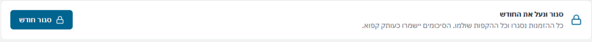
- **מה ראיתי:** "סגור חודש" נועל מיד, בלי אישור ובלי סיכום של מה ננעל. אחרי הנעילה ההודעה "10 הזמנות הקפה סומנו כשולמו · בטל" עדיין על המסך ([צילום](shots/close-1440-step4-locked-full.png)). לחיצה עליה תנסה לשנות מצב תשלום בחודש נעול.
- **למה זה חשוב:** נעילה היא פעולה שרק מנהל יכול לבטל, עם סיבה. היא צריכה רגע של "בטוח?" עם המספרים. "בטל" שעובד על חודש נעול יפתח תיבת "סיבה לתיקון לאחר סגירה" שאף אחד לא ציפה לה.
- **תיקון:** תיבת אישור קצרה: "נעילת 10.2026 · 229 הזמנות · ₪314,536 · יוצא להנה"ח 11.11", וכפתור "נעל". בזמן הנעילה לסגור הודעות "בטל" של אותו חודש.
- **פקודה:** `/impeccable harden`

**[P2] CL4 · כל החוסרים אדומים, ורובם הם אותה פעולה**
- 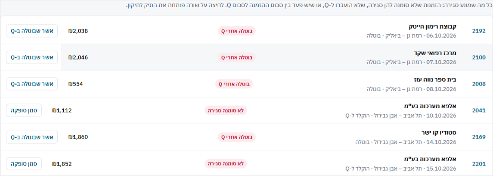
- **מה ראיתי:** 17 שורות. 14 מהן "בוטלה אחרי Q" עם "אשר שבוטלה ב-Q", ו-3 "לא סומנה סגירה". כולן בתג אדום. ההסבר למעלה מזכיר "סגירה, Q ופער" אבל לא ביטולים.
- **בקוד:** התג תמיד אדום (`MonthClosePage.css:33`), גם כשחומרת הבעיה כתומה (`health.ts:74`, כלל 10). הכפתור מטפל רק ב-`blockers[0]` (`MonthClosePage.tsx:157`).
- **למה זה חשוב:** בחודש אמיתי עם 40 ביטולים זה 40 לחיצות זהות, וההזמנה שבאמת לא נסגרה טובעת ביניהן.
- **תיקון:**
  - קיבוץ לפי סוג החוסר, עם ספירה: "לא נסגרו 3 · בוטלו אחרי Q 14".
  - פעולה לקבוצה: "אשר שבוטלו ב-Q (14)", עם אישור.
  - צבע התג לפי חומרת הבעיה. להוסיף לטקסט ההסבר את "ביטולים שלא אושרו ב-Q".
- **פקודה:** `/impeccable distill`

**[P2] CL5 · בטלפון שורות החוסרים נחתכות**
- 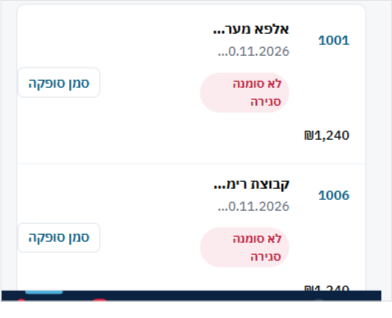
- **מה ראיתי:** ב-390 שם הלקוח נחתך ("אלפא מער…"), והתאריך נחתך מההתחלה ("…0.11.2026"), כך שאי אפשר לדעת איזה יום. הכפתור צף באמצע השורה, והסכום יורד לשורה נפרדת.
- **תיקון:** בטלפון סדר קבוע: מספר ולקוח (השם נשבר לשורה שנייה ולא נחתך), תאריך וסניף, תגים, ואז סכום וכפתור בשורה אחת. גובה כפתור 44px.
- **פקודה:** `/impeccable adapt`

**[P3] CL6 · אריחי הסיכום נשברים בשורה השנייה**
- 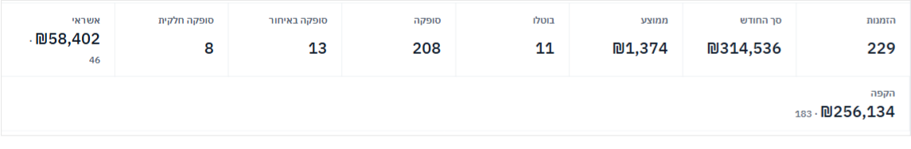
- **מה ראיתי:**
  - בשלב 4 יש שמונה אריחים. "הקפה" יורד לבד לשורה שנייה ברוחב מלא.
  - ב"אשראי" נקודה מיותמת: "· ₪58,402" ו-"46" בשורה מתחת.
  - "סופקה 208" כאן, "סופקו בזמן 90.7%" בדוח המפורט ו-"94%" בסיכום תקופה (ראו REP1).
  - הקישור "דוח ההקפות של החודש" בתחתית צבוע בסגול של קישור שנפתח.
  - בורר החודש לא מראה אילו חודשים נעולים.
- **תיקון:** רשת של 4 אריחים בשורה. אמצעי תשלום בשורה נפרדת בפורמט "₪58,402 · 46 הזמנות". אותו שם מדד ואותה הגדרה כמו בדוחות. סימן נעילה ליד חודש נעול בבורר.
- **פקודה:** `/impeccable polish`

### מה עובד
- **התהליך נגזר מהנתונים:** כל שלב מחושב מההזמנות החיות, כך שאפשר לעצור באמצע ומשתמש אחר ממשיך מאותה נקודה. מונה "N/4 שלבים הושלמו" בשורת המשנה.
- **מודל ביקורת חזק:** סיכום קפוא ברגע הנעילה, רשימת "תיקונים לאחר סגירה", הודעה כשהסך הנוכחי שונה מהסך שננעל, ופתיחה מחדש רק עם סיבה.
- **"כדי לנעול צריך:"** עם קישורים ישירים לשלב שחסר. בשלב 1 יש כפתור תיקון בכל שורה, אותו `FixButton` כמו במסך החריגים.

## אדומים לפי פרסונה
- **מנהל שמכין דוח להנהלה:**
  - 94% בסיכום תקופה מול 90.7% בדוח הסניפים.
  - שלושה סכומים בדוח המפורט.
  - "החודש" בשני דוחות הוא שני טווחים שונים.
- **אחמ"ש שסוגר חודש:**
  - ייצוא לפני התיקונים, ו-✓ ירוק שנשאר.
  - "סמן כשולם" בלי ✓ אחד.
  - 14 לחיצות זהות על "אשר שבוטלה ב-Q".
  - בשלב 4 רואה רק "נעילת חודש – מנהל מערכת", בלי דרך להודיע למנהל שהחודש מוכן.
- **משתמש מקלדת וקורא מסך:**
  - שורות הדוח ממוקדות ונפתחות ב-Enter, אבל אין להן role, ורווח לא עובד.
  - מספרי ביטולים וחלקיות מסומנים רק בצבע אדום.
  - שלב שהושלם מסומן ב-✓ בלבד, בלי הטקסט "הושלם".
  - ה-placeholder של "לקוח" בניגודיות 3.0:1.

## שאלות
1. האם הזמנה שסופקה חלקית אבל בזמן נחשבת "סופקה בזמן"? צריך החלטה אחת, ואז כל הדוחות וסגירת החודש מציגים אותו מספר.
2. האם הייצוא להנה"ח צריך להיות שלב נפרד, או חלק מהנעילה עצמה? כלומר: נועלים, והקובץ נבנה מהסיכום הקפוא.
3. האם ה-✓ "נמצא בדוח הקופה" הוא בדיקה שמחייבת משהו, או רק סימון לעצמי? אם הוא לא קובע כלום, אולי עדיף לוותר עליו.

---

# 2026-11-10 · "סיכום לתפעול", "חריגים ומשימות" · ענף design-polish

- **שיטה:** dual-agent (A: סקירת עיצוב של הקוד והצילומים · B: סורק `impeccable detect` ושכבת סימון בדפדפן). שילבתי את התוצאות ואימתתי בדפדפן ובקוד.
- **מצב:** מוצר (Operate). **בסיס:** PRODUCT.md, DESIGN.md. **סקילים:** impeccable critique + frontend-design.
- **סביבה:** harness מקומי (פורט 5174, Firebase מזויף, Playwright MCP, 1440 ו-390).
  - "סמן שנשלח", שינויים אחרי השליחה (שינוי שעה, אישור הזמנה, ביטול הזמנה), הורדת PDF ותיקונים מהשורה בוצעו על נתוני הדמה. חלק מהשינויים נכתבו ישירות לחנות המזויפת, כדי לדמות נציג אחר שעורך הזמנה.
  - לרשימה ריקה מחקתי את כל ההזמנות בחנות המזויפת. רענון עם `?q=` חדש מחזיר את נתוני הדמה.
  - לא שיניתי קוד.

| מסך | ציון | דירוג | P0 | P1 | P2 | P3 |
|---|---|---|---|---|---|---|
| **סיכום לתפעול** | **25/40** | סביר-טוב (63%) | 0 | 2 | 3 | 1 |
| **חריגים ומשימות** | **24/40** | סביר (60%) | 0 | 1 | 3 | 1 |

**החוט המשותף לשני המסכים:**
- **הדף שנשלח לתפעול** הוא אחד הדברים המעוצבים ביותר במערכת: קנבס קבוע ברוחב A4, סניף ככותרת פרק, שעה בולטת ותג כמות פיצות. ה-PDF נקי, וחותך עמודים בין הזמנות.
- **"חריגים"** נשען על מנוע כללים אחד (`health.ts`), עם כפתור תיקון בכל שורה ופופאובר מותאם לכל סוג. זה עיצוב מוצר טוב.
- **החולשה:** **מעקב שלא מחזיק כשמשנים את נקודת המבט.**
  - "נשלח" נשמר רק לאותו טווח תאריכים בדיוק.
  - "בטל" מחזיר רק חצי מהפעולה.
  - קבוצת החומרה "חסר" לא מכילה פרטים חסרים.
  - סינון שהתרוקן לא משאיר דרך לבטל אותו.

## מה נבדק

| מסך | מצב | צילום |
|---|---|---|
| סיכום – מחר | 2 אשכולות, אזהרה אדומה על 2 הזמנות שלא אושרו | [למעלה](shots/ops-1440-tomorrow.png) · [מלא](shots/ops-1440-tomorrow-full.png) |
| סמן שנשלח | פס "נשלח", שתי הודעות | [נשלח](shots/ops-1440-marked.png) · [הודעות](shots/ops-1440-marked-toasts.png) |
| שינויים מאז השליחה | שעה שונתה ("עודכן"), הזמנה אושרה ("חדש"), הזמנה בוטלה ("ירדו מהסיכום") | [למעלה](shots/ops-1440-dirty.png) · [מלא](shots/ops-1440-dirty-full.png) |
| סופ"ש / טווח / ריק | שישי–שבת, 10–16.11, טווח בלי הזמנות | [סופ"ש](shots/ops-1440-weekend.png) · [טווח](shots/ops-1440-range.png) · [טווח מלא](shots/ops-1440-range-full.png) · [ריק](shots/ops-1440-empty.png) |
| מה שנשלח לקבוצה | PDF לאשכול, PDF לכל האשכולות, צילום של הדף | [PDF ירושלים](shots/ops-sample-jerusalem.pdf) · [PDF הכל](shots/ops-sample-all.pdf) · [צילום הדף](shots/ops-sheet-jerusalem.png) |
| סיכום בטלפון | 390 | [למעלה](shots/ops-390-top.png) · [מלא](shots/ops-390-full.png) |
| חריגים – רשימה | 26 שורות בשלוש קבוצות, משימות מעקב | [למעלה](shots/exc-1440-list.png) · [מלא](shots/exc-1440-full.png) |
| כפתורי תיקון | "סמן עודכן" (פופאובר עם טלפון הסניף), "בדוק פער" (חיוב מול Q), "הלקוח אישר" (ישיר עם "בטל") | [עודכן](shots/exc-1440-fix-branch.png) · [פער](shots/exc-1440-fix-gap.png) · [אישר](shots/exc-1440-fix-approved.png) |
| סינון | צ'יפ "פער מול Q", אחרי תיקון השורה האחרונה, "שלי" | [צ'יפ](shots/exc-1440-chip.png) · [התרוקן](shots/exc-1440-chip-empty.png) · [שלי](shots/exc-1440-mine.png) |
| משימה ורשימה ריקה | סימון משימה עם "בטל", אין חריגים ואין משימות | [משימה](shots/exc-1440-task-done.png) · [ריק](shots/exc-1440-empty.png) |
| חריגים בטלפון | 390 | [למעלה](shots/exc-390-top.png) · [מלא](shots/exc-390-full.png) |

**מה לא נבדק:**
- שליחה אמיתית לקבוצת וואטסאפ, ואיך ה-PDF נראה שם בטלפון. בדקתי רק את הקובץ עצמו.
- אשכול שלא נכנס לעמוד אחד (חיתוך לכמה עמודים ב-`opsPdf.ts`). בנתוני הדמה כל אשכול נכנס לעמוד.
- "ללא אשכול".
- פופאובר "הועברה ל-Q", "סגירת הזמנה" ו"מצב תשלום". נבדקו רק "עודכן בתפעול" ו"פער מול Q".

**סורק:**
- **CLI:** אין דפוסים אסורים (exit 0). 13 ממצאים מייעצים.
  - **ops.css:** 12 ממצאים, כולם בדף שנשלח (`.os`): גדלים 11/17/18px, צבעים `#1b2733`, `#7a4a00`, `#1d6b3a`, ופינה 999px לתג. זה מסמך עם סולם הדפסה משלו, כמו דף ההצעה, ולכן חריגה סבירה, שכדאי לתעד ב-DESIGN.md.
  - **ExceptionsPage.css:20:** פינה של 3px לפס החומרה.
- **בדפדפן:**
  - **סיכום:** טקסט 11px בתוך הדף שנשלח (תוויות הנתונים והשורה התחתונה). מקובל במסמך.
  - **חריגים:** עמודה אחת ארוכה פי 3.7 מהשנייה (1850px מול 496px). זה מתחבר ל-EX5.
  - תג הפעמון ב-10px הוא במעטפת האפליקציה, לא במסכים האלה.
- **מדידה ב-390:** אין גלישה אופקית בשני המסכים.
  - הדף שנשלח מוקטן פי 0.32, ולכן הטקסט יוצא בגודל של 3.5–4px.
  - כפתורי התיקון בגובה 30px, ותיבת הסימון של משימה בגובה 28px.

## סיכום לתפעול – 25/40

| # | היוריסטיקה | ציון | עיקר |
|---|---|---|---|
| 1 | נראות מצב | 3 | הפס עוד לא נשלח / נשלח / יש שינויים ברור. אבל "סמן שנשלח" מסמן גם "עודכן בתפעול" בהזמנות, ורק הודעה שנייה מספרת על זה |
| 2 | התאמה לעולם | 3 | שפת הדף נכונה לסניף. אין בה שום מידע על תשלום |
| 3 | שליטה וחופש | 2 | "בטל" מחזיר את "עודכן בתפעול" אבל לא את סימון השליחה |
| 4 | עקביות | 2 | שני תחבירים לפריטים באותו דף, שתי הודעות על לחיצה אחת, "נשלח" שונה לפי הטווח |
| 5 | מניעת טעויות | 2 | אפשר לסמן "נשלח" בלי להוריד PDF. סיכום לטווח לא יודע על שליחה קודמת |
| 6 | זיהוי ולא זכירה | 3 | ההזמנות שלא אושרו מוצגות ככפתורים שפותחים את ההזמנה |
| 7 | גמישות ויעילות | 2 | הורדה, וואטסאפ, צירוף, חזרה ו"סמן שנשלח": חמישה צעדים בלי קיצור |
| 8 | אסתטיקה ומינימליזם | 3 | הדף צפוף ונקי. "הערות לסניף" ריקה כמעט תמיד ותופסת 150px |
| 9 | התאוששות משגיאות | 2 | "הורדת ה-PDF נכשלה. נסו שוב." בלי סיבה |
| 10 | עזרה | 3 | שורת המשנה ושורת הטלפון מספיקות |

### ממצאים

**[P1] OPS1 · "נשלח" נשמר רק לאותו טווח בדיוק**
- 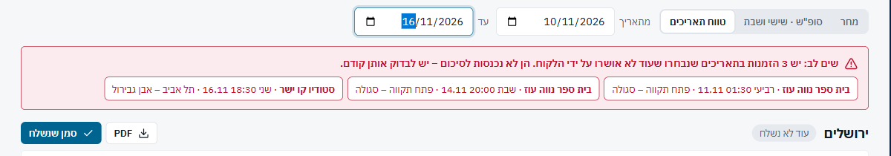
- **מה ראיתי:** סימנתי שהסיכום של ירושלים ל-11.11 נשלח. בטווח 10–16.11 אותו אשכול מופיע כ"עוד לא נשלח", בלי תגי "חדש" או "עודכן".
- **בקוד:** השליחות נטענות לפי `from`, ומסוננות לפי `s.to === to` (`OpsSummaryPage.tsx:37`).
- **למה זה חשוב:** ביום חמישי שולחים סופ"ש (שישי–שבת). ביום שישי בבוקר מי שפותח "מחר" (שבת) רואה "עוד לא נשלח" על הזמנות שכבר נשלחו. השינויים שקרו מאז לא מסומנים. התוצאה: שליחה כפולה לקבוצה, או שינוי שלא מגיע לסניף.
- **תיקון:** לחשב את מצב השליחה לכל הזמנה ולא לכל טווח. כל הזמנה בדף מקבלת את השליחה האחרונה שכללה אותה, והפס מסכם: "נשלח · 3 מתוך 4", או "חדש מאז: 1".
- **פקודה:** `/impeccable harden`

**[P1] OPS2 · "סמן שנשלח" כותב לשני מקומות, ו"בטל" מחזיר רק אחד**
- 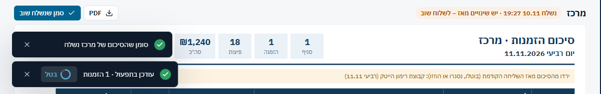
- **מה ראיתי:** לחיצה אחת הקפיצה שתי הודעות: "סומן שהסיכום של מרכז נשלח" ו"עודכן בתפעול · 1 הזמנות [בטל]".
- **בקוד:** "בטל" מחזיר את `branchApproval`, אבל רשומת `opsSends` נשארת (`OpsSummaryPage.tsx:58-66`, `opsSummary.ts:69`). אחרי "בטל" הפס עדיין אומר "נשלח 19:27", וההזמנות חוזרות ל"לא עודכן בתפעול" במסך החריגים.
- **למה זה חשוב:** הכלל ב-CLAUDE.md הוא ש"סמן שנשלח" **הוא** העדכון בתפעול. אחרי "בטל" חלקי, שני המסכים סותרים זה את זה. בנוסף, "1 הזמנות" שגוי.
- **תיקון:**
  - הודעה אחת: "סומן שנשלח · מרכז · עודכן בתפעול ב-1 הזמנה [בטל]".
  - "בטל" מחזיר את שני הדברים. `opsSends` בלי מחיקה, אז לשמור את השליחה הקודמת ולשחזר אותה, או לכתוב `revoked: true`.
- **פקודה:** `/impeccable harden`

**[P2] OPS3 · "עודכן" לא אומר מה השתנה, ו"ירדו מהסיכום" לא אומר למה**
- 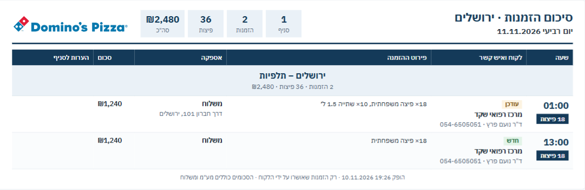
- **מה ראיתי:**
  - בהזמנה של מרכז רפואי שקד השעה שונתה מ-00:30 ל-01:00. הדף שנשלח שוב מציג "עודכן" בלבד.
  - הזמנה שבוטלה מופיעה תחת "ירדו מהסיכום (בוטלו, נסגרו או הוזזו)", כלומר שלוש אפשרויות שונות מאוד לסניף.
- **למה זה חשוב:** הסניף צריך להשוות לבד מול ה-PDF של אתמול כדי להבין מה השתנה.
- **תיקון:**
  - ב"עודכן": השדה שהשתנה ("שעה 00:30←01:00", "כתובת", "פריטים"). `orderSig` כבר שומר חתימה לכל הזמנה, אז אפשר לשמור את השדות עצמם.
  - ב"ירדו": "בוטלה" או "הועברה ל-13.11".
- **פקודה:** `/impeccable clarify`

**[P2] OPS4 · בטלפון הדף שנשלח מוקטן פי 0.32**
- 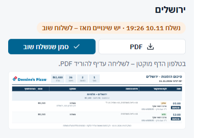
- **מה ראיתי:** הטקסט יוצא בגודל של 3.5–4px. השורה "בטלפון הדף מוקטן – לשליחה עדיף להוריד PDF" מודה בזה, אבל שורת המשנה עדיין מציעה "לצילום מסך".
- **למה זה חשוב:** אחמ"ש בטלפון לא יכול לבדוק את הדף לפני "סמן שנשלח". צילום מסך מהטלפון שולח לקבוצה תמונה לא קריאה. זה אותו דפוס כמו Q1 בהצעות מחיר.
- **תיקון:**
  - בטלפון: הפעולות קודם, והדף מוסתר מאחורי "תצוגה" שנפתחת ברוחב מלא עם גלילה אופקית.
  - "שתף" עם קובץ ה-PDF דרך `navigator.share` (עובד ב-Chrome באנדרואיד ובלי עלות), במקום הורדה ואז צירוף.
- **פקודה:** `/impeccable adapt`

**[P2] OPS5 · אין בדף שום מידע על תשלום**
- 
- **מה ראיתי:** עמודת "סכום" מציגה ₪1,240 בלי לומר אם לגבות. `o.method` ו-`o.payment` לא מוצגים (`OpsSummaryPage.tsx:189-205`).
- **למה זה חשוב:** הזמנה בהקפה, באשראי שכבר חויב או במזומן במקום דורשות התנהגות אחרת מהשליח. סניף עלול לגבות מלקוח הקפה.
- **תיקון:** שורה קטנה מתחת לסכום: "הקפה – לא לגבות", "שולם", "לגבייה במקום". צריך לאשר את הנוסח מול התפעול (שאלה 2).
- **פקודה:** `/impeccable clarify`

**[P3] OPS6 · פריטים בשני תחבירים באותו דף, ודקדוק**
- 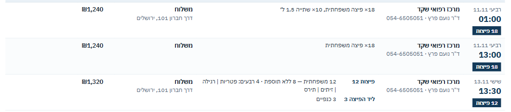
- **מה ראיתי:**
  - באותו דף מופיע "18× פיצה משפחתית, 10× שתייה 1.5 ל׳" (הזמנה בלי קטגוריות, `Items()` בשורות 208-210) ליד "פיצות 12 · 12 משפחתית — 8 ללא תוספת…". ה-"×" בהתחלה נקרא הפוך ב-RTL.
  - באזהרה האדומה: "יש הזמנה אחת … הן לא נכנסות".
  - בהודעה: "1 הזמנות".
- **תיקון:**
  - להעביר גם הזמנות ישנות דרך `groupItems`, או לאחד ל"פיצה משפחתית ×18".
  - יחיד ורבים באזהרה ובהודעה.
- **פקודה:** `/impeccable clarify`

### מה עובד
- **מעקב השינויים מאז השליחה:** חתימה לכל הזמנה, תגי "חדש" ו"עודכן", ופס "ירדו מהסיכום". שליחה חוזרת מספרת לסניף מה השתנה בלי הודעה נפרדת.
- **הדף נבנה לקורא שלו:** סניף ככותרת פרק במרכז, שעה ב-17px/800, תג כמות פיצות, "רק הזמנות שאושרו" בשורה התחתונה, ואין מספר הזמנה. ה-PDF חותך בין הזמנות ולא באמצע שורה.
- **ברירות מחדל חכמות:** ביום חמישי המסך נפתח על "סופ"ש". ההזמנות שלא אושרו מופיעות באדום עם קישור ישיר לכל אחת.

## חריגים ומשימות – 24/40

| # | היוריסטיקה | ציון | עיקר |
|---|---|---|---|
| 1 | נראות מצב | 3 | שורה שתוקנה יוצאת עם "בטל" |
| 2 | התאמה לעולם | 2 | הקבוצה "חסר" מכילה רק "לעדכן בתפעול"; פרטים חסרים נמצאים תחת "חריגות" |
| 3 | שליטה וחופש | 2 | סינון שהתרוקן לא משאיר דרך החוצה |
| 4 | עקביות | 2 | הצ'יפים מתמיינים מחדש אחרי כל תיקון. "לעדכן בתפעול" ו"לא עודכן בתפעול" זה לצד זה |
| 5 | מניעת טעויות | 3 | פופאובר לתיקונים רגישים. "הלקוח אישר" ישיר, עם "בטל" |
| 6 | זיהוי ולא זכירה | 3 | בכל שורה: לקוח, מועד, סניף ומספר הזמנה |
| 7 | גמישות ויעילות | 2 | אין ניווט מקלדת בין שורות. "שלי" לא נשמר בכתובת, בניגוד לסינון הסוג |
| 8 | אסתטיקה ומינימליזם | 2 | שורה לכל בעיה: הזמנה 1004 תופסת 3 שורות. 19 שורות אדומות |
| 9 | התאוששות משגיאות | 2 | סימון משימה שנכשל משאיר את התיבה מסומנת |
| 10 | עזרה | 3 | שורת המשנה והטקסט במשימות ריקות טובים |

### ממצאים

**[P1] EX1 · קבוצות החומרה לא תואמות את מה שבתוכן**
- 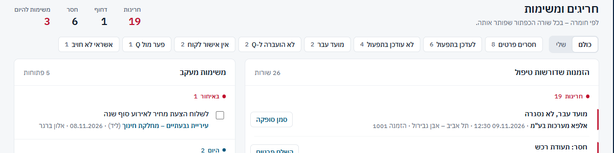
- **מה ראיתי:**
  - בכותרת: "חריגות 19 · דחוף 1 · חסר 6".
  - בתוך "חריגות" יש 9 שורות "חסר: תעודת רכש" ו"חסר: כתובת", כולל הזמנות ל-13.11 ול-14.11.
  - "חסר 6" הן כולן "לעדכן בתפעול" להזמנות רחוקות, שאין בהן שום פרט חסר.
- **בקוד:** כלל 8 תמיד `red` (`health.ts:104`), עם `alert: soon || diff < 0`. המסך מתעלם מ-`alert`. הקבוצה הצהובה ניזונה רק מכלל 0 (`health.ts:107`, `ExceptionsPage.tsx:20`).
- **למה זה חשוב:**
  - מי שמחפש פרטים חסרים מסתכל בקבוצה הלא נכונה.
  - "תעודת רכש לשבת" נראית בדיוק כמו "מועד עבר, לא נסגרה" מאתמול. 19 שורות אדומות, ושום דבר לא בולט.
  - ההחלטה "פרטים חסרים מסומנים באדום" נשמרת. הבעיה היא בשם הקבוצה ובערבוב של עכשיו מול בהמשך.
- **תיקון:**
  - במסך הזה, כלל 8 עם `alert: false` יורד לקבוצה התחתונה. הסימון האדום בשורה נשאר.
  - לשנות את שמות הקבוצות לפי זמן: "עכשיו" / "היום" / "בהמשך". או לשנות את "חסר" ל"להשלים בהמשך".
- **פקודה:** `/impeccable clarify`

**[P2] EX2 · סינון שהתרוקן נעלם, והמסך נשאר בלי דרך החוצה**
- 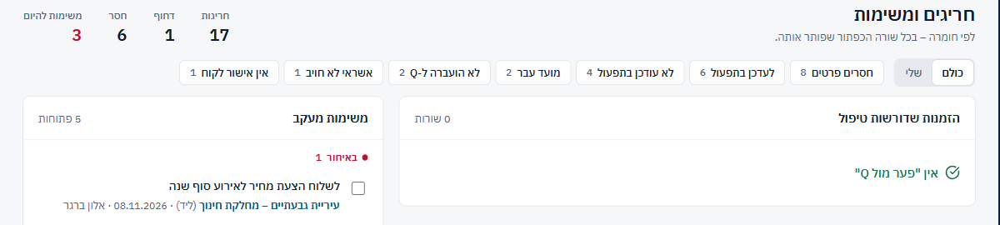
- **מה ראיתי:** סיננתי "פער מול Q" ותיקנתי את השורה היחידה. הצ'יפ נעלם (הצ'יפים נבנים רק מסוגים שיש להם שורות, `ExceptionsPage.tsx:38-42`). נשאר 'אין "פער מול Q"', הכתובת עדיין `?rule=2`, ואין כפתור לבטל את הסינון.
- **תיקון:**
  - הצ'יפ הפעיל נשאר תמיד, גם עם 0.
  - ברשימה הריקה: "הצג הכל".
  - עוד יותר טוב: כשהסינון מתרוקן אחרי תיקון, לבטל אותו אוטומטית עם "כל ה'פער מול Q' טופלו".
- **פקודה:** `/impeccable harden`

**[P2] EX3 · שורה לכל בעיה, לא לכל הזמנה**
- 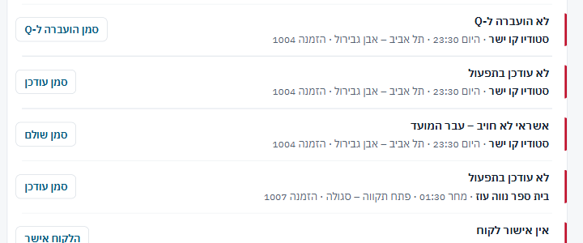
- **מה ראיתי:** 26 שורות על כ-14 הזמנות. סטודיו קו ישר (1004) מופיע 3 פעמים ברצף: "לא הועברה ל-Q", "לא עודכן בתפעול", "אשראי לא חויב". מרכז רפואי שקד (1010) מופיע 4 פעמים.
- **למה זה חשוב:** הנציג מרכיב בראש "מה חסר ב-1004", והרשימה נראית ארוכה פי 2 ממה שהיא.
- **תיקון:** שורה אחת להזמנה. הכפתור של הבעיה החמורה ביותר נשאר בשורה, ושאר הבעיות מופיעות כתגים קטנים עם תיקון משלהם. הקבוצה נקבעת לפי הבעיה החמורה.
- **פקודה:** `/impeccable distill`

**[P2] EX4 · צ'יפים שקופצים ממקומם, ושניים שנראים אותו דבר**
- 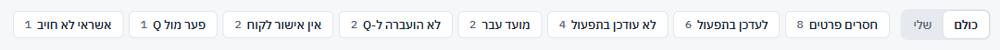
- **מה ראיתי:**
  - 8 צ'יפים ועוד "כולם / שלי", כלומר 10 אפשרויות באותה שורה.
  - הם ממוינים לפי כמות, ולכן זזים אחרי כל תיקון (השוו [לפני](shots/exc-1440-list.png) ו[אחרי](shots/exc-1440-chip-empty.png)).
  - "לעדכן בתפעול 6" ו"לא עודכן בתפעול 4" עומדים זה לצד זה, וההבדל ביניהם הוא רק המרחק בזמן.
  - הצ'יפ "חסרים פרטים" לא תואם לשורה "חסר: תעודת רכש".
- **תיקון:**
  - סדר קבוע לפי שלבי ההזמנה: אישור לקוח, תפעול, Q, תשלום, סגירה, פרטים.
  - לאחד את כלל 0 ואת כלל 4 לצ'יפ אחד, "עדכון בתפעול".
- **פקודה:** `/impeccable layout`

**[P3] EX5 · בטלפון המשימות קבורות בתחתית**
- 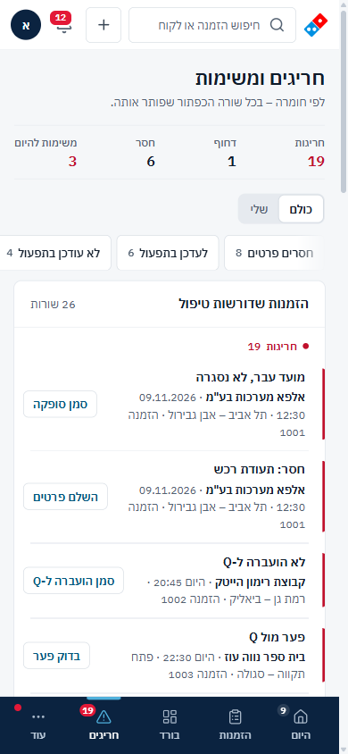
- **מה ראיתי:**
  - ב-390 כרטיס המשימות מתחיל בגובה 2,784px, מתחת ל-26 שורות. משימה באיחור לא תיראה.
  - כפתורי התיקון בגובה 30px.
  - הצ'יפים נחתכים באמצע, בלי שום רמז שיש עוד.
  - מספר ההזמנה נשבר לשורה שלישית.
- **תיקון:**
  - בטלפון: לשונית "חריגים / משימות" במקום שתי עמודות אחת מתחת לשנייה. לחלופין, להעלות את המשימות שבאיחור לראש הרשימה.
  - כפתורים בגובה 44px.
  - דהייה בקצה שורת הצ'יפים.
- **פקודה:** `/impeccable adapt`

### מה עובד
- **תיקון מתוך השורה:** פופאובר מותאם לכל סוג. ב"עודכן בתפעול" מופיע טלפון הסניף. ב"פער מול Q" מוצגים חיוב, Q ופער, עם שתי יציאות: לעדכן את הסכום, או לאשר עם סיבה. נפתר בלי לפתוח את ההזמנה.
- **מנוע אחד** מזין את "היום", הפעמון והמסך הזה, והתוויות והפעולות אחידות מהמקור.
- **תנועה פונקציונלית:** שורה שתוקנה יוצאת, עם כבוד ל-reduced motion. הרשימה הריקה ("אין חריגים. הכל מטופל") רגועה וברורה.

## אדומים לפי פרסונה
- **נציג תחת לחץ (דסקטופ):**
  - 19 שורות אדומות, בלי לדעת מה בוער בחצי השעה הקרובה.
  - שתי הודעות על "סמן שנשלח", בלי לדעת מה "בטל" מבטל.
  - יכול לסמן "נשלח" בלי לשלוח.
- **אחמ"ש בטלפון:**
  - הדף לתפעול הוא תמונה ממוזערת.
  - משימות באיחור נמצאות 3 מסכים למטה.
  - ביום שישי "מחר" אומר "עוד לא נשלח" על מה שנשלח בחמישי.
- **קורא בסניף (ה-PDF):**
  - "עודכן" בלי מה.
  - "ירדו" בלי למה.
  - אין מידע על גבייה.
  - "הערות לסניף" היא העמודה האחרונה בסדר הקריאה.

## שאלות
1. אם "שתף" באפליקציה היה שולח את ה-PDF, האם "סמן שנשלח" צריך להיות לחיצה נפרדת? השליחה יכולה להירשם ברגע השיתוף.
2. מה הסניף צריך לדעת על תשלום: "לגבות / לא לגבות" מספיק, או שצריך את אמצעי התשלום?
3. האם "חריגים" צריך לסדר לפי זמן עד ההשפעה ("נשארו 40 דקות") במקום לפי סוג הכלל?

---

# 2026-11-10 · "הצעות מחיר", "מחירונים", "סניפים ואשכולות" · ענף design-polish

- **שיטה:** dual-agent (A: סקירת עיצוב של הקוד והצילומים · B: סורק `impeccable detect` ושכבת סימון בדפדפן). שילבתי את התוצאות ואימתתי בדפדפן ובקוד.
- **מצב:** מוצר (Operate). **בסיס:** PRODUCT.md, DESIGN.md. **סקילים:** impeccable critique + frontend-design.
- **סביבה:** harness מקומי (פורט 5174, Firebase מזויף, Playwright MCP, 1440 ו-390).
  - הפיכת הצעה להזמנה, הורדת PDF, הדבקה מאקסל, הוספת מדרגת משלוח, וסימון סניף ואשכול כלא פעילים בוצעו דרך הממשק על נתוני הדמה. רענון הדף מחזיר את נתוני הדמה.
  - בתחילת העבודה הופיע מסך הכניסה, בגלל הניתוק אחרי 60 דקות בלי פעילות. מחקתי את דגל היציאה של הסביבה המזויפת (`sessionStorage.fakeOut`). לא הוקלדו פרטי כניסה.
  - לא שיניתי קוד.

| מסך | ציון | דירוג | P0 | P1 | P2 | P3 |
|---|---|---|---|---|---|---|
| **הצעות מחיר** | **26/40** | סביר-טוב (65%) | 0 | 3 | 3 | 2 |
| **מחירונים** | **24/40** | סביר (60%) | 0 | 2 | 2 | 1 |
| **סניפים ואשכולות** | **28/40** | טוב (70%) | 0 | 1 | 1 | 2 |

**החוט המשותף לשלושת המסכים:**
- המראה עקבי עם שאר המערכת, ושום דבר לא נראה גנרי.
- החולשה היא **מסך שאומר דבר אחד בזמן שהנתונים אומרים דבר אחר**. שלוש דוגמאות:
  - **מחירונים:** "נשמר ✓" על שורה עם מחיר לא תקין שנשמרה בלי מחיר.
  - **אשכולות:** אשכול "לא פעיל" שהסניפים שלו עדיין זמינים בבחירה.
  - **הפיכת הצעה להזמנה:** פיצה "עם תוספת" שנשמרת בלי תוספת, בלי שום סימון.
- זה בדיוק מה שהעיקרון "הנתונים מכתיבים את הסטטוס" נועד למנוע.

## מה נבדק

| מסך | מצב | צילום |
|---|---|---|
| הצעות – רשימה | ממתינות (עם תזכורת), הכל, טיוטות, אושרו, נדחו (ריק), חיפוש ריק | [ממתינות](shots/quotes-1440-list.png) · [הכל](shots/quotes-1440-all.png) · [טיוטות](shots/quotes-1440-drafts.png) · [אושרו](shots/quotes-1440-approved.png) · [ריק](shots/quotes-1440-closed-empty.png) · [חיפוש](shots/quotes-1440-search-empty.png) · [390](shots/quotes-390-list.png) |
| הצעה ששלחנו (1001) | מעקב, תזכורת "אין עדכון", יומן, עורך ותצוגה | [למעלה](shots/quote-1440-1001-top.png) · [מלא](shots/quote-1440-1001-full.png) |
| הצעה מאושרת (1003) | נעולה ← "הפוך להזמנה" ← הזמנה 1023 | [נעולה](shots/quote-1440-1003-approved.png) · [דיאלוג](shots/quote-1440-1003-to-order.png) · [פריטים](shots/quote-1440-1003-to-order-items.png) · [סכום](shots/quote-1440-1003-to-order-total.png) · [אחרי](shots/quote-1440-1003-after-order.png) |
| הצעה חדשה | ריקה, פריטים מהמחירון, דמי משלוח, "לקוח קיים?", קישור, הורדת PDF ושאלת "נשלחה?" | [ריקה](shots/quotenew-1440-empty.png) · [פריטים](shots/quotenew-1440-items.png) · [משלוח](shots/quotenew-1440-fee.png) · [לקוח](shots/quotenew-1440-customer-twin.png) · [מקושר](shots/quotenew-1440-linked.png) · [אחרי PDF](shots/quotenew-1440-after-pdf.png) |
| PDF | הקובץ שהורד (הצעה 1004) | [quote-sample.pdf](shots/quote-sample.pdf) |
| הצעה בטלפון | עריכה, פריטים, "תצוגת ההצעה" | [עריכה](shots/quote-390-1001-edit.png) · [פריטים](shots/quote-390-1001-items.png) · [תצוגה](shots/quote-390-1001-preview.png) |
| מחירונים | רשימה, עריכה ישירה ושמירה, הדבקה מאקסל, מדרגות משלוח והוספת מדרגה, לא פעיל, מחיקה | [רשימה](shots/pl-1440-list.png) · [עריכה](shots/pl-1440-editing.png) · [נשמר](shots/pl-1440-after-edit.png) · [הדבקה](shots/pl-1440-paste.png) · [משלוח](shots/pl-1440-delivery.png) · [מדרגה חדשה](shots/pl-1440-delivery-added.png) · [לא פעיל](shots/pl-1440-inactive.png) · [מחיקה](shots/pl-1440-delete-dialog.png) · [390](shots/pl-390-full.png) |
| סניפים ואשכולות | רשימה, סינון לפי אשכול, הוספה עם שם כפול, עריכה, סניף לא פעיל, הצגת לא פעילים, אשכול לא פעיל | [רשימה](shots/br-1440-list.png) · [סינון](shots/br-1440-cluster-filter.png) · [הוספה](shots/br-1440-add-open.png) · [כפול](shots/br-1440-add-dup.png) · [עריכה](shots/br-1440-edit.png) · [לא פעיל](shots/br-1440-inactive-toast.png) · [הצג לא פעילים](shots/br-1440-show-inactive.png) · [אשכול](shots/br-1440-cluster-inactive.png) · [390](shots/br-390-full.png) · [עריכה 390](shots/br-390-edit.png) |

**מה לא נבדק:**
- "נדחתה" עם סיבה ו"החזר לטיפול".
- שכפול הצעה ושכפול מחירון באחוז.
- שיוך לקוחות למחירון.
- מחיקת מחירון בפועל (רק פתחתי את הדיאלוג).
- בחירת סניף מאשכול לא פעיל בהזמנה חדשה נבדקה בקוד (`BranchPicker.tsx:33`), לא בממשק.

**סורק:**
- **CLI:** 6 ממצאים.
  - 2 אזהרות side-tab: פס צד בשורת הצעה מאחרת (`quotes.css:13`) ובכרטיס המעקב (`quotes.css:120`).
  - 4 ממצאים מייעצים:
    - צבע `#1b2733` וגודל 30px בדף ההצעה (`quotes.css:111-118`). זה מסמך ללקוח, ולכן חריגה סבירה, שכדאי לתעד ב-DESIGN.md.
    - `rgba(0,0,0,.2)` ב-`BranchesPage.css:64`.
- **בדפדפן:**
  - placeholders בניגודיות 3:1 (`#8a96a5`) בהצעה ובמחירון. זה טוקן גלובלי אחד, לא 10 בעיות נפרדות.
  - כרטיס בתוך כרטיס בהצעה ובמחירון.
  - תג הפעמון ב-10px במעטפת האפליקציה, לא במסכים האלה.
- **מדידה ב-390:** אין גלישה אופקית באף מסך. הידוע מ-CLAUDE.md ("תצוגת ההצעה גולשת") כבר לא נכון: היא מוקטנת במקום לגלוש, ועכשיו היא לא קריאה (Q1).

---

## מסך "הצעות מחיר" – `src/features/quotes/` – 26/40

| # | היוריסטיקה | ציון | הבעיה המרכזית |
|---|---|---|---|
| 1 | נראות מצב המערכת | 3 | תזכורת "אין עדכון" ויומן מעקב טובים; תצוגת הטלפון לא קריאה |
| 2 | התאמה לעולם האמיתי | 3 | "סמן שנשלחה", "אין מענה", סיבות דחייה – בשפת המוקד |
| 3 | שליטה וחופש | 3 | טיוטה משוחזרת, החזרת מחיר לשורה, "בטל אישור"; אין "בטל" על שינוי סטטוס |
| 4 | עקביות | 2 | הסטטוס מופיע פעמיים; אותה תזכורת באדום ובכתום; טופס נעול נראה פעיל |
| 5 | מניעת טעויות | 2 | הצעה שנשלחה נערכת בשקט; תוספות נעלמות בהפיכה להזמנה |
| 6 | זיהוי במקום זכירה | 3 | מוצרים מהמחירון כצ'יפים, "לקוח קיים ב-CRM?" |
| 7 | גמישות ויעילות | 2 | לחיצה על מוצר ממקדת כמות; אין קיצור לשמירה או ל-PDF |
| 8 | אסתטיקה ומינימליזם | 2 | בהצעה שמורה: מעקב + הודעת נעילה + 5 חלקים + פס + תצוגה |
| 9 | התאוששות משגיאות | 3 | שגיאות ספציפיות, קפיצה ללשונית של השורה הבעייתית |
| 10 | עזרה ותיעוד | 3 | טיפים רק בזמן עריכה |
| **סה"כ** | | **26/40** | |

**ספציפיות עיצובית:** ספציפי מאוד, וזה המסך הכי מגובש מבין השלושה.
- ההצעה ב-A4 מתעדכנת חי ליד העורך.
- הרשימה ממוינת לפי "מי מחכה הכי הרבה זמן".
- המחיר בכל שורה מסומן כשהוא שונה מהמחירון.
- ה-PDF עצמו ([quote-sample.pdf](shots/quote-sample.pdf)) נקי ומקצועי: לוגו, טבלה כחולה, סה"כ בולט ותנאים.

**עומס קוגניטיבי:**
- **עורך:** 4/8. הטופס והתצוגה מתחרים על הפוקוס. בהצעה שמורה כרטיס המעקב מעליהם. 5 עיגולי שלבים כחולים, פס תחתון וכפתור ראשי.
- **רשימה:** 6/8. כפתור כחול מלא בכל שורה ("הלקוח אישר" או "הפוך להזמנה"), וזה לא יחזיק ב-20 שורות.

**מה עובד:**
1. מיון לפי תזכורת ו"אין עדכון 2 ימים" בשורה (`QuotesPage.tsx:29`): הדבר הבא לעשות נמצא למעלה ([צילום](shots/quotes-1440-list.png)).
2. אחרי הורדת PDF המערכת שואלת "ההצעה ירדה ✓ – לסמן שנשלחה?" ברגע הנכון, ולא סומכת על זיכרון ([צילום](shots/quotenew-1440-after-pdf.png)).
3. מחיר ששונה מהמחירון מסומן בכתום, עם "שונה מהמחירון (₪X) – להצעה הזו בלבד" וכפתור חזרה (`QuoteEditor.tsx:403-412`).
4. לחיצה על מוצר מהמחירון מוסיפה שורה וממקדת את הכמות. מקלידים מספר וממשיכים.

### ממצאים לפי חומרה

#### Q4 · [P1] הפיכת הצעה להזמנה: התוספות לא עוברות, והבדיקה לא תופסת
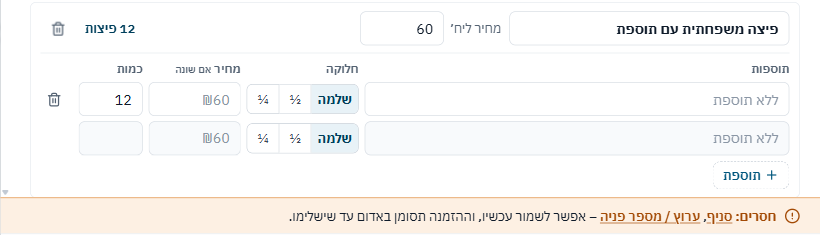

**מה רואים:**
- הצעה 1003 כוללת "פיצה משפחתית עם תוספת × 12". בדיאלוג ההזמנה כל השורות מגיעות עם "ללא תוספת".
- ההודעה למעלה מבקשת "נשאר לפרט בפיצות סוגים ותוספות". אבל שורת החסרים למטה מציינת רק סניף וערוץ.
- שמרתי, וההזמנה 1023 נוצרה עם 12 פיצות בלי תוספת, וההצעה סומנה "הפכה להזמנה".

**שורש בקוד:**
- `NewOrder.tsx:93` ממפה כל שורת הצעה ל-`{group, name, qty, unitPrice}` בלי תוספת.
- רשימת החסרים (`missLive`) לא בודקת פיצות שלא פורטו.

**למה זה חשוב:** הנציג שומר תוך כדי שיחה וסומך על שורת החסרים. הזמנה שגויה מגיעה לקופה ולסניף.

**תיקון:**
- להוסיף לחסרים "פירוט תוספות בפיצות", כך שההזמנה תסומן באדום עד שמשלימים. זה בהתאם ל"שמירה עם פרטים חסרים מותרת, אבל מסומנת באדום".
- או להעביר את שם המוצר מההצעה לשדה התוספות כטקסט.

**פקודה:** `/impeccable harden`

#### Q1 · [P1] "תצוגת ההצעה" בטלפון לא קריאה, ואין בה כפתור PDF
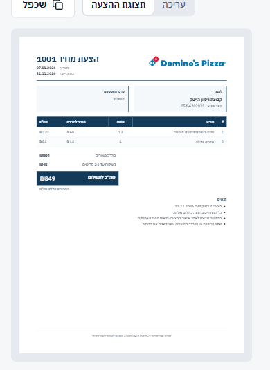

**מה רואים:**
- ב-390 הדף מוקטן פי 0.41, וטקסט של 13px הופך לכ-5px. אין גלישה, אבל אי אפשר לקרוא.
- הכפתור "הורדת PDF" נמצא בתוך `.qe-main`, שמוסתר בלשונית התצוגה (`quotes.css:155`). לכן במקום היחיד שבו האחמ"ש רואה מה הוא שולח, אין דרך לשלוח.

**תיקון:**
- בטלפון להציג את הדף ב-1:1 עם גלילה אופקית, או לאפשר הגדלה.
- להוציא את פס הפעולות מ-`.qe-main` כדי שיופיע בשתי הלשוניות.

**פקודה:** `/impeccable adapt`

#### Q3 · [P1] הצעה שכבר נשלחה נערכת בשקט, והסטטוס מופיע פעמיים
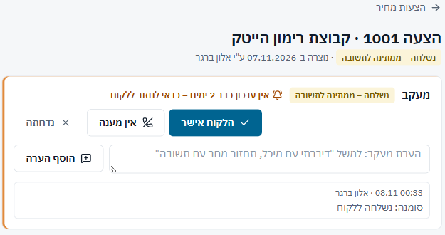

**מה רואים:**
- הצעה 1001 בסטטוס "נשלחה", והטופס כולו פתוח לעריכה.
- שמירה לא אומרת שה-PDF שאצל הלקוח כבר לא מעודכן, ולא נרשמת ביומן המעקב.
- "נשלחה – ממתינה לתשובה" מופיע גם מתחת לכותרת וגם בכרטיס המעקב.

**שורש בקוד:**
- `locked` (`QuoteEditor.tsx:116`) כולל רק approved, rejected ו-ordered.
- הסטטוס מוצג בשני מקומות: `QuoteEditor.tsx:312` ו-`QuoteTrack.tsx:193`.

**תיקון:**
- כשעורכים הצעה שנשלחה: שורה כתומה "הלקוח קיבל גרסה קודמת – הורידו PDF מחדש".
- לרשום ביומן "עודכנה אחרי שליחה".
- להשאיר את הסטטוס רק בכרטיס המעקב.

**פקודה:** `/impeccable harden`

#### Q2 · [P2] גם בדסקטופ התצוגה קטנה
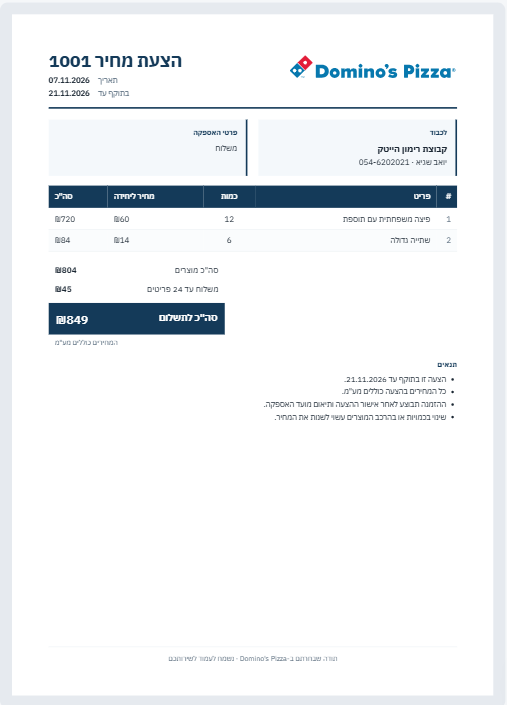

**מה רואים:** ב-1440 הדף מוקטן לכ-0.6, וטקסט הטבלה בערך 8px. אפשר לראות את המבנה, אבל לא לבדוק סכומים או שמות.

**תיקון:** הגדלה בלחיצה, או עמודת תצוגה רחבה יותר כשהמסך מאפשר.

**פקודה:** `/impeccable layout`

#### Q6 · [P2] תזכורת מעקב באדום
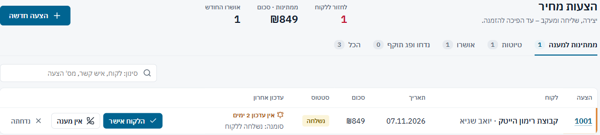

**מה רואים:**
- "לחזור ללקוח 1" והמונה בלשונית מסומנים באדום (`pages.css:117`, `pages.css:21`).
- אותו מצב בשורה ובכרטיס המעקב מסומן בכתום (`quotes.css:13`).
- אותו דפוס כמו L2 בלידים: אדום שמור לחריגה קריטית, ומעקב מכירות הוא לא חריגה קריטית.
- הסורק מצא גם פס צד (side-tab) בשורה ובכרטיס.

**תיקון:** כתום בכל המקומות. הפס יכול להישאר כסמן מצב, או להפוך לנקודה ליד המספר.

**פקודה:** `/impeccable quieter`

#### Q5 · [P2] הצעה נעולה נראית כמו טופס פעיל
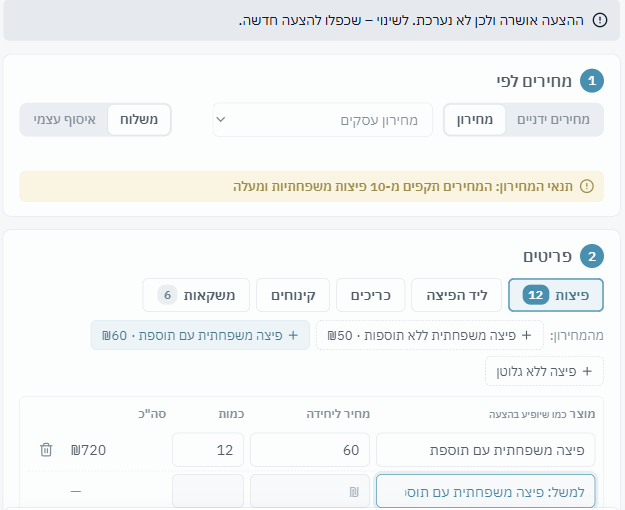

**מה רואים:**
- הצעה מאושרת מוצגת כטופס עם `opacity:.7` (`quotes.css:29`).
- הצ'יפים "+ פיצה…", הלשוניות, סל המחיקה ושורת הטיוטה (עם מסגרת כחולה) נראים פעילים.

**תיקון:** כשההצעה נעולה, להציג סיכום לקריאה בלבד: בלי שורת טיוטה, בלי צ'יפים ובלי סלים.

**פקודה:** `/impeccable distill`

#### Q7 · [P3] בטלפון הפס התחתון והניווט מכסים רבע מסך
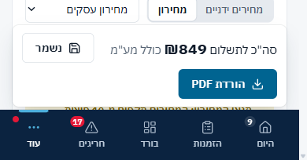

**מה רואים:** הפס "סה"כ + נשמר + הורדת PDF" (104px) יושב מעל הניווט התחתון (68px), בזמן שמקלידים כמויות.

**תיקון:** פס אחד צפוף בשורה אחת, או שהפס יופיע רק כשיש שינוי.

**פקודה:** `/impeccable adapt`

#### Q8 · [P3] רווח ריק בחלק "מחירים לפי"
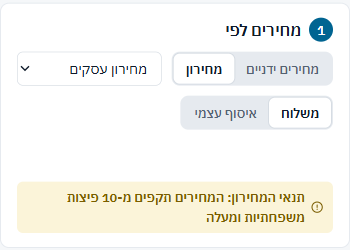

**מה רואים:** הטיפ המוסתר (`visibility:hidden`, כמו שצריך) משאיר רצועה ריקה בין הבחירה לבין תנאי המחירון. בטלפון זה בולט.

**תיקון:** להשאיר את המקום רק כשהטיפ נמצא מתחת לשדה שעורכים כרגע. כאן אין שדה שזז מתחתיו.

**פקודה:** `/impeccable layout`

**הערות קטנות:**
- הקישור ללקוח לא מעדכן את המחירים. `linkCustomer` (`QuoteEditor.tsx:215`) לא קורא ל-`reprice`, ולכן שורות שתומחרו לפני הקישור נשארות במחיר הקודם. זה נבדק בקוד בלבד.
- ב-PDF אין שם או טלפון של מי שמטפל בהצעה, ולכן ללקוח אין למי לחזור.
- "נשלחה" ו"אין מענה" באותו צהוב, ולכן הרשימה לא מראה "כבר חזרנו פעם אחת".
- "ממתינות · סכום" היא כותרת מסורבלת.

### דגלים אדומים לפי פרסונה
- **נציג מקליד תוך כדי שיחה:**
  - "לקוח ואספקה" הוא חלק 4 מתוך 5, אבל הלקוח הוא הדבר הראשון שנאמר בשיחה, והוא גם קובע את המחירון.
  - בהפיכה להזמנה הוא סומך על שורת החסרים (Q4).
- **נציג מהיר (Alex):** אין קיצור לשמירה או ל-PDF. ברשימה אין ניווט בחיצים, בניגוד לסניפים.
- **מקלדת / קורא מסך (Sam):** תצוגה של 5px. נעילה מסומנת רק בשקיפות. צ'יפי המדרגות הם `role="radio"` בלי ניווט בחיצים.

---

## מסך "מחירונים" – `src/features/pricelists/PriceListsPage.tsx` – 24/40

| # | היוריסטיקה | ציון | הבעיה המרכזית |
|---|---|---|---|
| 1 | נראות מצב המערכת | 2 | "נשמר ✓" אוטומטי, אבל הוא שגוי אחרי הדבקה |
| 2 | התאמה לעולם האמיתי | 3 | הדבקה מאקסל ו"עד כמה פריטים" מתאימים לעבודה; מדרגות לא ממוינות |
| 3 | שליטה וחופש | 2 | מחיקת שורה עם "בטל"; "לא פעיל" בלי "בטל" |
| 4 | עקביות | 2 | "בטל" בסניפים ולא כאן; "מחק" אדום; מחירון לא פעיל ממשיך להיות ניתן לעריכה |
| 5 | מניעת טעויות | 1 | הדבקה שומרת מחיר לא תקין כ"בלי מחיר" |
| 6 | זיהוי במקום זכירה | 3 | מחיר איסוף מציג את מחיר המשלוח כברירת מחדל |
| 7 | גמישות ויעילות | 3 | הדבקה, Enter לשורה הבאה, שכפול עם אחוז |
| 8 | אסתטיקה ומינימליזם | 3 | שקט ב-1440; הכותרת נשברת לשלוש שורות ב-390 |
| 9 | התאוששות משגיאות | 2 | השגיאה מוצגת, אבל הנתון כבר נשמר |
| 10 | עזרה ותיעוד | 3 | שורת עזרה על פורמט ההדבקה |
| **סה"כ** | | **24/40** | |

**ספציפיות עיצובית:** ספציפי.
- הדבקה מאקסל בפורמט "שם, מחיר משלוח, מחיר איסוף".
- מדרגות משלוח לפי "עד כמה פריטים".
- תנאי מינימום פיצות שמופיע כאזהרה בהצעה ולא בדף ללקוח.

**עומס קוגניטיבי:** 6/8. 6 לשוניות ("משלוח" מופרדת, וזה עובד) ו-4 פעולות בכותרת. מדרגות לא ממוינות מכריחות למיין בראש.

**מה עובד:**
1. עריכה ישירה בטבלה עם שמירה ביציאה מהשורה ו"נשמר ✓" בכותרת ([צילום](shots/pl-1440-after-edit.png)).
2. מחיקת שורה עם "בטל" בהודעה.
3. שכפול עם שינוי באחוז ועיגול, ומחיקה שדורשת סיבה ומציינת מה יקרה ללקוחות המשויכים.

### ממצאים לפי חומרה

#### PL1 · [P1] הדבקה מאקסל שומרת שורה לא תקינה, ומודיעה שנשמר
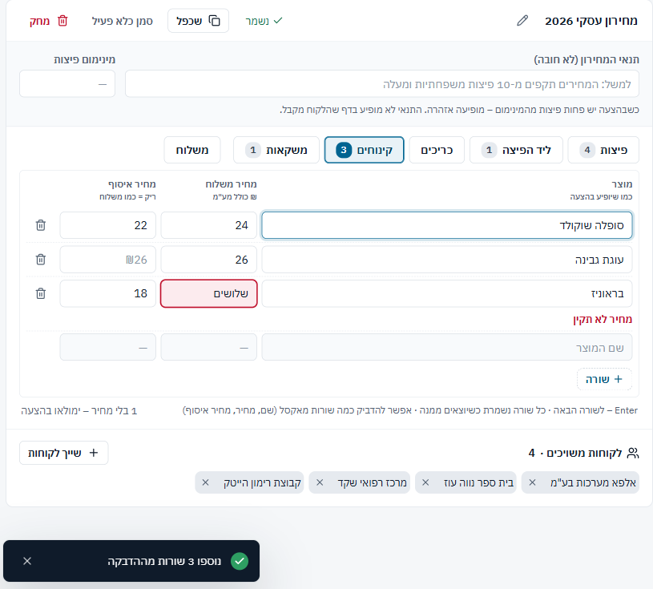

**מה רואים:** הדבקתי 3 שורות, ובאחת המחיר "שלושים".
- השורה מסומנת באדום "מחיר לא תקין".
- בכותרת: "נשמר ✓". בהודעה: "נוספו 3 שורות מההדבקה". בתחתית: "1 בלי מחיר – ימולאו בהצעה".
- בבדיקה במאגר: "בראוניז" נשמר **בלי מחיר משלוח** (רק `pickupPrice: 18`).

**שורש בקוד:**
- `onPaste` (`PriceListsPage.tsx:193-202`) שומר בלי לעבור דרך `problem()`, ו-`num()` הופך טקסט ל-`undefined`.
- במילוי רגיל של שורה, `leaveRow` כן חוסם שמירה כשיש בעיה, ולכן ההתנהגות לא עקבית.
- המונה בהודעה סופר גם שורות כפולות שסוננו (`:201`).

**תיקון:**
- לשמור רק שורות תקינות.
- הודעה מדויקת: "נוספו 2 · 1 לא נשמרה (מחיר לא תקין)".
- "נשמר ✓" רק כשאין בעיות פתוחות.

**פקודה:** `/impeccable harden`

#### PL2 · [P1] מדרגות משלוח לא ממוינות
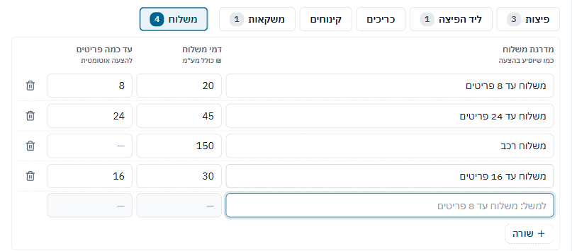

**מה רואים:**
- הוספתי "משלוח עד 16 פריטים", והיא נכנסה בסוף: 8, 24, רכב, 16.
- באותו סדר המדרגות מוצגות כצ'יפים בהצעה ([צילום](shots/quotenew-1440-fee.png)).
- הבחירה האוטומטית כן ממיינת (`QuoteEditor.tsx:202`), כך שהחישוב נכון אבל התצוגה מבלבלת.

**תיקון:** למיין לפי `upTo` בכל מקום, ומדרגות בלי `upTo` (רכב) בסוף.

**פקודה:** `/impeccable layout`

#### PL3 · [P2] שינוי מחיר במחירון משותף נשמר מיד, בלי להראות על מי הוא משפיע
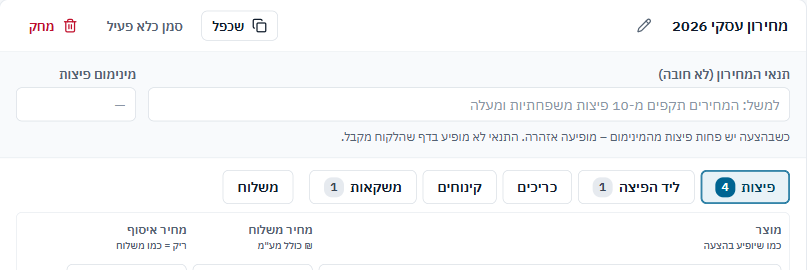

**מה רואים:**
- שיניתי 62 ל-64 ויצאתי מהשדה. השינוי נשמר מיד, והמחיר החדש חל על 4 לקוחות משויכים, בלי שום אזכור.
- אין "בטל" על שינוי מחיר, רק על מחיקת שורה.
- הלקוחות המשויכים מופיעים בתחתית הכרטיס, רחוק מהשדה.

**תיקון:** בהודעה אחרי שינוי מחיר: "המחיר עודכן · חל על 4 לקוחות" עם "בטל".

**פקודה:** `/impeccable clarify`

#### PL5 · [P2] "סמן כלא פעיל" בלי "בטל", ו"מחק" באדום
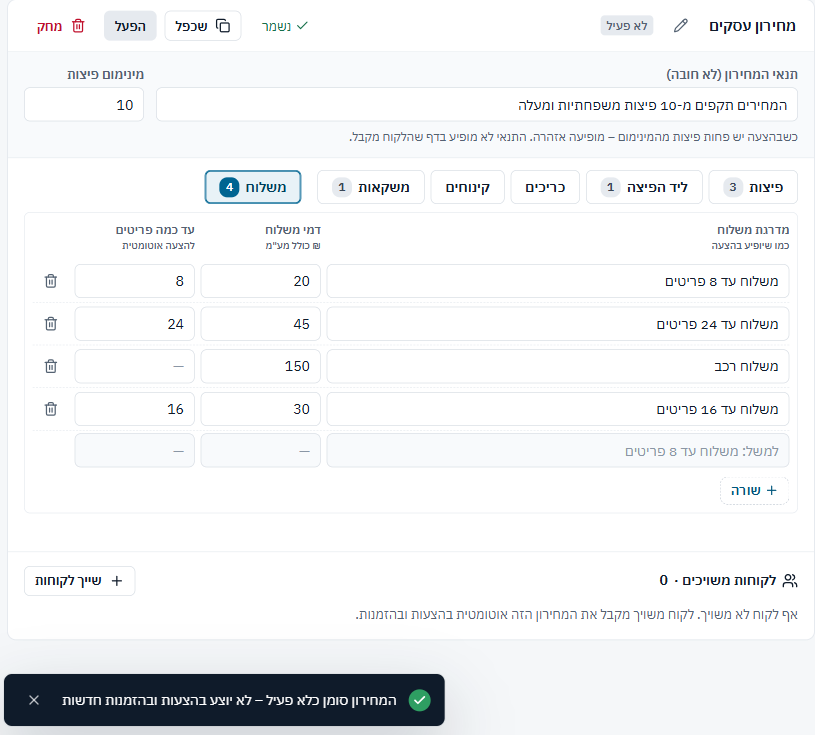

**מה רואים:**
- ההודעה "המחירון סומן כלא פעיל" היא בלי "בטל", בניגוד לסניפים ואשכולות (`BranchesPage.tsx:143,247`).
- מחירון לא פעיל נשאר פתוח לעריכה מלאה, עם תג אפור קטן בלבד.
- "מחק" באדום (`PriceListsPage.css:9`) הוא הדבר הכי צבעוני בכותרת, לפעולה נדירה של מנהל בלבד.

**תיקון:**
- "בטל" בהודעה.
- "מחק" בצבע ניטרלי או בתפריט ⋯. דיאלוג האישור כבר אדום.

**פקודה:** `/impeccable quieter`

#### PL4 · [P3] בטלפון המחירים בלי תוויות
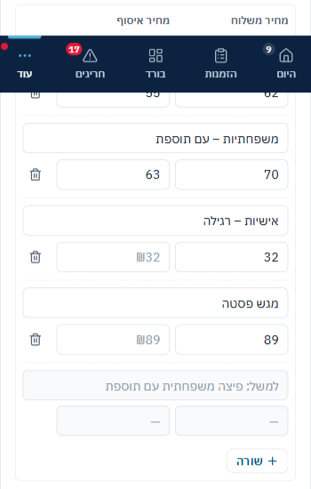

**מה רואים:**
- ב-390 כל מוצר הופך לכרטיס עם שני שדות מספר.
- הכותרות "מחיר משלוח / מחיר איסוף" מופיעות פעם אחת למעלה, ואחרי גלילה כבר לא ברור איזה שדה הוא איזה.
- זה אותו דפוס כמו C6 בלקוחות.
- בנוסף, "מגש פסטה" מהמחירון הישן (בלי קטגוריה) נופל ללשונית "פיצות".

**תיקון:** תווית קטנה בתוך כל שדה ("משלוח", "איסוף").

**פקודה:** `/impeccable adapt`

### דגלים אדומים לפי פרסונה
- **מנהל שמדביק מחירון שלם:** לא יכול לסמוך על "נשמר", ולכן צריך לבדוק כל הדבקה ידנית.
- **מקלדת / קורא מסך:** עם 5 שורות שגויות בהדבקה יש 5 הכרזות `role="alert"` ברצף. אף אחת לא אומרת מה נשמר בפועל. ה-Tab עובר בכל שורה גם דרך סל המחיקה.

---

## מסך "סניפים ואשכולות" – `src/features/branches/BranchesPage.tsx` – 28/40

| # | היוריסטיקה | ציון | הבעיה המרכזית |
|---|---|---|---|
| 1 | נראות מצב המערכת | 2 | שורה נעלמת מיד כשמכבים; אשכול לא פעיל לא אומר מה קרה לסניפים |
| 2 | התאמה לעולם האמיתי | 3 | "1 סניפים" |
| 3 | שליטה וחופש | 3 | "בטל" על שני המתגים, Esc מבטל עריכה |
| 4 | עקביות | 3 | עמודות זזות כשמסננים; כל המתגים ירוקים |
| 5 | מניעת טעויות | 2 | "האם התכוונת" מצוין; אשכול לא פעיל לא משפיע על הסניפים |
| 6 | זיהוי במקום זכירה | 3 | תג אשכול בכל שורה, צ'יפ סינון עם × |
| 7 | גמישות ויעילות | 3 | חיצים בין שורות, Enter לעריכה, החיפוש ממלא את שורת ההוספה |
| 8 | אסתטיקה ומינימליזם | 3 | שתי רשימות זו לצד זו, נקי |
| 9 | התאוששות משגיאות | 3 | שגיאות ברורות בשורה |
| 10 | עזרה ותיעוד | 3 | כותרת משנה אחת שמסבירה מה זה "לא פעיל" |
| **סה"כ** | | **28/40** | |

**ספציפיות עיצובית:** ספציפי ושקט, ומתאים למסך הגדרה שמשתמשים בו לעיתים רחוקות.

**עומס קוגניטיבי:** 7/8. הכישלון היחיד: אחרי כיבוי צריך לזכור לסמן "הצג לא פעילים" כדי למצוא את השורה.

**מה עובד:**
1. "קיים כבר סניף בשם דומה: 'רמת גן – ביאליק'. האם התכוונת אליו?" עם בחירה בינארית ברורה ([צילום](shots/findings/BR5-dup-prompt.png)).
2. מקלדת מלאה: חיצים, Enter ו-Esc, ומסגרת מיקוד כחולה.
3. מה שהוקלד בחיפוש עובר לשורת ההוספה: "חיפשתי, לא מצאתי, הוספתי" בלי להקליד שוב.

### ממצאים לפי חומרה

#### BR1 · [P1] אשכול "לא פעיל" לא מוציא את הסניפים שלו משימוש
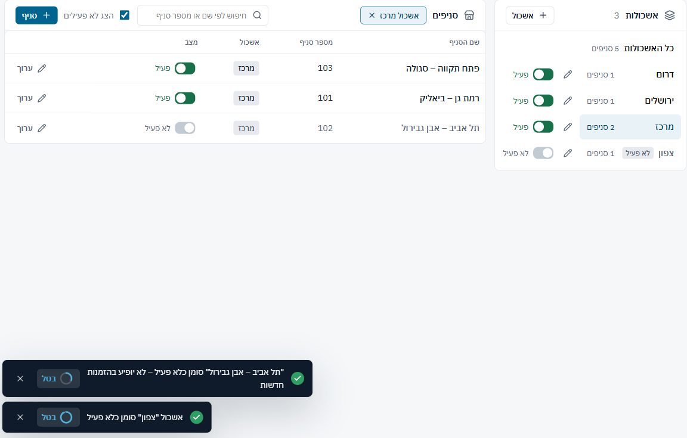

**מה רואים:**
- כיביתי את "צפון". האשכול מסומן "לא פעיל", אבל "חיפה – חורב" נשאר "פעיל" ו"1 סניפים".
- ההודעה אומרת רק "סומן כלא פעיל".
- בקוד, בחירת הסניף בהזמנה מסננת רק לפי `b.active` (`BranchPicker.tsx:33`), כך שהסניף ממשיך להופיע בהזמנות חדשות.
- בפועל, "לא פעיל" באשכול רק מונע להוסיף לו סניפים חדשים.

**תיקון:** אחת משתיים:
- כיבוי אשכול מכבה גם את הסניפים שלו, או מסנן אותם בבחירה.
- הודעה שאומרת את התוצאה, עם הצעה: "הסניף חיפה – חורב עדיין זמין בהזמנות – לכבות גם אותו?".

**פקודה:** `/impeccable harden`

#### BR2 · [P2] שורה נעלמת מתחת ליד כשמכבים סניף
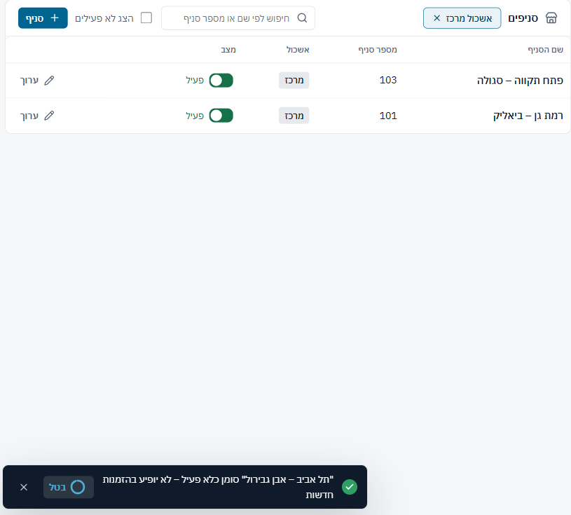

**מה רואים:**
- כיביתי את "תל אביב – אבן גבירול", והשורה נעלמה מיד כי לא פעילים מוסתרים כברירת מחדל (`BranchesPage.tsx:27-28`).
- נשארה רק ההודעה עם "בטל". השורות מתחתיה עלו למעלה, מתחת לסמן העכבר.

**תיקון:** להשאיר את השורה מעומעמת עד שמשנים סינון או יוצאים מהמסך.

**פקודה:** `/impeccable harden`

#### BR3 · [P3] כל המתגים ירוקים, ו"1 סניפים"
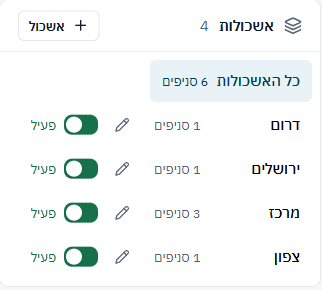

**מה רואים:**
- כל "פעיל" מסומן במתג ירוק (`BranchesPage.css:65-66`), שמונה בעמוד אחד. ירוק על המצב הרגיל הוא רעש, והחריג הוא "לא פעיל".
- "1 סניפים" (`BranchesPage.tsx:113,133`) צריך להיות "סניף אחד".

**תיקון:** מתג ניטרלי (כחול כהה או אפור) למצב פעיל, ותיקון הניסוח.

**פקודה:** `/impeccable quieter`

#### BR4 · [P3] בטלפון המתגים לא מיושרים, ובדסקטופ העמודות זזות
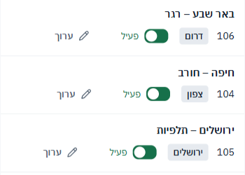

**מה רואים:**
- ב-390 המתג והכפתור "ערוך" זזים לפי אורך תג האשכול ("ירושלים" לעומת "דרום").
- ב-1440 עמודת "מצב" זזה כשמסננים לפי אשכול ([לפני](shots/br-1440-list.png) · [אחרי](shots/br-1440-cluster-filter.png)).

**תיקון:** רוחב קבוע לתג ו-`table-layout: fixed`.

**פקודה:** `/impeccable layout`

**הערה קטנה:** "כן, זה רמת גן – ביאליק" רק סוגר את שורת ההוספה. הוא לא מדגיש את השורה הקיימת, ולכן צריך לחפש אותה.

### דגלים אדומים לפי פרסונה
- **מנהל שסוגר אשכול:** חושב שהסניפים שלו יצאו משימוש, והם לא (BR1).
- **מקלדת / קורא מסך:** אחרי כיבוי השורה נעלמת, והמיקוד נשאר על אלמנט שכבר לא קיים.

### שאלות
1. האם הצעה שנשלחה צריכה להינעל כמו הצעה מאושרת, כך ששינוי ייעשה ב"שכפל כגרסה ב׳"? היום ה-CRM יכול להחזיק גרסה שונה מה-PDF שאצל הלקוח.
2. האם העורך צריך להתחיל ב"מי הלקוח?" ולא ב"מחירים לפי"? הלקוח קובע את המחירון.
3. האם "לא פעיל" הוא מושג אחד או שניים? באשכול ובמחירון המתג משנה תווית ולא התנהגות. או שהוא צריך להשפיע על מה שתחתיו ולנעול, או שצריך לקרוא לו בשם של מה שהוא עושה בפועל.

---

# 2026-11-10 · "לקוחות", "תיק לקוח", "לקוחות פוטנציאליים" · ענף design-polish

- **שיטה:** dual-agent (A: סקירת עיצוב של הקוד והצילומים · B: סורק `impeccable detect` ושכבת סימון בדפדפן). שילבתי את התוצאות ואימתתי בדפדפן ובקוד.
- **מצב:** מוצר (Operate). **בסיס:** PRODUCT.md, DESIGN.md. **סקילים:** impeccable critique + frontend-design.
- **סביבה:** harness מקומי (פורט 5174, Firebase מזויף, Playwright MCP, 1440 ו-390).
  - יצירת לקוח עם ח.פ כפול ואיחוד כפולים בוצעו דרך הממשק על נתוני הדמה. רענון הדף מחזיר את נתוני הדמה.
  - באמצע העבודה האפליקציה ניתקה את המשתמש אחרי 60 דקות בלי פעילות. מחקתי את דגל היציאה של הסביבה המזויפת (`sessionStorage.fakeOut`); לא הוקלדו פרטי כניסה.
  - לא שיניתי קוד.

| מסך | ציון | דירוג | P0 | P1 | P2 | P3 |
|---|---|---|---|---|---|---|
| **לקוחות** | **27/40** | סביר-טוב (68%) | 0 | 2 | 2 | 2 |
| **תיק לקוח** | **20/40** | סביר בקושי (50%) | 1 | 3 | 2 | 2 |
| **לקוחות פוטנציאליים** | **28/40** | טוב (70%) | 0 | 2 | 3 | 1 |

**החוט המשותף לשלושת המסכים:**
- התוכן ספציפי לדומינוס: ח.פ, טלפון הקפה, ת. רכש, הנחיות קבועות, וצעד הבא עם תאריך לכל ליד.
- השכבה סביב התוכן גנרית: שורת KPI, 10 לשוניות ולוח קנבן.
- הממצא החמור ביותר עד עכשיו בביקורת הוא **איחוד לקוחות**. הוא מאבד נתוני חיוב בשקט, נועל את ה-ח.פ, ואי אפשר לבטל אותו.

## מה נבדק

| מסך | מצב | צילום |
|---|---|---|
| לקוחות | רשימה | [1440](shots/cust-1440-list.png) · [390 – כרטיסים](shots/cust-390-list.png) |
| לקוחות | חיפוש: שם, טלפון, ח.פ, איש קשר; חיפוש ריק | [שם](shots/cust-1440-search.png) · [ריק](shots/cust-1440-search-empty.png) |
| לקוחות | מסנן "חסרים פרטים" | [1440](shots/cust-1440-missing-filter.png) |
| לקוחות | יצירת לקוח; ח.פ כפול לפני השמירה ואחריה | [פתיחה](shots/cust-1440-create-open.png) · [לפני](shots/cust-1440-create-dup-taxid.png) · [אחרי](shots/cust-1440-create-dup-save.png) |
| תיק לקוח | 10 לשוניות | [סקירה](shots/custfile-1440-01-overview.png) · [הזמנות](shots/custfile-1440-02-orders.png) · [הצעות](shots/custfile-1440-03-quotes.png) · [חודשי](shots/custfile-1440-04-monthly.png) · [מחירון](shots/custfile-1440-05-prices.png) · [תשלום](shots/custfile-1440-06-payment.png) · [אנשי קשר](shots/custfile-1440-07-contacts.png) · [מסמכים](shots/custfile-1440-08-docs.png) · [פעילות](shots/custfile-1440-09-activity.png) · [היסטוריה](shots/custfile-1440-10-history.png) |
| תיק לקוח | איחוד כפולים: תפריט, חיפוש, אישור, תוצאה, הלקוח שמוזג | [תפריט](shots/custfile-1440-menu.png) · [פתיחה](shots/custfile-1440-merge-open.png) · [חיפוש](shots/custfile-1440-merge-search.png) · [אישור](shots/custfile-1440-merge-confirm.png) · [תוצאה](shots/custfile-1440-merge-done.png) · [מקור](shots/custfile-1440-merged-source.png) |
| תיק לקוח | טלפון | [סקירה](shots/custfile-390-overview.png) · [הזמנות](shots/custfile-390-orders.png) · [חודשי](shots/custfile-390-monthly.png) |
| לידים | לוח לפי שלבים; שינוי שלב מהתפריט | [לוח](shots/leads-1440-board.png) · [תפריט שלב](shots/leads-1440-stage-menu.png) · [390](shots/leads-390-board.png) |
| לידים | טבלה; "צעד הבא באיחור" | [טבלה](shots/leads-1440-table.png) · [באיחור](shots/leads-1440-table-late.png) |
| לידים | המשימות שלי היום | [1440](shots/leads-1440-mytasks.png) |
| תיק ליד | צעד באיחור; תיעוד פעילות | [תיק](shots/leadfile-1440-overdue.png) · [תיעוד](shots/leadfile-1440-log-activity.png) · [390](shots/leadfile-390.png) |

**מה לא נבדק:**
- "הפוך ללקוח" מליד.
- "לא רלוונטי" עם סיבה.
- גרירה בפועל על הלוח (נבדק רק תפריט השלב).
- עריכת לקוח קיים ושינוי ח.פ.

**סורק:**
- **CLI:** ממצא מייעץ אחד. `rgba(180,35,24,.12)` ב-`CustomerForm.css:25` מחוץ לפלטה. זה אותו צבע שנמצא ב-NewOrder.css.
- **בדפדפן:** בכל המסכים רק תג הפעמון ב-10px (מעטפת האפליקציה, לא המסכים האלה).
- **מדידה ב-390:** גלישה של כל הדף בלשונית "סיכומים חודשיים" (פירוט ב-F4).

---

## מסך "לקוחות" – `src/features/customers/CustomersPage.tsx` – 27/40

| # | היוריסטיקה | ציון | הבעיה המרכזית |
|---|---|---|---|
| 1 | נראות מצב המערכת | 3 | מונים על הסינון; פרטים חסרים לא נראים בלי המסנן |
| 2 | התאמה לעולם האמיתי | 3 | עמודות נכונות לתחום; "כללי" על טלפון משותף לא ברור |
| 3 | שליטה וחופש | 3 | סוג נשמר; "חסרים פרטים" ו"לא פעילים" מתאפסים |
| 4 | עקביות | 2 | עמודת "מה חסר" שבורה; אייקון בלי כותרת |
| 5 | מניעת טעויות | 2 | ח.פ כפול ידוע תוך כדי הקלדה, אבל מוצג כשגיאה רק בשמירה |
| 6 | זיהוי במקום זכירה | 3 | ה-placeholder של החיפוש מפרט מה הוא מחפש |
| 7 | גמישות ויעילות | 3 | חיצים ו-Enter בשורות; "לקוח חדש: xyz" מחיפוש ריק |
| 8 | אסתטיקה ומינימליזם | 2 | כותרת משנה מסבירה; הרבה "—" |
| 9 | התאוששות משגיאות | 3 | שגיאת הכפול נותנת שם ומקשרת; מיקוד לשדה הראשון |
| 10 | עזרה ותיעוד | 3 | מצב ריק מסביר |
| **סה"כ** | | **27/40** | |

**ספציפיות עיצובית:** ספציפי בדרך כלל. ח.פ, טלפון הקפה, מחירון, תעודת רכש וזיהוי טלפון משותף הם כולם לוגיקה של התחום. החלקים החלשים הם כותרת המשנה הכללית ועמודת האייקון.

**עומס קוגניטיבי:**
- 5 בקרות בסרגל: סוג, חסרים, לא פעילים, חיפוש וכפתור.
- במסנן החסרים: עד 7 תגיות אדומות בשורה, בלי סדר עדיפות.

**מה עובד:**
1. החיפוש מכסה שם, ספרות טלפון, ח.פ ואיש קשר. חיפוש ריק מציע "לקוח חדש: 'xyz'" ([צילום](shots/cust-1440-search-empty.png)).
2. זיהוי כפולים בשתי שכבות: ח.פ זהה חוסם, ושם או טלפון דומים מזהירים ודורשים לחיצה שנייה "זה לקוח אחר – הוסף".
3. בטלפון הרשימה הופכת לכרטיסים ולא לטבלה ([צילום](shots/cust-390-list.png)).

### ממצאים לפי חומרה

#### C1 · [P1] עמודת "מה חסר" שבורה
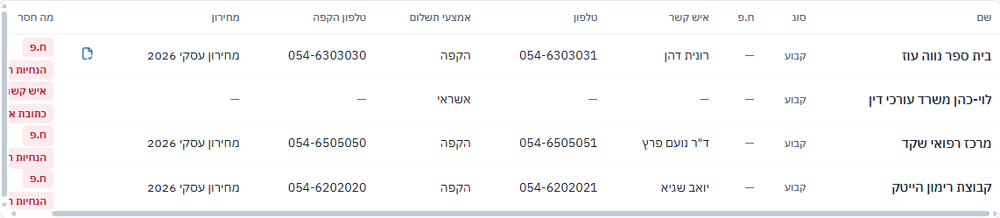

**מה רואים:** במסנן "חסרים פרטים" התגיות חתוכות ("הנחיות ז", "איש קש"), כל תא גולל בנפרד, ויש פס גלילה אופקי גם ב-1440.

**שורש בקוד:**
- `.cust-table td:last-child { width: 40px }` (`CustomersPage.css:2`) נועד לעמודת אייקון ת. רכש. כשהמסנן פעיל, עמודת החסרים הופכת לאחרונה ונדחסת.
- `display:flex` על `<td>` (שורה 12) שובר את פריסת התא.

**תיקון:**
- לכוון לעמודת ת. רכש לפי class ולא `:last-child`.
- לעטוף את התגיות ב-div פנימי.
- להציג את החסר הראשון ו"+N".

**פקודה:** `/impeccable layout`

#### C2 · [P1] ח.פ כפול מוצג כשגיאה רק אחרי "הוסף לקוח"
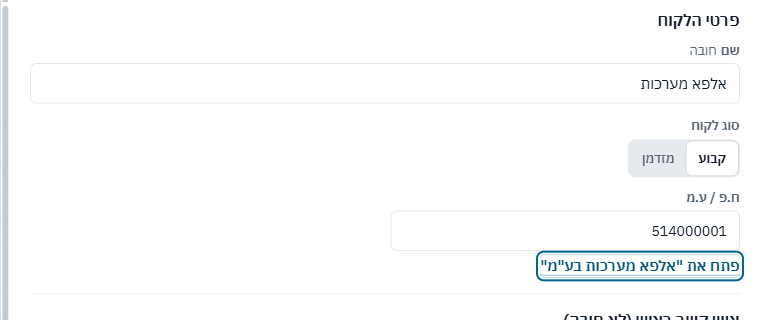

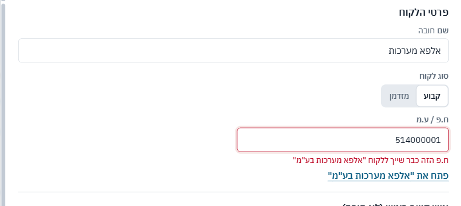

**מה רואים:**
- לפני השמירה מופיע רק קישור ניטרלי "פתח את 'אלפא מערכות בע"מ'".
- בתחתית מופיעה הערה כתומה "נמצא לקוח דומה – נבדוק לפני השמירה". היא בכלל מגיעה מהתאמת **שם**.
- לכן החסימה הקשיחה נראית רכה יותר מהאזהרה הרכה. ה-twin מחושב חי (`CustomerForm.tsx:38-39`), אבל השגיאה נקבעת רק ב-`validate()` (שורה 56).

**תיקון:**
- שגיאה בשדה (`aria-invalid`) ברגע שיש התאמה, עם הקישור בתוכה.
- כפתור "ח.פ קיים – פתח לקוח" במקום "הוסף לקוח".

**פקודה:** `/impeccable harden`

#### C3 · [P2] טלפון הקפה חוסם יצירת לקוח
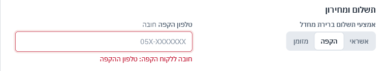

**מה רואים:** הטופס נפתח על "הקפה", ו"טלפון הקפה" חוסם את השמירה (`CustomerForm.tsx:57-59`). זה סותר את ההחלטה "שמירה עם פרטים חסרים מותרת", ו-`customerGaps` (`customers.ts:165`) כבר מתייחס אליו כחוסר.

**תיקון:** לשמור ולסמן כחסר.

**פקודה:** `/impeccable clarify`

#### C4 · [P2] אי אפשר לראות ברשימה אילו לקוחות חסרים
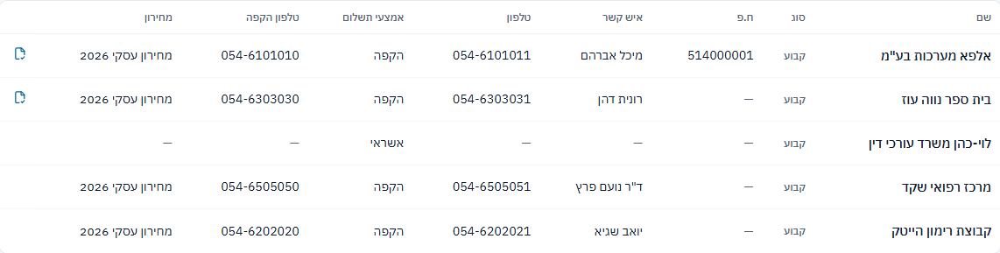

**מה רואים:** 4 מתוך 5 לקוחות חסרים פרטים, ושום דבר בשורה לא מסמן את זה, עד שמפעילים את המסנן. זה בניגוד ל"מסומנת באדום".

**תיקון:** נקודת חוסר שקטה ליד השם, לפי DESIGN.md "Health dot".

**פקודה:** `/impeccable colorize`

#### C5 · [P3] טקסט ורעש בראש הרשימה

**מה רואים:**
- כותרת המשנה "לחיצה על לקוח פותחת את התיק שלו." היא הוראה ולא מידע.
- "קבוע" בכחול נראה כמו קישור.
- אייקון ת. רכש בלי כותרת עמודה, והוא גם עצירת Tab בתוך שורה שכבר ממוקדת.

**פקודה:** `/impeccable distill`

#### C6 · [P3] כרטיסים בטלפון בלי תוויות
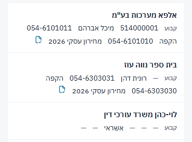

**מה רואים:** "קבוע — — — אשראי" – בלי תוויות אי אפשר לדעת מה חסר: ח.פ? איש קשר? טלפון?

**תיקון:** להשמיט שדות ריקים, או לכתוב "חסר: ח.פ, איש קשר".

**פקודה:** `/impeccable adapt`

### דגלים אדומים לפי פרסונה
- **נציג מהיר:** אין קיצור ל"לקוח חדש" או למיקוד בחיפוש של המסך. המסננים מתאפסים כשחוזרים למסך.
- **מקלדת / קורא מסך:** אייקון ת. רכש הוא עצירת Tab נוספת בכל שורה, ויעד המגע שלו 15×15.
- **אחמ"ש בנייד:** שדות ריקים בלי תוויות.

---

## מסך "תיק לקוח" – `src/features/customers/CustomerFile.tsx` – 20/40

| # | היוריסטיקה | ציון | הבעיה המרכזית |
|---|---|---|---|
| 1 | נראות מצב המערכת | 2 | סקירה וחודשי נותנים מספרים שונים לאותו חודש; כל החודשים "פתוח" |
| 2 | התאמה לעולם האמיתי | 3 | נאמן לתחום |
| 3 | שליטה וחופש | 1 | אין דרך לבטל איחוד (ל"לא פעיל" יש "בטל"); הלשונית לא ב-URL |
| 4 | עקביות | 2 | באנר ההנחיות בצבע "חסר"; קישורי החסרים בכחול |
| 5 | מניעת טעויות | 1 | איחוד בלי ספירה ובלי השוואת שדות, ומאבד נתונים |
| 6 | זיהוי במקום זכירה | 2 | 10 לשוניות שטוחות; מונה רק על אנשי קשר |
| 7 | גמישות ויעילות | 2 | אין חיצים בין הלשוניות; "הזמנה" ממלא את הלקוח מראש (טוב) |
| 8 | אסתטיקה ומינימליזם | 2 | החודשי הוא בעיקר טבלת אפסים; "מצב חודש" עמודה מתה |
| 9 | התאוששות משגיאות | 2 | דף הלקוח שמוזג אומר "כל הפרטים עברו" – לא נכון |
| 10 | עזרה ותיעוד | 3 | הערות של שורה אחת מתחת ל-KPI ובכותרת החודשי |
| **סה"כ** | | **20/40** | |

**ספציפיות עיצובית:**
- הכותרת חזקה. הקפה, טלפון הקפה ייעודי או משותף, תגית ת. רכש, באנר הנחיות קבועות וכרטיסי ההזמנה האחרונה והבאה – כולם בגובה העין.
- הסקירה היא ה-dashboard הגנרי ביותר במערכת: 5 אריחי KPI וגרף עמודות.

**עומס קוגניטיבי:**
- 10 לשוניות.
- 4 פעולות בכותרת ועוד תפריט.
- 5 KPI × 3 תקופות.
- טבלת חודשי של 10 עמודות × 12 שורות.
- שני מספרים שונים בשם "פתוח לתשלום".

**מה עובד:**
1. "מי להתקשר אליו, איך הוא משלם, מה ההנחיות" מופיעים למעלה, עם קישורי tel: ו-mailto:.
2. כרטיס "פרטים חסרים" מקשר כל חוסר ללשונית שבה משלימים אותו.
3. כרטיסי ההזמנה האחרונה והבאה פותחים את כרטיס ההזמנה במקום.

### ממצאים לפי חומרה

#### F1 · [P0] איחוד לקוחות מאבד נתונים בשקט, וכותב שהכול עבר
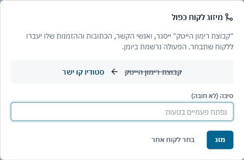
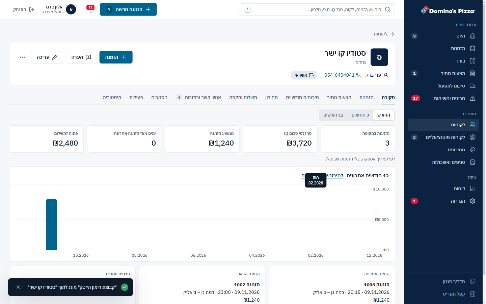

**מה רואים:** איחדתי את "קבוצת רימון הייטק" (קבוע · הקפה · טלפון הקפה ייעודי · מחירון עסקי) לתוך "סטודיו קו ישר" (מזדמן · אשראי). התוצאה: מזדמן, אשראי, בלי טלפון הקפה ובלי מחירון. דף המקור אומר "כל הפרטים עברו ללקוח 'סטודיו קו ישר'".

**שורש בקוד:** `mergeCustomers` (`customers.ts:136-154`) מעביר רק אנשי קשר, כתובות והזמנות. הוא **לא** מעביר:
- ח.פ, ומסמך הייחודיות `taxIds` נשאר מצביע ללקוח שמוזג, כך שה-ח.פ נעול.
- טלפון הקפה, אמצעי תשלום, מחירון ומחירים מיוחדים.
- הנחיות והנחיות חיוב.
- הצעות מחיר ומשימות.

**למה P0:** אובדן בלתי הפיך של נתוני חיוב ושל ייחודיות ה-ח.פ, ובמקביל המסך מודיע שהכול עבר.

**תיקון:**
- מסך תצוגה מקדימה עם ספירות (N הזמנות, N אנשי קשר, N הצעות).
- טבלת התנגשויות לכל שדה, עם בחירה שמתחילה בערך שאינו ריק: סוג, תשלום, טלפון הקפה, מחירון, ח.פ, הנחיות.
- להעביר הצעות ומשימות, ולהעביר או לשחרר את `taxIds`.
- לתקן את הטקסט בדף המקור.

**פקודה:** `/impeccable harden`

#### F2 · [P1] אין דרך לבטל איחוד

**מה רואים:** זו הפעולה ההרסנית ביותר בתיק, והיחידה בלי "בטל". "לא פעיל" כן מאפשר ביטול (`CustomerFile.tsx:116`). כפתור "מזג" בעיצוב רגיל ולא כפעולה מסוכנת.

**תיקון:** "בטל" בהודעה שמשחזר את הפעולה (מזהי ההזמנות כבר נרשמים ביומן), או אישור שני שמציג את הספירות.

**פקודה:** `/impeccable harden`

#### F3 · [P1] הסקירה והחודשי לא מסכימים על אותו חודש

**מה רואים:** אותו לקוח ואותו חודש:
- בסקירה – "הזמנות בתקופה 3 · פתוח לתשלום ₪2,480".
- בחודשי – "5 הזמנות · פתוח לתשלום ₪4,700".

הסקירה סופרת רק עד היום (`CustomerFile.tsx:178,185`), והחודשי כולל הזמנות עתידיות. שני המספרים נקראים באותו שם.

**תיקון:** "עד היום" בתווית הסקירה ושורה "+N עתידיות", או כלל אחד לשניהם.

**פקודה:** `/impeccable clarify`

#### F4 · [P1] בטלפון לשונית "סיכומים חודשיים" שוברת את כל הדף

**מה רואים:**
- `scrollWidth` 658 מול 380. הכותרת, הלשוניות והכרטיס זזים הצידה.
- `.report__scroll` גדל לרוחב הטבלה ולכן לא גולל.

**שורש בקוד:** פריט הגריד ב-`.page.cfile` נשאר עם `min-width: auto`.

אותה משפחה של הבעיה הידועה ב-CLAUDE.md ("טבלאות הדוחות גולשות"), אבל כאן נשבר כל התיק ולא רק הטבלה.

**תיקון:**
- `min-width:0` לפריט הגריד או ל-tabpanel.
- ב-390 – חודש · הזמנות · סך · פתוח.

**פקודה:** `/impeccable adapt`

#### F5 · [P2] החודשי הוא בעיקר שורות אפס

**מה רואים:**
- 11 מתוך 12 שורות הן אפסים.
- "מצב חודש" תמיד "פתוח", עם title פנימי "סגירת חודש – שלב 9" (`CustomerFile.tsx:283`).

**תיקון:**
- לקפל חודשים ריקים לשורה אחת ("ללא הזמנות: 01–10.2026").
- להסתיר את "מצב חודש" עד שנעילת חודש מחוברת.

**פקודה:** `/impeccable distill`

#### F6 · [P2] עשר לשוניות, בלי קיבוץ ובלי כתובת

**מה רואים:**
- הלשונית לא נשמרת ב-URL, ולכן "אחורה" או קישור לעמית מאבדים אותה.
- רק ל"אנשי קשר" יש מונה, והוא סופר אנשי קשר וכתובות יחד ("2").
- בטלפון הלשוניות נחתכות ("מחיו") בלי רמז ([צילום](shots/findings/F7-F8-mobile-file-top.png)).
- אין ניווט בחיצים בין הלשוניות (`CustomerFile.tsx:138-146`).

**תיקון:** כ-6 לשוניות:
- סקירה.
- הזמנות, עם חודשי כתצוגה.
- הצעות.
- מחירון ותשלום.
- אנשי קשר.
- פעילות, עם מסמכים והיסטוריה כמסננים.

ובנוסף: `?tab=` ב-URL, ומונים להזמנות ולהצעות.

**פקודה:** `/impeccable layout`

#### F7 · [P3] באנר ההנחיות הקבועות בצבע "חסר"

**מה רואים:** הנחיה קבועה היא לא אזהרה (`CustomerFile.css:21`). בצבע הזה, נציג לומד להתעלם מהצהוב. בטלפון כפתור "⋯" גם יורד לבד לשורה משלו.

**תיקון:** סגנון הערה ניטרלי או brand-50.

**פקודה:** `/impeccable colorize`

#### F8 · [P3] בטלפון תוויות ציר הגרף נדחסות

**מה רואים:** התוויות 10.2026, 08.2026 וכן הלאה נוגעות זו בזו.

**תיקון:** תווית אחת מכל שלוש ברוחב צר.

**פקודה:** `/impeccable adapt`

### דגלים אדומים לפי פרסונה
- **נציג מהיר:** 10 לשוניות בלי מקלדת. אין קישור ללשונית. האיחוד דורש 4 צעדים.
- **מקלדת / קורא מסך:** ללשוניות אין חיצים ואין `aria-controls`. שורות החודשי לחיצות בלי תווית.
- **אחמ"ש בנייד:** החודשי שובר את הדף; הלשוניות חתוכות; "⋯" לבד בשורה.

---

## מסך "לקוחות פוטנציאליים" – `src/features/leads/LeadsPage.tsx` – 28/40

| # | היוריסטיקה | ציון | הבעיה המרכזית |
|---|---|---|---|
| 1 | נראות מצב המערכת | 3 | שורת צעד הבא עם "היום" / "באיחור", תג בתפריט, KPI |
| 2 | התאמה לעולם האמיתי | 3 | שלבי המכירה נכונים; "שנה" דו-משמעי (לשנות / שנה) |
| 3 | שליטה וחופש | 3 | מעבר שלב דורש צעד הבא; סיבת אובדן; "פתח מחדש" |
| 4 | עקביות | 2 | אדום ל"צעדים להיום" ולמעקב באיחור; שתי דרכים להפוך ללקוח |
| 5 | מניעת טעויות | 3 | גרירה ל"לקוח פעיל" פותחת דיאלוג ולא משנה בשקט |
| 6 | זיהוי במקום זכירה | 3 | תגיות שלב ומסלול שלבים בתיק |
| 7 | גמישות ויעילות | 3 | 3 תצוגות; תפריט כחלופה לגרירה; התצוגה נשמרת |
| 8 | אסתטיקה ומינימליזם | 2 | אזורי גרירה תמיד גלויים; "צעד הבא" דחוס בטבלה |
| 9 | התאוששות משגיאות | 3 | פתיחה מחדש של ליד שאבד |
| 10 | עזרה ותיעוד | 3 | רמזים קצרים |
| **סה"כ** | | **28/40** | |

**ספציפיות עיצובית:** המסך הכי ספציפי מהשלושה. הכלל "לכל ליד פתוח יש צעד הבא עם תאריך" מעצב כל תצוגה. "המשימות שלי היום" ([צילום](shots/leads-1440-mytasks.png)) הוא המסך הטוב ביותר בסבב: מקובץ לפי באיחור והיום, עם קישור טלפון ופעולה אחת בשורה. הלוח עצמו הוא קנבן גנרי.

**עומס קוגניטיבי:**
- בטבלה: 4 רשימות, צ'יפ באיחור וחיפוש.
- בתיק ליד: 3 כפתורים, תפריט, ו-5 שלבים לחיצים – כ-10 יעדים לפני התוכן.

**מה עובד:**
1. "המשימות שלי היום" – רשימת "מה לעשות עכשיו" אמיתית (עיקרון 2).
2. מעבר שלב מחייב צעד הבא, כך שהכלל נאכף דרך הזרימה.
3. לגרירה יש חלופה בתפריט ובמקלדת ([צילום](shots/leads-1440-stage-menu.png)), והיא מכבדת reduced-motion.

### ממצאים לפי חומרה

#### L1 · [P1] בטבלה עמודת "צעד הבא" דחוסה והתאריך באיחור חתוך

**מה רואים:** העמודה החשובה ביותר מפסידה רוחב לעמודות שלא נשברות (אזור, מקור, איש קשר + טלפון). "באיחור · 08.11.2026" נחתך, ויש פס גלילה אופקי ב-1440.

**תיקון:**
- min-width של כ-220px עם שבירת שורות.
- להעביר את העמודה ליד השם.
- אזור ותחום בשורה מושתקת מתחת לשם.
- מקור רק כמסנן.

**פקודה:** `/impeccable layout`

#### L2 · [P1] אדום למעקב מכירות

**מה רואים:** "צעדים להיום 3" באדום (`LeadsPage.tsx:57`), וצעד באיחור בתיק הוא באנר ורוד-אדום ברוחב מלא (`Leads.css:76`). מעקב מכירות באיחור הוא לא חריגה קריטית. זה אותו דפוס כמו T1 ו-O2.

**תיקון:**
- כתום (urgent) לצעד באיחור.
- מספר ניטרלי ל"צעדים להיום".
- האדום נשאר לחריגות בהזמנות.

**פקודה:** `/impeccable quieter` + `/impeccable colorize`

#### L3 · [P2] כפתור "שנה" דו-משמעי ותקוע בקצה

**מה רואים:** הכפתור עומד לבד בקצה השמאלי של באנר ברוחב מלא, וטקסט הצעד לפניו מסתיים ב"סוף שנה". לקורא מסך אין לו מושא (`LeadFile.tsx:115`).

**תיקון:**
- "עדכן צעד", או פעולה ראשית "בוצע ← צעד הבא" שמתעדת ומתזמנת בצעד אחד.
- הכפתור צמוד לתאריך.
- הבאנר ברוחב התוכן.

**פקודה:** `/impeccable clarify`

#### L4 · [P2] שתי דרכים להפוך ללקוח, ומסלול שלבים לחיץ

**מה רואים:** "הפוך ללקוח" (`LeadFile.tsx:77`) ו"לקוח פעיל" הירוק (שורה 107) פותחים את אותו דיאלוג. כל שלב קודם במסלול הוא כפתור, ולכן קל לחזור אחורה בטעות.

**תיקון:** כניסה אחת להמרה. המסלול לקריאה בלבד, והמעבר דרך "העבר שלב".

**פקודה:** `/impeccable distill`

#### L5 · [P2] אזורי הגרירה מוצגים תמיד, גם במגע

**מה רואים:** "גרירה לכאן פותחת 'הפיכה ללקוח'" מוצג קבוע, בניגוד ל"טיפים רק בזמן עריכה". בטלפון גרירה של HTML5 לא עובדת, כך שהאזורים מתים ([390](shots/leads-390-board.png)).

**תיקון:**
- להציג רק בזמן גרירה (`.lboard.is-dragging` כבר קיים, `Leads.css:44`).
- להסתיר מתחת ל-640px.

**פקודה:** `/impeccable quieter` + `/impeccable adapt`

#### L6 · [P3] מבנה הלוח

**מה רואים:**
- עמודות של כ-230px עם הרבה ריק מתחתן.
- שורת הפרטים בכרטיס נשברת ומשאירה "·" תלוי ("בריאות · ד"ר רון כץ ·").
- שורת ה-KPI צפה בקצה, מנותקת מהכותרת.

**תיקון:**
- מפרידים ב-CSS בין spans.
- KPI בשורה אחת מתחת לכותרת.

**פקודה:** `/impeccable polish`

### דגלים אדומים לפי פרסונה
- **נציג מהיר:** "המשימות שלי" מצוין, אבל אין זרימת "בוצע + הבא" במקלדת. מסנני הטבלה לא נשמרים.
- **מקלדת / קורא מסך:** "שנה" בלי מושא. כפתורי המסלול מכריזים רק את שם השלב. "באיחור" כתוב גם כטקסט (טוב).
- **אחמ"ש בנייד:** הלוח נערם יפה, אבל אזורי הגרירה מתים. "המשימות שלי" – התצוגה שהכי מתאימה לטלפון – לא ברירת המחדל בו.

### שאלות
1. האם תיק של 10 לשוניות משרת נציג באמצע שיחה? אולי תיק אחד נגלל (כותרת, כסף פתוח, הזמנות אחרונות, אנשי קשר) עם "עוד" יענה על 90% מהבדיקות בלי לחיצה?
2. אם איחוד לא יודע לבחור בין שדות סותרים ואין לו ביטול – האם נציגים צריכים אותו? אולי פעולת מנהל בלבד, שמתחילה בהשוואה צד-לצד של שני הלקוחות?

---

# 2026-11-09 · "הזמנות", "כרטיס הזמנה", "הזמנה חדשה" · ענף design-polish

- **שיטה:** dual-agent (A: סקירת עיצוב של הקוד והצילומים · B: סורק `impeccable detect` ושכבת סימון בדפדפן). שילבתי את התוצאות ואימתתי בדפדפן.
- **מצב:** מוצר (Operate). **בסיס:** PRODUCT.md, DESIGN.md. **סקילים:** impeccable critique + frontend-design.
- **סביבה:** harness מקומי (פורט 5174, Firebase מזויף, Playwright MCP, 1440 ו-390). את מעבר השלבים ביצעתי דרך הממשק על הזמנת דמה. למצב "הוקלד ל-Q ולא נשלח לתפעול" שיניתי שדה אחד בזיכרון. רענון הדף מחזיר את נתוני הדמה. לא שיניתי קוד.

| מסך | ציון | דירוג | P0 | P1 | P2 | P3 |
|---|---|---|---|---|---|---|
| **הזמנות** | **26/40** | סביר-טוב (65%) | 0 | 2 | 2 | 3 |
| **כרטיס הזמנה** | **25/40** | סביר (63%) | 0 | 2 | 4 | 3 |
| **הזמנה חדשה** | **25/40** | סביר (63%) | 0 | 2 | 5 | 1 |

**החוט המשותף לשלושת המסכים:** המערכת גוזרת את השלב מהנתונים, אבל עדיין מאפשרת לסמן "סופקה" בלי לעבור את השלבים. זה קורה בשלושה מקומות: בפעולה מרובה, בשורה, ובכרטיס אחרי Q. בנוסף, אדום משמש לשלבים שגרתיים. המסכים חזקים בדיוק במקומות הספציפיים לדומינוס: בלוק הקופה, שורת Q עם בדיקת סכום, ופיצות לפי סוג. הם חלשים בשכבה הגנרית שמסביב.

## מה נבדק

| מסך | מצב | צילום |
|---|---|---|
| הזמנות | טבלה (מחר) | [1440](shots/orders-1440-tomorrow.png) · [390 – כרטיסים](shots/orders-390-tomorrow.png) |
| הזמנות | סימון מרובה (2 שורות) | [1440](shots/orders-1440-bulk.png) |
| הזמנות | מסנן "עם חריג" + שורה עם חריגה (tooltip) | [מסנן](shots/orders-1440-filter-issues.png) · [שורה](shots/orders-1440-exception-row.png) |
| הזמנות | ארכיון (סופקה, חלקית, בוטלה) | [1440](shots/orders-1440-archive.png) |
| כרטיס | ממתין לאישור לקוח | [1440](shots/panel-1440-s1-pending-customer.png) |
| כרטיס | הלקוח אישר → ממתין לעדכון בתפעול | [1440](shots/panel-1440-s1b-after-approve-click.png) · [טופס תפעול](shots/panel-1440-s2-ops-form.png) |
| כרטיס | מאושר + שורת Q | [1440](shots/panel-1440-s3-approved.png) · [שורת Q מלאה](shots/panel-1440-qrow-filled.png) |
| כרטיס | הוקלד ל-Q | [1440](shots/panel-1440-s4-q-typed.png) |
| כרטיס | נשלח בקבוצת תפעול | [1440](shots/panel-1440-s5-ops-sent.png) |
| כרטיס | סגירה (סופקה / חלקית / באיחור) → סופקה | [טופס](shots/panel-1440-s6-close-form.png) · [סופקה](shots/panel-1440-s7-delivered.png) |
| כרטיס | בוטלה | [1440](shots/panel-1440-cancelled.png) · [390](shots/panel-390-cancelled.png) |
| כרטיס | לשוניות | [היסטוריה](shots/panel-1440-tab-history.png) · [תשלום ומסמכים](shots/panel-1440-tab-pay.png) · [הערות](shots/panel-1440-tab-notes.png) |
| כרטיס | טלפון | [390](shots/panel-390-open.png) |
| הזמנה חדשה | פתיחה (N) + חיפוש לקוח | [1440](shots/new-1440-open.png) · [390](shots/new-390-open.png) |
| הזמנה חדשה | לקוח נבחר: סניף מועדף, אנשי קשר מוצעים | [1440](shots/new-1440-customer-picked.png) |
| הזמנה חדשה | פיצות לפי סוג, שורות במקלדת | [סוג](shots/new-1440-pizza-type-open.png) · [שורות](shots/new-1440-pizza-rows-keyboard.png) · [390](shots/new-390-items.png) |
| הזמנה חדשה | שמירה חסומה / "הצג" / נשמרה עם חסרים | [חסומה](shots/new-1440-save-blocked-row.png) · [הצג](shots/new-1440-show-incomplete-row.png) · [נשמרה](shots/new-1440-saved-missing.png) |

**עבודה במקלדת בלבד בהזמנה חדשה:**
- N פותח את הטופס עם המיקוד בחיפוש לקוח, ו-Enter בוחר את הלקוח.
- סדר ה-Tab הגיוני, אבל יש כ-33 עצירות מהלקוח עד ההערות.
- בשורת פיצה: תוספות, ואחריהן 3 כפתורי חלוקה, מחיר וכמות (5 עצירות). Enter בכמות פותח שורה חדשה.
- Ctrl+Enter שומר.
- טבעת מיקוד גלויה בכל העצירות שנבדקו.

**מה לא נבדק:**
- "החזר מביטול" ו"החזר להזמנה פתוחה" לא הופעלו.
- זרימת "פער מול Q" נבדקה בקוד בלבד.
- מסלול "לקוח חדש" בהזמנה חדשה לא נבדק.

**סורק:**
- **CLI:** 3 ממצאים.
  - `side-tab` ב-`OrdersTable.css:24`: פס אדום 3px על שורות קריטיות. זה סימון מצב לגיטימי בטבלה, אבל הוא מחמיר את בעיית האדום (O2).
  - שני ממצאי `rgba(180,35,24,.12)` ב-`NewOrder.css:10,104`, צבע שלא נמצא בפלטה.
- **בדפדפן:**
  - 7 ממצאי `low-contrast` בהזמנה חדשה: placeholder ב-#8A96A5 על לבן, ניגודיות 3.0:1. זה טוקן גלובלי אחד, `components.css:155`.
  - בכרטיס – נקי.

---

## מסך "הזמנות" – `src/features/orders/OrdersPage.tsx` – 26/40

| # | היוריסטיקה | ציון | הבעיה המרכזית |
|---|---|---|---|
| 1 | נראות מצב המערכת | 3 | נקודות שלב + תווית + שורת "למה" מתחת ללקוח – מצוין |
| 2 | התאמה לעולם האמיתי | 3 | הלשוניות כמו המשמרת: היום, מחר, עתידיות, שעבר מועדן, ארכיון |
| 3 | שליטה וחופש | 2 | "סמן כסופקו" ו"סמן שולם" נכתבים מיד על כל המסומנות (יש "בטל" בהודעה) |
| 4 | עקביות | 3 | בשורה אין את הצעד "נשלח בקבוצת תפעול", ובכרטיס יש |
| 5 | מניעת טעויות | 2 | אפשר לסמן כסופקה ביחד גם הזמנות שלא אושרו ולא הוקלדו ל-Q |
| 6 | זיהוי במקום זכירה | 3 | הצעד הבא בתוך השורה; הצ'יפים קוראים לבעיה בשמה |
| 7 | גמישות ויעילות | 3 | חיצים, Enter, N, `/`; אין מקש לצעד הבא בשורה ואין בחירת טווח |
| 8 | אסתטיקה ומינימליזם | 2 | 5 מתוך 7 שורות אדומות; "ביטול" חוזר בכל שורה |
| 9 | התאוששות משגיאות | 3 | "בטל" בהודעה; ביטול הזמנה דורש סיבה |
| 10 | עזרה ותיעוד | 2 | 4 הנקודות מוסברות רק ב-aria-label |
| **סה"כ** | | **26/40** | |

**ספציפיות עיצובית:** עמודות הנתונים נבנו למוקד הזה: מסלול השלבים והצעד הבא בתוך השורה. השכבה שמעל הטבלה (לשוניות, צ'יפים, חיפוש, צפיפות) היא תבנית ניהול סטנדרטית.

**עומס קוגניטיבי:**
- עד 5 נקודות החלטה בכל שורה: סימון, פתיחה, תיקון, צעד הבא, ביטול.
- 11 בקרות לפני השורה הראשונה.
- אדום הוא מצב ברירת המחדל.

**מה עובד:**
1. הצעד הבא הוא פועל שמתאים לשלב, והוא בתוך השורה.
2. שורת "למה" מתחת לשם הלקוח, כמו "לא עודכן בתפעול" או "פער מול Q".
3. סגירת כרטיס מהבהבת את השורה שעבדו עליה, וניווט בחיצים מחזיר את המיקוד לשורה.

### ממצאים לפי חומרה

#### O1 · [P1] פעולה מרובה עוקפת את מסלול ההזמנה

**מה רואים:** סימנתי שתי הזמנות, אחת "הוקלד ל-Q" ואחת "ממתין לעדכון בתפעול". שני הכפתורים "סמן כסופקו" ו"סמן שולם" פעילים, ונכתבים מיד בלי בדיקת שלב (`OrdersTable.tsx:62-63`). יש "בטל" בהודעה, אבל רק לכמה שניות.

**למה חשוב:** הזמנה שלא הוקלדה ל-Q ולא עודכנה בתפעול נסגרת כ"סופקה". זה בדיוק "נופל בין הכיסאות".

**תיקון:** להחיל רק על הזמנות שאפשר לסגור, ולומר "7 סומנו · 3 דולגו (לא ב-Q)". חלופה: להשבית את הכפתור עם סיבה. "סמן שולם" ידלג על מבוטלות.

**פקודה:** `/impeccable harden`

#### O2 · [P1] האדום מנופח

**מה רואים:** ב"מחר" 5 מתוך 7 שורות מופיעות כ"חריגה" אדומה עם פס אדום. גם "דורשות טיפול 5" בכותרת אדום. הסיבה: "לא עודכן בתפעול" ו"אין אישור לקוח" מוגדרים בחומרה אדומה (`rules-engine/health.ts:92,99`), גם יום לפני האספקה. זה אותו דפוס כמו T1 ב"היום".

**למה חשוב:** חיוב אשראי שנכשל, שהוא באמת קריטי, נבלע בין השאר.

**תיקון:**
- שלבי תהליך פתוחים – כתום, עד סף זמן.
- אדום רק לפער Q, חיוב שנכשל ומועד שעבר.
- בלי פס אדום לשורות שאינן קריטיות.

**פקודה:** `/impeccable colorize` + `/impeccable quieter`

#### O3 · [P2] "ביטול" בכל שורה, ליד הפעולה הראשית

**מה רואים:** פעולה נדירה ורגישה יושבת בעמודה העמוסה ביותר, צמוד לכפתור הצעד הבא. במובייל היא כבר מוסתרת (`OrdersTable.css:115`), מה שמראה שהיא לא הכרחית שם.

**תיקון:** להעביר לכרטיס או לתפריט ⋯ בשורה.

**פקודה:** `/impeccable distill`

#### O4 · [P2] בטלפון הלשוניות נחתכות

**מה רואים:**
- "ארכיון" לא נראה, ו"פתוחות שעבר מועדן" חתוך.
- הצ'יפים גוללים הצידה בלי רמז.
- שדה הסינון בגובה 22px.

**תיקון:**
- "פתוחות שעבר מועדן" → "באיחור".
- fade בקצה.
- מתחת ל-420px, לשוניות כרשימה נפתחת.
- גובה 32px לשדה הסינון.

**פקודה:** `/impeccable adapt`

#### O5 · [P3] שני כפתורים שווים בשורה

**מה רואים:** "בדוק פער" ו"סמן סופקה" באותו סגנון, בלי סדר פעולות.

**תיקון:** רק הדחוף יותר מלא; השני כקישור או מוסר.

**פקודה:** `/impeccable layout`

#### O6 · [P3] "ייצוא לאקסל" מושבת עם tooltip פנימי

**מה רואים:** הכפתור מושבת, וה-tooltip שלו הוא `title="שלב 8"` – תווית פיתוח שמגיעה למשתמש (`OrdersTable.tsx:64`).

**תיקון:** להסתיר עד שהייצוא קיים.

**פקודה:** `/impeccable polish`

#### O7 · [P3] סיבת החריגה בריחוף בלבד

**מה רואים:** הרשימה המלאה ("פער מול Q · חסר: תעודת רכש") מופיעה רק ב-tooltip. בשורה מופיעה הסיבה הראשונה בלבד.

**תיקון:** "+1" ליד שורת ה"למה".

**פקודה:** `/impeccable clarify`

### דגלים אדומים לפי פרסונה
- **נציג מהיר:** אין מקש לצעד הבא בשורה המסומנת; אין Shift-click לטווח.
- **מקלדת / קורא מסך:** כל שורה היא עצירת Tab, ובתוכה עוד 3–5 עצירות. מעבר על 150 שורות ארוך מאוד; צריך roving tabindex.
- **אחמ"ש בנייד:** אין סימון מרובה; "ארכיון" מוסתר; שורת הסיכום תופסת שליש מהמסך הראשון.

---

## מסך "כרטיס הזמנה" – `src/features/orders/OrderPanel.tsx` – 25/40

| # | היוריסטיקה | ציון | הבעיה המרכזית |
|---|---|---|---|
| 1 | נראות מצב המערכת | 3 | מסלול 4 השלבים ברור, אבל מתחת לבלוק הקופה (במובייל – שני מסכים למטה) |
| 2 | התאמה לעולם האמיתי | 3 | "להעברה לקופה" משקף בדיוק את ההקלדה ל-Q |
| 3 | שליטה וחופש | 3 | "בטל" בהודעה, "החזר מביטול", תיקון שלב מתוך הכותרת |
| 4 | עקביות | 2 | "נשלח בקבוצת תפעול" בשלושה מקומות; שני טפסי Q נפרדים בקוד |
| 5 | מניעת טעויות | 2 | אחרי Q הצעד הראשי הוא "סמן סופקה"; הזמנה מבוטלת נשארת ניתנת להעתקה ועריכה |
| 6 | זיהוי במקום זכירה | 3 | כל מה שצריך ל-Q במשטח אחד, עם "העתק הכל" |
| 7 | גמישות ויעילות | 2 | אין קיצור לצעד הבא; שדה Q לא מקבל מיקוד בשלב "מאושר" |
| 8 | אסתטיקה ומינימליזם | 2 | אותו פריסה בכל שלב; הצעד הבא חלש מהכפתור הכתום לידו |
| 9 | התאוששות משגיאות | 3 | זרימות פער מול Q וביטול אחרי Q מחושבות היטב |
| 10 | עזרה ותיעוד | 2 | ההיסטוריה רושמת שליחה לתפעול כ"עדכון" ריק; ביטול בלי הקשר |
| **סה"כ** | | **25/40** | |

**ספציפיות עיצובית:** זה המסך הספציפי ביותר במערכת: בלוק הקופה, שורת Q עם בדיקת סכום, ואישור פער. החולשה היא שהכרטיס זהה בכל שלב, ולא משנה את צורתו לפי מה שהשלב הזה צריך.

**עומס קוגניטיבי:** אחרי Q יש יותר מ-12 נקודות החלטה באותו מסך: עריכה, תיקון, תיבת סימון לתפעול, תשלום, סוג, 3 עריכות שלב, סמן סופקה, לשלוח בקבוצת תפעול, ביטול, השלם פרטים, מחק, חזרה. שלושה מקורות מתחרים על "מה לעשות": בלוק הקופה, המסלול ורשימת החסרים.

**מה עובד:**
1. בלוק "להעברה לקופה" ו"העתק הכל" מתאימים בדיוק לעבודת ההקלדה ל-Q.
2. סכום Q הוא בדיקת בקרה: השדה ריק עד שמקלידים, ומושווה לסכום ההזמנה.
3. תיקון שלב שהושלם נעשה מתוך הכותרת שלו, ו"בטל" זמין בכל הודעה.

### ממצאים לפי חומרה

#### P1 · [P1] אחרי Q הצעד הראשי מדלג על השליחה לתפעול

**מה רואים:** בשלב "הוקלד ל-Q" כשעוד לא נשלח לתפעול, "הצעד הבא" הוא "סמן סופקה" (`OrderTimeline.tsx:85`). "לשלוח בקבוצת תפעול" מופיע ככפתור כתום משני לידו (שורות 158-160), ואצל Q מופיעה נקודה אדומה. זה אותו שורש כמו T4 ב"היום".

**תיקון:**
- כש-`qNumber && opsNotified === false`, הצעד הבא הוא "נשלח בקבוצת תפעול".
- "סמן סופקה" מופיע רק אחריו.
- להסיר את הכפתור הכתום הכפול.

**פקודה:** `/impeccable clarify` + `/impeccable layout`

#### P2 · [P1] הזמנה מבוטלת נשארת פעילה ובלי הקשר

**מה רואים:**
- רק פס אפור "בוטלה", בלי סיבה, מי ומתי.
- מתחתיו בלוק "להעברה לקופה" מלא, עם "העתק הכל", בחירת תשלום ו"עריכה" פעילים (`OrderPanel.tsx:157`).
- [גרסת טלפון](shots/panel-390-cancelled.png).

**למה חשוב:** נציג יכול להעתיק הזמנה מבוטלת ל-Q.

**תיקון:**
- "בוטלה · סיבה · ע"י · תאריך" בראש הכרטיס.
- בלוק הקופה לקריאה בלבד ומקופל, בלי "העתק הכל".
- "החזר מביטול" היא הפעולה היחידה.

**פקודה:** `/impeccable harden`

#### P3 · [P2] ההיסטוריה לא רושמת את השליחה לתפעול

**מה רואים:** השורה מופיעה כ"אלון ברגר · עדכון" בלי פירוט. הסיבה: אין `opsNotified` במילון `FIELD` (`OrderPanel.tsx:242-247, 276`). דווקא השלב שהכי הרבה מתווכחים עליו נשאר בלי תיעוד.

**תיקון:**
- `opsNotified: 'נשלח בקבוצת תפעול'`.
- לבדוק מפתחות חסרים נוספים (`late`, `qNeedsUpdate`).

**פקודה:** `/impeccable harden`

#### P4 · [P2] בטלפון המסלול והצעד הבא קבורים

**מה רואים:** המסך הראשון בטלפון הוא בלוק ההקלדה ל-Q. המסלול מופיע כשני מסכים למטה. ([כרטיס מלא](shots/panel-390-open.png))

**תיקון:** מתחת ל-760px – מסלול וצעד הבא קודם, ובלוק הקופה מקופל.

**פקודה:** `/impeccable adapt`

#### P5 · [P2] הודעות מכסות את כפתורי התחתית

**מה רואים:** כל שמירה מקפיצה הודעה בפינה השמאלית-תחתונה, והיא מכסה את "מחק הזמנה" ו"חזרה לרשימה".

**תיקון:** כשהכרטיס פתוח, למקם את ההודעות מעל התחתית של הכרטיס או בצד שמחוץ לו.

**פקודה:** `/impeccable layout`

#### P6 · [P2] placeholder ‏"cs669" נראה כמו ערך אמיתי

**מה רואים:** השדה נראה מלא (`OrderRegister.tsx:139`, `OrderActions.tsx:67`). בנוסף, ניגודיות ה-placeholder היא 3.0:1.

**תיקון:** להסיר את הדוגמה; היא כבר מופיעה בהודעת השגיאה.

**פקודה:** `/impeccable clarify`

#### P7 · [P3] נקודה אדומה לאזהרה שאינה קריטית

**מה רואים:** "!" אדום על "הוקלד ל-Q" עבור "לא נשלח לתפעול" (`OrderTimeline.css:8,26`). ב-health.ts זו רמה כתומה.

**תיקון:** טוקנים `--urgent-*`.

**פקודה:** `/impeccable colorize`

#### P8 · [P3] שני טפסי Q ושלוש בקרות לתפעול
*(ממצא קוד בלבד)*

**מה רואים:** `QRow` ו-`QForm` כבר שונים זה מזה: לאחד יש `role="alert"` ולשני לא, אחד מקבל מיקוד ואחד לא. השליחה לתפעול מופיעה בשלושה מקומות.

**תיקון:** רכיב אחד לכל אחד מהם.

**פקודה:** `/impeccable distill`

#### P9 · [P3] קישורים קטנים בטלפון

**מה רואים:** "תיקון" 28×20, "עריכה" 35×20, "מחק הזמנה" 83×20, כפתורי עריכת שלב בגובה 21px.

**תיקון:** min-height של 32px ב-≤600px.

**פקודה:** `/impeccable adapt`

### דגלים אדומים לפי פרסונה
- **נציג מהיר:** אין דרך במקלדת מפתיחת הכרטיס להקלדת Q. המיקוד נוחת על הכותרת, ומשם עוד כמה עצירות Tab. כדאי מיקוד אוטומטי בשדה Q בשלב "מאושר".
- **מקלדת / קורא מסך:** בחירת תשלום וסוג בבלוק נשמרת מיד בלחיצה. מעבר עליהן בחיצים משנה נתונים. ה-tooltip של "מסך מלא" בריחוף בלבד.
- **אחמ"ש בנייד:** צריך את המסלול קודם. בהזמנה מבוטלת, ההקשר מגיע רק אחרי בלוק ארוך.

---

## מסך "הזמנה חדשה" – `src/features/orders/NewOrder.tsx` – 25/40

| # | היוריסטיקה | ציון | הבעיה המרכזית |
|---|---|---|---|
| 1 | נראות מצב המערכת | 2 | שמירה חסומה לא מסמנת את השורה ולא מזיזה מיקוד; הכפתור עדיין "שמור … עם 5 פרטים חסרים" |
| 2 | התאמה לעולם האמיתי | 3 | פיצה לפי סוג עם שורות תוספות – כמו שמכתיבים בטלפון |
| 3 | שליטה וחופש | 3 | אישור סגירה רק אחרי הקלדה; Escape בטוח בתוך הטבלאות |
| 4 | עקביות | 2 | "חובה" על שדות שלא חוסמים; "(חובה)" מול "חובה"; נקודה אדומה מול באנר כתום |
| 5 | מניעת טעויות | 2 | מחיר מוצע לא מוחל; כפתור מחיקת הסוג בתוך מסלול ה-Tab |
| 6 | זיהוי במקום זכירה | 3 | אנשי קשר כצ'יפים, סניף מועדף, סוגי פיצה מהירים, מחיר מוצע |
| 7 | גמישות ויעילות | 3 | N, חיפוש בהקלדה, Enter לבחירה, Enter לשורה, Ctrl+Enter |
| 8 | אסתטיקה ומינימליזם | 3 | חלקים רגועים; שני באנרים ותחתית תופסים כ-180px בטלפון |
| 9 | התאוששות משגיאות | 2 | "הצג" עובד, אבל Ctrl+Enter לא; קישורי החסרים קופצים לשדה הנכון |
| 10 | עזרה ותיעוד | 2 | שורת קיצורי המקלדת מתחת לפיצות מוצגת תמיד; "חובה" מטעה |
| **סה"כ** | | **25/40** | |

**ספציפיות עיצובית:** בונה הפיצות לפי סוג הוא החלק המקורי ביותר בממשק: סוג אחד, שורות תוספות, ומחיר שעובר בירושה. כל השאר הוא טופס ארוך וגנרי בשישה חלקים, שלא משקף שבזמן השיחה רק כחמישה שדות חשובים, והשאר אפשר להשלים אחר כך.

**עומס קוגניטיבי:**
- כ-20 שדות ו-5 בקרות בחירה.
- 5 בקרות בכל שורת פיצה.
- שלושה מקומות מתארים את אותם "חסרים": שני באנרים ותווית הכפתור.

**מה עובד:**
1. זרימה שמתחילה בלקוח: N, חיפוש, Enter. הסניף המועדף והכתובת מתמלאים, ואנשי הקשר מוצעים כצ'יפים ולא ממולאים אוטומטית, לפי ההחלטה ב-CLAUDE.md.
2. שמירה עם חסרים כנה: הכפתור סופר את החסרים, הבאנר מקשר לכל שדה, וההזמנה נשמרת ומסומנת באדום ([נשמרה](shots/new-1440-saved-missing.png)).
3. Enter בכמות פותח את השורה הבאה עם מיקוד בתוספות – מהיר בזמן שיחה.

### ממצאים לפי חומרה

#### N1 · [P1] Ctrl+Enter נחסם בשקט כששורת פיצה לא שלמה

**מה רואים:** יש שורה עם תוספות בלי כמות. Ctrl+Enter לא שומר, והבאנר אומר "בשורה המסומנת באדום". אבל אף שורה לא אדומה, המיקוד נשאר במקום, והכפתור עדיין "שמור הזמנה עם 5 פרטים חסרים". רק אחרי לחיצה על "הצג" שדה הכמות מאדים.

**שורש בקוד (לפי סקירת הקוד):** `PizzaGroups` שומר `focus` משלו ומדכא את האדום בשורה הפעילה (`PizzaGroups.tsx:44,184-185`). איפוס המיקוד ב-`ItemsBuilder.tsx:148` לא מגיע אליו.

**תיקון:**
- להעביר את אות החשיפה ל-`PizzaGroups`, לסמן את השורה ולהעביר מיקוד לשדה הכמות.
- כל עוד השמירה חסומה, הכפתור אומר "השלם שורה בפיצות".

**פקודה:** `/impeccable harden`

#### N2 · [P1] "חובה" על שדות שלא חוסמים

**מה רואים:** שעה, ערוץ, טלפון וסניף מסומנים "חובה", והשמירה עוברת בלעדיהם. בפועל חוסמים רק לקוח ותאריך. גם הפורמט לא אחיד: "סניף (חובה)" מול "שעה חובה".

**תיקון:** "חובה" רק לשדות שחוסמים; לשאר "להשלים" ניטרלי או בלי תווית. הבאנר עושה את העבודה.

**פקודה:** `/impeccable clarify`

#### N3 · [P2] סוג פיצה מחוץ למחירון נשמר בלי מחיר

**מה רואים:** הקלדתי "משפחתית". המערכת מציעה "מחיר מוצע: משפחתיות – רגילה ₪58 / עם תוספת ₪70", אבל לא מחילה אף אחד מהם, ושדה "מחיר ליח'" נשאר "—". ההזמנה נשמרת עם "חסר סכום" ([נשמרה](shots/new-1440-saved-missing.png)).

**תיקון:**
- לסמן את מחיר הסוג כחסר בזמן העריכה.
- להוסיף "מחיר לסוג משפחתית" לבאנר.
- כשיש התאמה אחת – להחיל אותה.

**פקודה:** `/impeccable clarify`

#### N4 · [P2] כפתור "הסר את הסוג וכל השורות" במסלול ה-Tab

**מה רואים:** שני Tab משם הסוג נוחתים על הפח (`PizzaGroups.tsx:163`). Enter או רווח מוחקים את כל הקבוצה.

**תיקון:** `tabIndex={-1}` עם קיצור חלופי, או להעביר אותו אחרי השורות. "בטל" בהודעה.

**פקודה:** `/impeccable harden`

#### N5 · [P2] בטלפון "ביטול" נדחק מחוץ למסך

**מה רואים:**
- "ביטול" ב-‎-14px.
- הרמז "Ctrl+Enter" מוצג גם במגע.
- הבאנרים והתחתית תופסים כ-180px ([מסך](shots/findings/N5-mobile-footer-viewport.png) · [פריטים](shots/new-390-items.png)).

**תיקון:**
- `kbd` מוסתר ב-`(pointer: coarse)`.
- תווית קצרה: "שמור (5 חסרים)".
- באנר מקופל לשורה אחת.

**פקודה:** `/impeccable adapt`

#### N6 · [P2] כל אפשרות בבקרת בחירה היא עצירת Tab

**מה רואים:** שלמה/חצי/רבעים מוסיפים 3 עצירות לכל שורה, כלומר 30 עצירות להזמנה של 10 שורות. כך גם תשלום, סוג ושלב.

**תיקון:** roving tabindex – עצירה אחת וחיצים (`PizzaGroups.tsx:224-226`, `NewOrder.tsx:385,395,496,580,628`).

**פקודה:** `/impeccable harden`

#### N7 · [P2] ניגודיות placeholder של 3.0:1 (סורק)

**מה רואים:** 7 שדות בטופס. השורש הוא טוקן גלובלי אחד: `.input::placeholder { color: var(--gray-400) }` (`components.css:155`). לכל שדה יש גם תווית גלויה, ולכן ההשפעה מתונה.

**תיקון:** gray-600 ל-placeholder.

**פקודה:** `/impeccable colorize`

#### N8 · [P3] נקודה אדומה על "פיצות" ושורת עזרה קבועה

**מה רואים:** שורה לא שלמה היא בעיית אימות ולא חריגה עסקית, ובכל זאת הנקודה אדומה. שורת הקיצורים הארוכה מוצגת תמיד, בניגוד ל"טיפים רק בזמן עריכה". `rgba(180,35,24,.12)` ב-`NewOrder.css` מחוץ לפלטה.

**פקודה:** `/impeccable colorize` + `/impeccable distill`

### דגלים אדומים לפי פרסונה
- **נציג מהיר:** כ-33 עצירות Tab; אין קפיצה לחלק "פריטים"; Ctrl+Enter שנחסם בשקט פוגע באמון בקיצור.
- **מקלדת / קורא מסך:** לחסימה אין יעד מיקוד; עצירה לכל אפשרות בכל בקרת בחירה.
- **אחמ"ש בנייד:** רשימת הלקוחות מכסה את כל הטופס ([צילום](shots/new-390-open.png)); "ביטול" מחוץ למסך; רמז Ctrl+Enter.

### שאלות
1. אם השלב נגזר מהנתונים, למה עדיין אפשר לסמן "סופקה" (בשורה, בפעולה מרובה ובכרטיס) להזמנה שלא הגיעה ל-Q או לתפעול? אולי "סופקה" צריך לדרוש סיבה, כמו תיקון בחודש נעול?
2. מה אם הכרטיס ייפתח בתצוגה של השלב: בשלב "מאושר" – טופס Q והעתקה; ב"הוקלד ל-Q" – שליחה לתפעול; בהזמנה סגורה או מבוטלת – סיכום לקריאה בלבד?

---

# 2026-11-09 · "היום" + "בורד" · ענף design-polish

- **שיטה:** dual-agent (A: סקירת עיצוב של הקוד והצילומים · B: סורק `impeccable detect` ושכבת סימון בדפדפן). שילבתי את התוצאות והשלמתי בסבב צילום נוסף.
- **מצב:** מוצר (Operate). **בסיס:** PRODUCT.md, DESIGN.md. **סקילים:** impeccable critique + frontend-design.
- **סביבה:** harness מקומי (פורט 5174, Firebase מזויף). את המצבים מ"כל סוגי המשימות" ו"אין משימות" יצרתי בשינוי נתונים בזיכרון בלבד, בלי שינוי קוד. רענון הדף מחזיר את נתוני הדמה.
- **רוחבים:** 1440 ו-390, ב-Playwright MCP.

| מסך | ציון | דירוג | P0 | P1 | P2 | P3 |
|---|---|---|---|---|---|---|
| **היום** | **27/40** | סביר-טוב (68%) | 0 | 4 | 4 | 2 |
| **בורד** | **27/40** | סביר-טוב (68%) | 0 | 2 | 7 | 3 |

הציונים ירדו בנקודה אחת לכל מסך לעומת הסבב הקודם (28), בגלל ממצאים חדשים מהמצבים שנבדקו עכשיו: משימת "לשלוח בקבוצת תפעול", מצב ריק, החלפת תקופה ומצב בלי נתונים.

## מה נבדק

| מסך | מצב | צילום |
|---|---|---|
| היום | כל 10 סוגי המשימות (כולל "לשלוח בקבוצת תפעול") | [1440](shots/today-1440-all-tasks.png) · [390](shots/today-390-all-tasks.png) |
| היום | ברירת מחדל (9 משימות) | [1440](shots/today-1440.png) · [390](shots/today-390.png) |
| היום | אין משימות פתוחות | [1440](shots/today-1440-empty.png) · [390](shots/today-390-empty.png) |
| היום | ציר ההזמנות של היום | בתוך הצילומים למעלה, וחיתוכים T3, T4, T8, T10 |
| בורד | כל 8 הסעיפים, "החודש" | [1440](shots/board-1440.png) · [390](shots/board-390.png) · [390 מסך ראשון](shots/board-390-viewport.png) |
| בורד | השבוע | [1440](shots/board-1440-week.png) |
| בורד | החודש הקודם (אין נתונים ואין השוואה) | [1440](shots/board-1440-prev-month.png) |
| בורד | 30 יום | [1440](shots/board-1440-30d.png) |
| בורד | טווח | [1440](shots/board-1440-range.png) · [390 + סינון](shots/board-390-range-filtered.png) |
| בורד | סינון פתוח / מסונן לפי אשכול | [פתוח](shots/board-1440-filter.png) · [מסונן](shots/board-1440-filtered.png) |
| בורד | אין נתונים להשוואה | מופיע בכל התקופות ב-harness (אין היסטוריה). חיתוכים B5, B7 |

**מה לא נבדק:** בבורד לא היה אף מצב **עם** נתוני השוואה, כי ב-harness אין היסטוריה. לכן לא ראיתי איך נראים חיצי עלייה וירידה בפועל. על הממצא "אדום לירידה במכירות" (B2) מבוסס על הקוד בלבד.

---

## מסך "היום" – `src/features/today/TodayPage.tsx` – 27/40

| # | היוריסטיקה | ציון | הבעיה המרכזית |
|---|---|---|---|
| 1 | נראות מצב המערכת | 3 | קו "עכשיו" ו"הבאה בתור" מצוינים; אין "עודכן לאחרונה" ואין מצב שגיאה |
| 2 | התאמה לעולם האמיתי | 4 | המשימות בשפת המוקד: לאשר, לעדכן בתפעול, להקליד ל-Q, לשלוח בקבוצת תפעול |
| 3 | שליטה וחופש | 3 | "כולם/שלי" מתאפס בכל כניסה |
| 4 | עקביות | 2 | אדום על שלב שגרתי; "אין משימות" לצד תג אדום 1 בתפריט ובפעמון |
| 5 | מניעת טעויות | 2 | הציר מציע "סמן סופקה" להזמנה שעוד לא נשלחה בקבוצת תפעול |
| 6 | זיהוי במקום זכירה | 3 | כותרות משנה עוזרות; חלקן מילוי ("במסך חריגים ומשימות") |
| 7 | גמישות ויעילות | 2 | משימות הן `<button>` ולא קישור; אין קיצורי מקלדת |
| 8 | אסתטיקה ומינימליזם | 3 | שקט ומסודר; המספר 9 מופיע שלוש פעמים |
| 9 | התאוששות משגיאות | 2 | טעינה שנכשלה תיראה כמו "אין משימות פתוחות" בירוק |
| 10 | עזרה ותיעוד | 3 | מספיק לכלי פנימי |
| **סה"כ** | | **27/40** | |

**ספציפיות עיצובית:** המסך נבנה למוצר הזה. המשימות נגזרות מ-`stageOf`, והציר עם קו "עכשיו" ו"הבאה בתור · בעוד X" הוא כלי משמרת אמיתי. השכבה הוויזואלית גנרית אבל ממושמעת.

**סורק:** `side-tab` ב-`TodayPage.css:100` (פס 2px על השורה הבאה) הוא גבולי: זה סימון מצב ולא קישוט, אבל ה-`inset -2px 0 0` פיזי ועובד ב-RTL במקרה. יש גם `border-radius: 3px` מחוץ לסולם (`TodayPage.css:77`).

**עומס קוגניטיבי – 3 כשלים:**
- עד 10 משימות ברשימה שטוחה, כולן באותו משקל.
- העמודה הרחבה ניתנה לציר, שהוא משני.
- הסדר לפי שלבי התהליך ולא לפי דחיפות.

**מה עובד:**
- משימות נגזרות שנעלמות כשהן נסגרות, ומספר אחד משותף עם התפריט.
- הציר: קו "עכשיו", השורה הבאה מודגשת עם ספירה לאחור, וכפתור השלב הבא בתוך השורה.
- מצב ריק רגוע וברור ("אין משימות פתוחות" עם וי), ו-skeleton עם `aria-busy`.

### ממצאים לפי חומרה

#### T1 · [P1] האדום נשחק

**מה רואים:** 4 מתוך 10 שורות עם מספר אדום, ועוד תגית אדומה בכותרת ותגים אדומים בתפריט. "לאשר מול הלקוח" הוא שלב ראשון שגרתי, ולכן "חריגים דחופים" לא בולט.

**תיקון:** אדום רק ל"חריגים דחופים" (ואולי ל"לסגור הזמנות שעברו"). התגית בכותרת ניטרלית, ושאר המספרים ב-gray-900.

**פקודה:** `/impeccable colorize`

#### T2 · [P1] הסדר לפי התהליך ולא לפי דחיפות

**מה רואים:** "חריגים דחופים" במקום השישי, ו"לסגור הזמנות שעברו" במקום החמישי.

**תיקון:** שתי קבוצות: "עכשיו" (חריגים דחופים, הזמנות שעברו, אישור לקוח להיום) ו"בהמשך היום". בתוך כל קבוצה – לפי סדר התהליך.

**פקודה:** `/impeccable layout`

#### T3 · [P1] בטלפון אין פעולה מהציר

**מה רואים:** ב-1440 בכל שורה יש "הקלד ל-Q" או "סמן סופקה". ב-390 הכפתורים מוסתרים (`.tl__marks{display:none}`, `TodayPage.css:334`). בנוסף, הציר יושב מתחת לכל 10 המשימות ([צילום מלא](shots/today-390-all-tasks.png)).

**תיקון:**
- כפתור קומפקטי לשלב הבא מתחת לשורת השלב.
- במובייל, להציג את "הבאה בתור" מעל המשימות.

**פקודה:** `/impeccable adapt`

#### T4 · [P1] הציר מציע לדלג על שליחה בקבוצת תפעול *(חדש)*

**מה רואים:** הזמנה 19:45 הוקלדה ל-Q ועוד לא נשלחה בקבוצת תפעול. ברשימה מופיעה המשימה "לשלוח בקבוצת תפעול · 1". אבל בשורה בציר הכפתור היחיד הוא "סמן סופקה", והחוסר מסומן רק בנקודה אדומה בין נקודות השלב, בלי טקסט. בכרטיס ההזמנה יש כפתור "לשלוח בקבוצת תפעול" (`OrderTimeline.tsx:158`), אבל `NextStep` בציר של "היום" לא מכיר את השלב הזה.

**למה חשוב:** נציג שעובד מהציר יסמן "סופקה" בלי לשלוח לתפעול. זה בדיוק "נופל בין הכיסאות".

**תיקון:** כשיש `qNumber` ו-`opsNotified === false`, הצעד הבא בציר הוא "נשלח בקבוצת תפעול", ו"סמן סופקה" יופיע רק אחריו.

**פקודה:** `/impeccable harden`

#### T5 · [P2] "אין משימות" לצד תגים אדומים *(חדש)*

**מה רואים:** המסך אומר "אין משימות פתוחות" בירוק, ובאותו זמן "חריגים ומשימות" מציג 1 באדום, וגם הפעמון מציג 1. כנראה זה חריג לא-קריטי שלא מכוסה במשימה.

**למה חשוב:** שני מספרים סותרים לשאלה "יש לי מה לעשות?". זה בדיוק מה שההערה ב-`todayTasks.ts:1-2` אומרת שתוקן.

**תיקון:** אחת משתיים:
- שורת "חריגים אחרים · 1" אפורה במצב הריק.
- תג אפור (לא אדום) בתפריט לחריגים שאינם קריטיים.

**פקודה:** `/impeccable clarify`

#### T6 · [P2] "כולם/שלי" לא נשמר

**מה רואים:** המתג מוגדר ב-`useState(false)` (`TodayPage.tsx:28`), ולכן נציג צריך ללחוץ "שלי" בכל כניסה.

**תיקון:** `usePref('today:mine')`, כמו התקופה בבורד.

**פקודה:** `/impeccable harden`

#### T7 · [P2] משימות הן כפתורים ולא קישורים

**מה רואים:** אין פתיחה בלשונית חדשה או בלחיצת אמצע. קורא מסך מקריא "כותרת, כותרת משנה, 2" בלי לומר מה המספר סופר.

**תיקון:**
- `<Link>` עם `aria-label` מלא.
- לשקול מקשי 1–9 כשהמיקוד לא בשדה.

**פקודה:** `/impeccable harden`

#### T8 · [P2] שלוש עצירות Tab לכל הזמנה בציר

**מה רואים:** יש שלוש עצירות בכל שורה:
- השורה (328×46).
- נקודת הבריאות, `tabIndex=0`, ברוחב **8×22px**.
- כפתור השלב.

**תיקון:** להוציא את הנקודה מסדר ה-Tab ולהעביר את התיאור שלה ל-aria-label של השורה.

**פקודה:** `/impeccable harden`

#### T9 · [P3] CSS מת
*(ממצא קוד בלבד, אין מה לצלם)*

**מה רואים:** `.morning*`, `.progress`, `.urgent*`, `.info*`, `.task__step`, `.task--done`, `.task__ok` ב-`TodayPage.css`, והערת הכותרת בשורה 1 לא מעודכנת.

**פקודה:** `/impeccable distill`

#### T10 · [P3] פורמט הספירה לאחור

**מה רואים:**
- "בעוד 1:18 שעות" – פורמט מעורב.
- ב-390 חסר רווח: "בעוד 1:17שעות" ([חיתוך מובייל](shots/findings/T3-mobile-timeline-no-action.png)).

**תיקון:** "בעוד שעה ו-18 דק'", או "1:18 ש'" בתוך `<bdi>` עם רווח קשיח.

**פקודה:** `/impeccable clarify`

### דגלים אדומים לפי פרסונה
- **נציג מהיר:** אין קיצורים, אין פתיחה בלשונית, "שלי" מתאפס, והציר מציע צעד שגוי (T4).
- **מקלדת / קורא מסך:** 3 עצירות לכל הזמנה, אחת מהן ברוחב 8px. המספר במשימה מוקרא בלי הקשר. אדום מול שחור מעביר משמעות בצבע בלבד. `aria-live` על השורה המסכמת עלול לדבר בכל שינוי.
- **אחמ"ש בנייד:** לא יכול לקדם מהציר, וצריך לגלול מעבר לכל המשימות כדי לראות את ההזמנה הבאה.

### שאלות
1. סדר לפי התהליך, או לפי מה שנשבר ראשון אם מתעלמים ממנו?
2. אם משימה היא רק קישור לרשימה מסוננת, למה לא להציג את 2–3 ההזמנות בתוך "היום" ולסיים שם?

---

## מסך "בורד" – `src/features/board/BoardPage.tsx` – 27/40

| # | היוריסטיקה | ציון | הבעיה המרכזית |
|---|---|---|---|
| 1 | נראות מצב המערכת | 3 | "נכון ל-21:12" טוב; בטעינה כל הבורד מוחלף ב-4 שורות skeleton |
| 2 | התאמה לעולם האמיתי | 3 | משפט פותח לכל סעיף; אבל "עוד לא סופקו" מופיע גם בחודש שעבר |
| 3 | שליטה וחופש | 3 | צ'יפ סינון עם ✕ ואיפוס תצוגה; הסינון לא נשמר ולא ב-URL |
| 4 | עקביות | 2 | אותם צבעים במשמעויות שונות; מצבים ריקים שונים בכל סעיף |
| 5 | מניעת טעויות | 3 | תאריכי טווח מוגבלים ב-min/max |
| 6 | זיהוי במקום זכירה | 3 | יש מקרא, אבל מוכנות לפי יום בצבע בלבד |
| 7 | גמישות ויעילות | 3 | התאמת תצוגה ו"הצג כטבלה"; סינון לא ניתן לסימניה |
| 8 | אסתטיקה ומינימליזם | 2 | טווח תאריכים ב-6 כותרות; "—" חוזר; ~3,700px בטלפון |
| 9 | התאוששות משגיאות | 2 | יש הודעה לכשל טעינה מרחוק; כשל במאגר החי לא מטופל |
| 10 | עזרה ותיעוד | 3 | משפטי הפתיחה מסבירים היטב |
| **סה"כ** | | **27/40** | |

**ספציפיות עיצובית:** ברובו נבנה למוצר. "תדריך ולא קיר אריחים" – משפט לכל סעיף ואז הנתונים – בחירה טובה, ופסי המוכנות לכל יום ספציפיים לתפעול. החלקים החלשים גנריים: מספר KPI גדול עם רשימת שינויים, גרף עמודות ופסי חלק.

**סורק:** 8 ממצאים מייעצים:
- `border-radius: 3px` ב-`Board.css` בשורות 51, 68, 88, 103, 116, 147.
- `9px` בשורה 10.
- `font-size: 34px` בשורה 72.
- בדפדפן: "סופ"ש" ב-10px.

**החלפת תקופה וסינון עובדים נכון:**
- כל התקופות מעדכנות את הסעיפים התקופתיים, ו"הזמנות קרובות" ו"גבייה (מצב נוכחי)" נשארים קבועים, כמצופה.
- "רענן" מופיע רק ב"החודש הקודם", שנטען מהשרת.
- הסינון לפי אשכול מסנן גם את "הזמנות קרובות" (16→13) ומציג צ'יפ עם ✕.

**עומס קוגניטיבי – 4 כשלים:**
- 8 סעיפים באותו משקל.
- בקרת תקופה עם 5 אפשרויות, סינון עם 4 רשימות, ותפריט תצוגה עם 8 מתגים.
- בסיס ההשוואה נאמר רק למעלה.
- אין גילוי הדרגתי במובייל.

**מה עובד:**
- משפט פותח לכל סעיף, בדיוק "מילים רק כשהן עוזרות לפעול".
- רוב המצבים הריקים הם משפט אחד נקי ("אין הזמנות בתקופה הזו").
- חלופה נגישה לגרף (`
` "הצג כטבלה", `role="img"`), ותצוגה אישית שנשמרת לכל משתמש.

### ממצאים לפי חומרה

#### B1 · [P1] אריחי הימים לא מוכרזים ככפתורים

**מה רואים:** `role="listitem"` על `<button>` (`BoardPage.tsx:228, 244`). קורא מסך מכריז "פריט ברשימה" ולא כפתור.

**תיקון:** `<ul><li><button>`, בלי role.

**פקודה:** `/impeccable harden`

#### B2 · [P1] צבעי סטטוס במשמעויות סותרות

**מה רואים:**
- כתום = "ממתינות לאישור הלקוח" בהזמנות קרובות, אבל "באיחור" בעמידה בזמנים.
- זית = "לא עודכנו בתפעול", אבל גם "חלקית".
- הגבייה משתמשת בתכלת, כחול ונייבי, והכחול שמור לפעולה.
- אדום מסמן ירידה במכירות (לפי הקוד), "לחזור ללקוח – אין מענה", ו"הזמנה אחת שעבר מועדה".
- ההערה ב-`Board.css:38` ("אותו דבר בכל מקום") לא נכונה.

**תיקון:**
- משמעות אחת לכל גוון.
- ירידה באפור עם "−".
- אדום רק לפערי Q ולחיובים שנכשלו.

**פקודה:** `/impeccable colorize`

#### B3 · [P2] טבלת הצוות ב-390

**מה רואים:** הטבלה רחבה מהכרטיס ב-114px. יש פס גלילה דק, אבל העמודה "סופקו בזמן" נחתכת באמצע המילה והעמודה "עם פרטים חסרים" לא נראית.

**תיקון:** מתחת ל-600px:
- להוריד עמודות משניות, או להציג את השורות מוערמות כמו `.bshare`.
- להוסיף fade בקצה.

**פקודה:** `/impeccable adapt`

#### B4 · [P2] מוכנות לפי יום – בצבע בלבד ומוסתרת מקורא מסך

**מה רואים:** `.bready` מוגדר עם `aria-hidden` (שורה 236), וה-aria-label של האריח דורס את הסכום והפיצות. הזית מול הירוק (#7A5D00 / #16704A) מסוכן לעיוורון צבעים.

**תיקון:**
- להוריד את ה-aria-label.
- להוסיף טקסט sr-only.
- להציג "2/7 מוכנות" קטן וגלוי.

**פקודה:** `/impeccable harden`

#### B5 · [P2] חזרות ורעש כשאין השוואה

**מה רואים:**
- ארבע שורות עם "—" בעמודת השינוי.
- המשפט הארוך "אין נתונים להשוואה מול אותם ימים בחודש שעבר".
- טווח התאריכים חוזר ב-6 כותרות.

**תיקון:**
- להסתיר את עמודת השינוי כשאין בסיס.
- להציג את הטווח פעם אחת בסרגל העליון.

**פקודה:** `/impeccable distill`

#### B6 · [P2] בטלפון ~3,700px פתוחים

**תיקון:** ב-≤600px:
- להשאיר פתוחים את "הזמנות קרובות" ואת משפטי הפתיחה.
- לקפל את גוף הסעיפים מאחורי "פירוט".

**פקודה:** `/impeccable adapt`

#### B7 · [P2] מצב ריק של "מכירות" רועש *(חדש)*

**מה רואים:** ב"החודש הקודם" (אין נתונים) כל סעיף אחר מציג משפט אחד, "אין הזמנות בתקופה הזו". "מכירות" לעומת זאת מציג:
- ₪0 גדול.
- ארבע שורות אפס עם "—".
- מקרא לגרף ריק.
- "אין נתונים להשוואה".

**תיקון:** כש-`count === 0`, להציג את אותו מצב ריק של משפט אחד כמו בשאר הסעיפים.

**פקודה:** `/impeccable distill`

#### B8 · [P2] בורר הטווח שובר את הסרגל *(חדש)*

**מה רואים:**
- ב-1440 שני שדות התאריך נערמים זה מעל זה, כל אחד ברוחב ~280px, עם "–" שמונח לבד, והעמוד קופץ למטה ב-57px.
- ב-390, עם צ'יפ סינון, הבקרות תופסות ~400px לפני שמתחיל התוכן.
- גם הצ'יפ של הסינון מזיז את הדף ב-42px ([מסונן](shots/board-1440-filtered.png)).

**תיקון:**
- שני שדות צרים בשורה אחת ליד "טווח".
- במובייל, שורה אחת בגלילה או גיליון תחתון.

**פקודה:** `/impeccable layout`

#### B9 · [P2] מטרות מגע קטנות בטלפון

**מה רואים:**
- "הצג כטבלה" בגובה **18px**, מתחת למינימום WCAG 2.2 (24px).
- "הזמנה אחת שעבר מועדה" בגובה 20px.
- צ'יפים בגובה 28–30px.

**תיקון:** min-height של 32px לכל הבקרות האלה ב-≤600px.

**פקודה:** `/impeccable adapt`

#### B10 · [P3] "עוד לא סופקו" בתקופה שעברה *(חדש)*

**מה רואים:** בחודש שעבר "עמידה בזמנים" אומר "עוד לא סופקו הזמנות בתקופה הזו". הניסוח מתאים לתקופה שעוד נמשכת.

**תיקון:** "אין הזמנות שסופקו בתקופה הזו", כמו בשאר הסעיפים.

**פקודה:** `/impeccable clarify`

#### B11 · [P3] טקסט ב-10px ומספר ב-34px

**מה רואים:** "סופ"ש" ב-10px בעברית, `bsales__big` ב-34px מחוץ לסולם, ופינות מעוגלות של 3px ו-9px.

**פקודה:** `/impeccable typeset`

#### B12 · [P3] רשת לא אחידה כשסעיף קצר *(חדש)*

**מה רואים:** ב"השבוע" "עמידה בזמנים" הוא שתי שורות, לצד "גבייה" הגבוה, ונוצר חור לבן גדול. גם האריח "אחר כך" בלי פס מוכנות.

**תיקון:** `align-items: start` מכוון, או לסדר את הזוגות לפי גובה צפוי.

**פקודה:** `/impeccable layout`

### דגלים אדומים לפי פרסונה
- **משתמש מהיר:** אי אפשר לשמור בסימניה תצוגה מסוננת (אשכול + 30 יום). האריחים הם כפתורים בלי פתיחה בלשונית. ה-tooltip בגרף עובד בריחוף בלבד.
- **מקלדת / קורא מסך:** `role="listitem"`, מוכנות בצבע בלבד, וזית מול ירוק.
- **אחמ"ש בנייד:**
  - טבלת הצוות חתוכה, ו-400px של בקרות בטווח.
  - "הצג כטבלה" בגובה 18px.
  - לחיצה על יום מובילה ללשונית כללית ולא לרשימת ההזמנות שלא מוכנות.

### שאלות
1. "הזמנות קרובות" תפעולי, וכל השאר ניהולי. האם הוא שייך ל"היום" של האחמ"ש, והבורד נשאר אנליטי?
2. אם כל סעיף כבר נפתח במשפט, האם הבורד בטלפון יכול להיות רק 8 המשפטים, כל אחד עם קישור לפירוט?
3. מי מחליף תקופה חמש פעמים ביום? האם "החודש / החודש הקודם / טווח" מספיקים?
